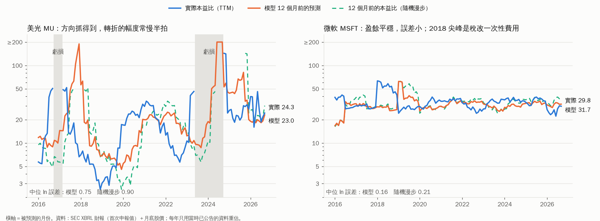

# 前瞻本益比模型：科技股，3–36 個月後

> 上一版（`projects/pe-model/`，在 `claude/macro-economy-asset-forecast` 分支）用 70 年總體數據回答
> 「大盤撐得起幾倍」。這一版回答的是另一個問題：**站在今天，這家公司 3–36 個月後的本益比是多少？**
> 不用歷史平均本益比，也不用產業標籤，只用當時看得到的財報、股價與殖利率。
>
> 設計的推導過程見 `DESIGN.md`，資料來源與陷阱見 `data/SOURCES.md`。

```
python3 orbit_price.py MU --eps 150 --eps2 200 --cons auto        # 本益比軌道＋你的看法（＋自動抓市場共識）→ 6／12／24 個月後的本益比與股價區間（§16，最新）
python3 orbit_price.py NVDA --eps 9 --cons auto --rate-view -1   # 共識自動校正成預期的 GAAP（§19.1）＋利率情境：10 年期降 1 個百分點（§19.3）
python3 orbit_price.py TSM --cons auto                            # 外國公司 ADR（每 ADR 美元，§19.4）
python3 target_price.py MU --eps 55,70,85                 # 你給 12 個月後的 EPS → 那時的本益比與股價區間（§15）
python3 target_price.py MU --eps 70 --eps2 90 --h 12      # 也給再下一年的 EPS；--h 6/12/18/24/36
python3 pe_forecast.py predict MU                         # 今天 → 3–36 個月後（組合模型，§12）＋盈餘拆解
python3 pe_forecast.py predict MU --asof 2025-09          # 回到 2025-09，只用當時的資料
python3 pe_forecast.py predict MU --rev-growth=-0.2,-0.3,0 --margin 0.35,0.15,0.2   # 你的情境
python3 pe_forecast.py implied MU NVDA MSFT GOOGL         # 市場現價在賭什麼
python3 pe_forecast.py backtest && python3 report.py      # 全部回測，重算本文每一張表
python3 pe_forecast.py history MU --h 12                  # 過去每一次「12 個月前的預測」vs 實際
python3 lab_run.py                                        # §12：哪個預測距離、哪個方法最有效（約 6 分鐘）
```

---

## 0. 結論先講

**本益比軌道＋你的看法（§16，2026-10-07，最新）。** h 個月後股價 ＝ 今天股價 × e^((資金成本 − 股利殖利率) × 年數 ＋ 看法調整)，本益比 ＝ 股價 ÷ 你的 EPS。
看法調整＝你的 EPS（h 個月後與再下一年），有市場共識時拆成「市場已預期的成長」＋「你和共識的差距」。
軌道比「本益比不變」準 40%（2022 以後與最近一段都成立）；看法參數再改善 1–9%（24 個月較多、再下一年的 EPS 較重要）。
最近一段科技股的誤差主要來自產業重新定價（半導體／設備／記憶體比軌道多漲約 61%、軟體／網路少漲約 13%），EPS 解釋不了。
市場共識可以自動抓（`--cons auto`，Yahoo 選股器，不用開任何網域），也永遠可以自己覆寫。

**第二輪優化（§19，2026-10-11）：四個方向，照「邏輯 → 走動式實證 → 驗算」做，只有通過樣本外檢驗的才放進模型。**
(1) **共識校正模型（已採用）**：用 14 條當時看得到的線索預測「實際 GAAP ÷ 共識」，共識的 EPS 誤差 0.144 → 0.113、12 個月本益比誤差（2022 以後）0.221 → 0.197，
`--cons auto` 與網頁預設套用（只限 S&P 500／Nasdaq-100）。(2) **產業重新定價因子（沒採用）**：產業估值偏離、產業動能、產業共識修正、個股動能都只改變 ±0.1 個百分點，方向還會隨期間反轉。
(3) **利率與升降息預期（做成情境）**：市場的預期已在 10 年期裡；事前的利率線索樣本外沒有比較準，就算完全預知利率，股價的反應方向也會變號（2012–2021 ≈ 0、2022 以後每升 1 個百分點 −5%），
所以只提供 `--rate-view` 情境；另外軌道改用 FRED 最新的 10 年期（之前的資料落後 3 個月：4.60% → 5.22%）。
(4) **涵蓋範圍（已加入）**：中小型股點預測一樣有效（12 個月 0.365 → 0.238），約 100 檔外國 ADR 可算；兩者的 80% 區間依實測放寬（×1.13–1.29）。

**第三輪（§20，2026-10-12）**：共識校正加「同時點護欄」（Apple 年報前 1.08 → 1.02；EPS 誤差 0.1125 → 0.1099）、搬到中小型股（0.214 → 0.185，距離年報 < 9 個月才用）、
虧損公司改用「EPS 變化 ÷ 股價」（12 個月 0.253 → 0.240）；時變風險溢酬在 1880 年以來的資料裡沒有一種贏過固定 5%（不採用）；
用真正的歷史共識重估 β，和正式版差不到 0.2 個百分點（不換）；每月共識快照管線上線（驗證下一財年的校正）；整套模型重新凍結前瞻預測（2027-04 第一次驗收）。

**第四、五輪（§21–22，2026-10-13）**：中小型股的共識放上網頁（有共識 556 → 2,810 檔）並補凍事前預測；區間依 VIX 放寬（事前挑的沒有更好，不採用）；
分析師意見分歧（資料被 Google Drive 配額擋住，沒做成）。**回頭驗證**：如果 2024、2025 年就用這個模型，S&P 500 約 400 家的本益比中位誤差
12 個月 23.1%（本益比不變 27.1%）、24 個月 29.0%（34.6%），台積電／Google／NVIDIA／Micron／Meta 五檔 12.5%／15.7%；最大的誤差來源是分析師的 EPS
（AI 行情裡大幅低估）。由此採用「EPS 變化越大、區間越寬」（24 個月 EPS 大變化的 80% 區間涵蓋 75% → 82%），並發現 24 個月把成長率再延一年會高估 EPS（加警示）。

**第六輪（§23，2026-10-14）**：回測三條使用建議——①同一個目標日，12 → 6 → 2 個月前預估的本益比誤差 21.7% → 17.6% → 13.4%，24 個月 29.1%（不外推 25.4%），共識舊 2 個月以上才開始變差：**12 個月、每月更新**站得住；②只填共識一個情境時 80% 區間實際只涵蓋 61%，**三情境 ±20% 取聯集 → 79%（6 個月 83%）**，區間分數也最好；谷底的公司連 ±40% 都只涵蓋 61–74%；③台積電法說前一週用 3 個月營收估當季 EPS，誤差中位 12% → **3%**，12 個月後 EPS 20% → 13%，但 12 個月後本益比沒有變準（估值變動主導）。**誤差特徵**：波動大、EPS 不穩、分析師預期 EPS 大變化、過去一年跌、過去 5 年虧損過、軟體／半導體／硬體／醫療 → 誤差大；公用事業、必需消費、EPS 穩定的大型股 → 誤差小；大誤差有 67–74% 主要是 EPS 估錯。Nasdaq-100 同樣兩個起點：12 個月 32.3%（S&P 500 23.1%）、24 個月 32.6–40.4%（29.0–29.5%），這兩年比 S&P 500 難。

**第七輪（§24，2026-10-14）——成長定價：把成長預期放進本益比**。軌道模型的股價對 EPS 反應很小（β 0.05–0.2），EPS 調高 → 本益比往下。但市場其實是對「下一年」的 EPS 給倍數（同一個月比較，ln 本益比對明年預期成長的斜率 1.05）。新的「成長定價」把**目標日時市場對下一年的成長預期**放進本益比：本益比變化 ≈ ＋0.6～0.7 ×（目標日的成長預期）− 0.5 ×（這段期間交出的成長）− 0.55～0.6 ×（今天已反映的成長預期）− 過去一年漲幅的回吐。I/B/E/S 走動式（EPS_a 與「目標日時市場對下一年的預期」都給對）：12 個月本益比誤差 16.7% → **15.0%**（6 年裡 6 年較準）、24 個月 21.9% → **16.6%**、半導體 22.5% → 15.5%；只猜對下一年的實際 EPS 時 12 個月差不多（16.8% → 16.2%）、24 個月 21.1% → 18.7%；2025-10 起點回頭驗證 S&P 500 16.9% → 15.3%、五檔 26.2% → 13.8%（MU 本益比 3.2 → 8.8 倍，實際 12.8），但 2024 起點的 24 個月打平或較差。只用今天共識、沒有自己的看法時，12 個月整體是軌道略準，但科技三組成長定價（回歸）較準（§24.7）。已做成網頁與命令列的第二種方法（網頁「自動」（第十輪起已取消，§26）：你填了自己的 EPS 時採用；只有範例共識時 12 個月科技三組用成長定價、非科技用軌道，24 個月都用成長定價——§25）。另一個發現：forward 本益比本身的重新評價有一半是大盤和產業、和成長預期上調反而負相關，事前預測不了。

**成長定價回測 S&P 500、Nasdaq-100（§24.7）**：12、24 個月前預估今天的本益比。猜對 EPS 和目標日的成長預期時，12 個月成長定價在兩個指數都較準（S&P 500 16.9% → 15.3%、Nasdaq-100 23.6% → 21.8%）；真正的事前預估沒有一個方法全面勝出（S&P 500 軌道 23.1%／29.0%，Nasdaq-100 12 個月成長定價 28.0–31.1%、軌道 32.3%），但事前預估裡**科技與半導體類成長定價（回歸）6 比 2 勝出、非科技 3 比 1 是軌道**（猜對 EPS 時半導體類 24 個月反而是軌道較準）——網頁「自動」（第十輪起已取消，§26）改成只有範例共識時科技用成長定價、非科技用軌道。同時修正回顧資料的分割口徑（NFLX、BKNG 等 12 家，起點本益比原本錯 1.2～25 倍），§22、§23 的回顧數字已更新。

**第九輪（§25，2026-10-14）——拉長回測期間，不只 AI 行情**：公司層級 S&P 500 2011–2024 每一年當起點（約 3,600–3,900 組；1995 年做不到：機器可讀的公司季報 2009 年才有）、使用者提供的 Bloomberg 共識 2019–2025 每個月當起點（約 2–2.5 萬組，含分析師第 13–24 個月預估）、S&P 500 指數 1960–2022（Shiller）。**站得住的**：本益比不變在大多數年份最差；猜對 EPS 時成長定價在大多數年份比軌道準（12 個月嚴格事前非科技 14.5% vs 16.1%）；12 個月只有共識時，非科技軌道略好（20.9% vs 22.1%）、科技成長定價略好（28.2% vs 29.5%）——兩個起點時的分組規則成立，但差距都小。**要改的**：24 個月成長定價和「不外推」的軌道接近、非科技略好（嚴格事前 24.0% vs 25.1%；Bloomberg 24.6% vs 25.7%），比網頁原本的軌道做法（分析師第二年或外推）好→ 網頁「自動」（第十輪起已取消，§26）24 個月改用成長定價；分析師第 13–24 個月預估比「把成長延一年」準（EPS 誤差 22.5% vs 28.8%）。**新發現**：指數層級成長定價沒有比軌道好（指數自己的係數，目標日成長預期只有 +0.09、公司層級 +0.61）——成長預期決定的是「哪家拿高本益比」，不是大盤的本益比；誤差最大的是大盤本益比大漲大跌的年份（2020 起點、2007–09 年），所有方法都失準；兩個起點的回頭驗證很不穩（資料小修就讓勝負計數從 8 比 0 跳到 6 比 2）。也修正了一個資料錯誤：配息股 2025-06 以前的面板股價被高估（MO 約 17–21%），已逐筆核對除息、重建並重估模型（§25.0）。

**第十輪（§26，2026-10-15）——審閱（`REVIEW_2026-10-14.md`）後的三項**：①**統一模型**：只有共識時成長定價在代數上就等於軌道（12 個月事前 0.227 vs 0.232），
差別只在你的 EPS_b 是「基本面預估」（軌道的小係數最準：猜對實現值時 0.157 vs 成長定價 0.164）還是「市場在目標日會預期的數字」（成長定價的係數最準：0.143 vs 當基本面處理 0.162）——
所以現在只有一個模型（`pef/unified.py`），網頁改選「EPS_b 的意思」，不再依公司類型、距離自動切換；②**conformal 區間**：只有共識時改用「只有共識」的實際誤差校準，
80% 區間走動式實測涵蓋 6／12／24 個月 0.88／0.86／0.85（舊區間 57–63%），寬度 ×1.5–1.8；③**相對輸出**：扣掉同一天 S&P 500 只用共識的預測中位，
相對誤差 12 個月 0.207（絕對 0.227）、每個起點月排序的 Spearman 0.77（本益比不變 0.65），網頁與命令列都加「相對大盤」與百分位。

**給定 EPS 版（§15，2026-09-30）——你有一年後（或 6–36 個月後）的 EPS 預估時用這個。**
那時的本益比 ＝ 今天股價 × e^(資金成本 × 年數 ＋ 個股調整) ÷ 你的 EPS；股價 ＝ 本益比 × EPS。
S&P 500 回測（假設 EPS 完全正確，保留期 2022 以後）：12 個月股價／本益比一半落在預測的 **0.86–1.17 倍**，比「本益比不變」準 39%、
比「股價照資金成本漲」準 2.6%（個股調整在 24–36 個月才明顯：−9%、−11%）。**股價幾乎不隨同期 EPS 變**（EPS 多 10%，12 個月後股價只多約 0.7%）：
你的 EPS 決定的主要是本益比，股價區間主要來自股價波動——所以區間寬度看波動（波動^0.7），80% 區間實測涵蓋 70%（2015–2021）／84%（2022 以後）。
保留期的設計看過結果，真正的驗收是 2026-09-24 凍結的前瞻紀錄（§15.9）。外部審查的逐條回應：`REVIEW_RESPONSE.md`；整套模型的第二次審閱（2026-10-14，含「事前時成長定價＝軌道」「區間該用 conformal 校準」等發現與建議）：`REVIEW_2026-10-14.md`。

0. **改良版（§12，2026-09-25）：主模型換成四個預測器的等權平均（組合模型），預測距離擴到 3–36 個月。**
   12 個月誤差 ±30%，「本益比不變」±38%（改善 18%）；用過去推到現在，72% 的公司組合比較準。
   **3 個月贏不了「本益比不變」，9–12 個月最有效**，18–36 個月看方向不看數字。「回到歷史本益比」當特徵也沒幫助。
   12 個月方向命中 68%，但點估計落在實際 ±20% 內只有 37%——用法是「方向＋區間」。盈餘可以自己給（`--earnings-growth`，§12.7）。
   **全美股版（§13）**：用全部 S&P 500 回測（475 家），12 個月誤差 ±25%、「本益比不變」±31%，方向命中 67%；
   訓練資料擴大到全部 S&P 500 是這一輪唯一明確的改善。報酬假設換成 CAPM beta 或產業歷史報酬都沒有更好。
   網頁可以查任何美股代號（3,199 家有季報，其中 3,072 家有預測）。
   **擴大到 Nasdaq-100、S&P 400／600、Russell 2000（§14）**：同一個模型不用改，12 個月誤差比「本益比不變」少 12–15%（Nasdaq-100 ±27% vs ±32%、Russell 2000 ±38% vs ±44%）；中小型股改用較寬的 80% 區間；不在主要指數的微型股 3–6 個月不要用。過程中修正了 SEC 股數單位錯誤（S&P 500 63 家），修正後 S&P 500 12 個月誤差 ±25%。
   以下 1–7 是原始版本（兩階段盈餘模型，現在是組合的成員之一）的結論，仍成立。
1. **本益比的變化只有兩個來源：股價報酬和盈餘成長。** 對科技股，12 個月本益比變化的變異有 **73–91%
   來自盈餘那一項**（表 5；IT 服務例外，47%）。盈餘是可以預測的，所以本益比有一大塊是可以預測的。
2. **模型在四個預測距離都贏過「本益比維持不變」（隨機漫步）；贏「歷史平均本益比」（舊思維）更多。**
   12 個月後的誤差 0.270 vs 隨機漫步 0.312 vs 歷史均值 0.335（ln PE 中位絕對誤差；0.27 ≈ 實際值的 ×/÷1.31）。
   樣本：68 家美股科技公司、2015–2026、每年只用當時已公告的資料重估（表 1）。
3. **「站在 12 個月前預測今天（2026-09）」**：11 家公司的中位 ln 誤差 **0.093（約 ±10%）**，
   本益比不變 0.361、5 年均值 0.224。MU：12 個月前預測 23.0，實際 24.3（表 6）。
4. **驗證過程推翻了原本設計的一半**：「內在價值 vs 股價的缺口會修正」**不成立**（γ ≈ +0.04，
   貴的股票沒有變便宜）；DCF 用歷史利潤率**完全解釋不了**橫斷面的本益比差異。
   但把 DCF 倒過來用——**反推市場現價隱含的長期利潤率**——它對「未來利潤率」有很強的預測力：
   市場押注利潤率結構性變高（>1.5 倍歷史）時，24 個月後真的高於歷史的比例 **80%**（§4）。
5. **記憶體「脫離循環」可以用資料量出來**：MU 上兩次盈餘高峰（2018、2022）時，市場隱含的長期淨利率
   只有歷史的 0.29–0.39 倍（＝押注崩跌，本益比 4–7 倍）；**這一次高峰（2026-09）是 2.82 倍**（＝押注延續，
   本益比 24 倍）。市場在 2024-06 MU 還在虧損時就已經押 3.63 倍，而兩年後的實際淨利率是 55.9%（§5）。
6. **只從科技股學到的規律，套到非科技股也大致成立**（§4b）：能源股 12 個月誤差比隨機漫步低 47%、軍工低 10%；電力股好壞參半。
7. **2026 年 CSP 的 GAAP 本益比不能直接比**：GOOGL、AMZN、META 的 TTM 淨利都含大額一次性項目（AI 公司持股評價利得、稅務費用）。
   GOOGL 的 GAAP 本益比 17，換成營業利益口徑約 32（§6、`results/snapshot_2026-09.md`）。

---

## 1. 第一性原理：本益比不是一個東西，是兩個東西的比

```
ln PE(t+h) − ln PE(t)  =  股價報酬(t→t+h)  −  盈餘成長(t→t+h)
```

這是恆等式，不是模型。它直接告訴你該怎麼設計：

| | 可預測嗎 | 為什麼 | 模型怎麼處理 |
|---|---|---|---|
| 盈餘成長 | **大部分可以** | 營收有慣性（訂單、合約、產能爬坡）、利潤率會回歸、存貨與毛利率斜率是領先訊號 | **模組 E**：從財報推出來 |
| 股價報酬 | **幾乎不行** | 可以預測就會被套利掉 | **假設**：預設＝資金成本（10 年期 + 5%），你可以改 |

**表 5：本益比 12 個月變化，變異有多少來自盈餘**（各產業中位數，2012 起）

| 產業 | 股價報酬波動 | 盈餘成長波動 | 盈餘占比 |
|---|---|---|---|
| software | 0.23 | 0.65 | **0.91** |
| semis | 0.30 | 0.49 | 0.76 |
| memory | 0.51 | 0.88 | 0.75 |
| hardware | 0.26 | 0.54 | 0.74 |
| internet | 0.27 | 0.73 | 0.73 |
| semicap | 0.39 | 0.61 | 0.73 |
| itservices | 0.21 | 0.23 | 0.47 |

個股：AMAT 0.81、STX 0.81、MSFT 0.80、MU 0.73、NVDA 0.58、GOOGL 0.55、**AAPL 0.28**（盈餘太穩，本益比幾乎全跟股價走）。
軟體的 0.91 裡有一部分是 GAAP 一次性項目（MSFT 2018 稅改費用讓 TTM 本益比從 30 跳到 60）——那一塊誰都預測不到。

---

## 2. 模型結構

```
PE(t+h) = 市值(t) × exp(報酬假設 × h/12) ÷ 預測淨利TTM(t+h)
                                                 │
                         模組 E：營收(t+h) × 淨利率(t+h)
                           ├ 營收成長 ← 近 4 季成長、最新一季加速度、存貨天數變化、毛利率斜率、
                           │           6 個月股價動能、P/S、E/P、市場隱含利潤率缺口
                           └ 淨利率   ← (TTM − 5年中位) 的回歸、最新季 vs TTM、毛利率斜率、存貨、
                                       6 個月股價動能、P/S、E/P、市場隱含利潤率缺口
                                                 ▲
                         模組 V（倒過來用）：現價 → 反推市場隱含的長期淨利率
```

- **係數用 68 家公司一起估**（Huber 穩健迴歸，每個預測距離各一組），不分產業——物理規律
  （存貨堆積 → 降價 → 利潤率掉）對所有公司一樣，差別在各家的訊號值。所以它能套到新公司、新結構。
- **沒有任何一個本益比的歷史平均值進入模型。** 本益比是算出來的：今天的市值 ÷ 預測的盈餘。
- **時點正確**：財報一律用**第一次申報的數字與申報日**（後來的重述不准用）；每年 1 月用當時為止的資料重估。
- 模組 V 是最小 DCF（前 3 年用模組 E 的預測，之後成長以 5 年半衰到 3%、利潤率收斂到長期值，
  再投資 = 營收增量 ÷ 公司自己的營收/投入資本比，折現率 = 10 年期 + 5%）。**它不直接預測股價**
  （§4 證明它做不到），而是解一個方程式：「長期淨利率要多高，這個 DCF 才等於現在的市值？」

---

## 3. 回測：到底準不準

**方法**：2015 年起每年 1 月重估，預測接下來 12 個月每個月底的 6／12／24／36 個月後本益比。
**選模期 2015–2021**：所有規格決策只看這段。**保留期 2022–2026**：不參與任何選擇，剛好包含 2023 記憶體崩盤與 AI 行情。
評分只在「實際盈餘為正、每個方法都有預測」的共同樣本上算（虧損時本益比沒有定義；E/P 版本見 `results/scores_ep.csv`）。

**表 1：ln PE 中位絕對誤差（越小越好；0.19 ≈ ×/÷1.21、0.27 ≈ ×/÷1.31、0.33 ≈ ×/÷1.39）**

| 方法 | 6 個月 | 12 個月 | 24 個月 | 36 個月 |
|---|---|---|---|---|
| **模型（報酬＝資金成本）** | **0.188** | **0.270** | **0.329** | **0.331** |
| 模型（報酬＝過去 10 年中位） | 0.188 | 0.276 | 0.322 | 0.332 |
| 模型（股價不動） | 0.196 | 0.290 | 0.380 | 0.430 |
| 隨機漫步（本益比不變） | 0.201 | 0.312 | 0.355 | 0.354 |
| 歷史均值（該公司過去 5 年） | 0.314 | 0.335 | 0.361 | 0.400 |
| 同業中位數 | 0.341 | 0.377 | 0.381 | 0.357 |

n = 6,643／6,208／5,489／4,811（公司×月）。

| 分期（模型 / 隨機漫步） | 6 個月 | 12 個月 | 24 個月 | 36 個月 |
|---|---|---|---|---|
| 選模期 2015–21 | 0.184 / 0.199 | 0.282 / 0.322 | 0.316 / 0.357 | 0.327 / 0.339 |
| **保留期 2022–26** | 0.193 / 0.205 | **0.250 / 0.296** | 0.373 / 0.350 | **0.364 / 0.454** |

保留期 24 個月輸給隨機漫步，原因在報酬假設不在盈餘：2022–26 科技股的實際報酬遠高於資金成本
（改用「過去 10 年中位報酬」時保留期 24 個月是 0.304，贏隨機漫步）。**這正是恆等式說的：報酬那一項預測不了。**

**表 2：方向命中率（本益比會升還是降）**：模型 64%／66%／64%／63%（6/12/24/36 個月）；歷史均值 58%／62%／62%／58%；同業中位數 55%／58%／61%／62%。

**表 3：盈餘預測本身**（誤差以 t 時點市值標準化，pp）

| | 6 個月 | 12 個月 | 24 個月 | 36 個月 |
|---|---|---|---|---|
| 模型 | 0.41 | 0.81 | 1.30 | 1.61 |
| 假設盈餘不變 | 0.49 | 0.94 | 1.55 | 2.16 |
| 模型比較準的比例 | 62% | 62% | 63% | 68% |

**表 4：分產業（12 個月）**

| 產業 | 公司 | 模型 | 隨機漫步 | 歷史均值 | 同業中位數 | 模型 vs 隨機漫步 |
|---|---|---|---|---|---|---|
| internet | 9 | 0.238 | 0.303 | 0.390 | 0.335 | −21% |
| semis | 12 | 0.259 | 0.327 | 0.383 | 0.507 | −21% |
| semicap | 4 | 0.301 | 0.370 | 0.285 | 0.328 | −19% |
| memory | 3 | 0.564 | 0.675 | 0.583 | 0.725 | −17% |
| hardware | 16 | 0.291 | 0.336 | 0.324 | 0.405 | −13% |
| itservices | 6 | 0.220 | 0.231 | 0.247 | 0.291 | −4% |
| software | 13 | 0.267 | 0.277 | 0.326 | 0.319 | −3% |

記憶體的絕對誤差最大（0.56），但相對改善排前段；軟體幾乎沒有改善（盈餘可預測的部分已經在股價裡了）。

**表 6：站在過去，預測 2026-09 的本益比**（11 家有 2026-09 股價的公司）

| 公司 | 2026-09 實際 | 12 個月前的模型 | 12 個月前的本益比 | 24 個月前的模型 | 36 個月前的模型 |
|---|---|---|---|---|---|
| MU | 24.3 | **23.0** | 30.2 | 48.4 | 36.5 |
| NVDA | 34.5 | 43.7 | 52.9 | 52.4 | 39.7 |
| MSFT | 29.8 | 31.9 | 38.0 | 35.1 | 24.4 |
| GOOGL | 25.8 | 23.5 | 25.7 | 22.8 | 21.8 |
| META | 27.0 | 24.9 | 26.4 | 26.2 | 22.6 |
| AMZN | 29.9 | 29.3 | 33.6 | 31.4 | 26.8 |
| AVGO | 59.0 | 60.2 | 84.7 | 63.0 | 20.3 |
| AMAT | 44.5 | 21.8 | 24.0 | 23.0 | 18.5 |
| LRCX | 57.6 | 24.6 | 32.2 | 22.6 | 21.1 |
| ORCL | 24.7 | 46.0 | 65.8 | 32.1 | 17.7 |
| AMD | 202.5 | 51.7 | 93.1 | 56.0 | 38.9 |

中位 ln 誤差：**12 個月前 0.093**（本益比不變 0.361、5 年均值 0.224）；24 個月前 0.263（0.455、0.373）；36 個月前 0.330（0.837、0.624）。
（這張表用的是回測資料：GOOGL、AMZN 的財報到 2026-Q1，「實際」本益比也是 GAAP 口徑，含 §6 講的一次性利得。）
只有 11 家，當例證，不當證明。錯最多的是半導體設備（AMAT、LRCX 被重新定價，股價漲、盈餘沒跟上）和 AMD（盈餘崩）。



---

## 4. 被資料推翻的假設（這一段最重要）

設計時（`DESIGN.md` §6）預先寫下三條否證條件。結果：

| 原本的假設 | 檢驗 | 結果 |
|---|---|---|
| 模組 E 能預測盈餘 | 12 個月 ln PE 誤差要贏隨機漫步 | ✅ 成立（0.270 vs 0.312；保留期 0.250 vs 0.296） |
| 股價會向內在價值修正 | 報酬 = a + γ·(ln 市值 − ln V)，γ 應為負 | ❌ **γ12 每年重估都是 +0.00 ～ +0.05**。貴的沒變便宜，反而略漲——觸發否證條件 3 |
| DCF 能解釋「為什麼 A 公司比 B 公司貴」 | ln PE 與 ln(V/盈餘) 的橫斷面相關（表 9） | ❌ **−0.40 ～ +0.01**，衰退半衰期從 1 年換到 12 年都一樣；同一天同業中位數是 +0.21 ～ +0.54 |

**為什麼 DCF 失敗**：它用公司自己的 5 年中位利潤率當長期值。市場定價的是**未來**的利潤率——
PLTR、CRWD 這種還在放大的公司、AI 之後的 MU，歷史利潤率都不代表未來。這正是你說的第 1 點，被資料證實了。

**把它倒過來就成功了**：不問「DCF 值多少」，改問「**要多高的長期淨利率，DCF 才等於現在的市值**」。（表 8）

| | 24 個月後淨利率偏離歷史的 R²：只用現在偏離 | ＋市場隱含偏離 | 市場押注變高（>1.5 倍）後真的高於歷史 | 押注變差（<0.67 倍）後真的低於歷史 |
|---|---|---|---|---|
| 選模期 2015–21 | 0.10 | **0.25** | **81%**（n=776） | 49%（n=1,249） |
| 保留期 2022–26 | 0.09 | **0.33** | **80%**（n=409） | 51%（n=253） |

**市場對「結構性變好」的押注大多是對的，對「會變差」的押注是擲銅板。**
所以隱含利潤率缺口被接回模組 E 當輸入（兩階段）。

**所有試過的規格**（`python3 ablation.py` 用目前的程式重跑，→ `results/ablation.csv`；報酬一律＝資金成本，最後一列除外）

| 規格 | 選模期 PE 誤差（6/12/24/36 平均） | 選模期盈餘誤差 24／36 個月（pp） | 保留期 PE 誤差平均 | 保留期盈餘誤差 24／36 |
|---|---|---|---|---|
| E0 財報＋股價動能＋P/S | 0.277 | 1.48 / 2.06 | 0.340 | 1.34 / 2.20 |
| E1 E0＋E/P | 0.281 | 1.39 / 1.91 | 0.324 | 1.38 / 2.08 |
| E2 只有財報、不看股價 | **0.275** | 1.48 / 2.10 | 0.338 | 1.60 / 2.57 |
| E3 E1＋循環性交互作用 | 0.287 | 1.38 / 1.92 | 0.326 | 1.41 / 2.02 |
| **E1＋兩階段隱含利潤率（最終版）** | 0.277 | **1.33 / 1.60** | **0.295** | **1.20 / 1.65** |
| 最終版，報酬＝過去 10 年中位 | 0.284 | 1.33 / 1.60 | 0.267 | 1.20 / 1.65 |

誠實的讀法：
- **在選模期，E0／E1／E2／最終版的本益比誤差差距只有 0.006，是雜訊等級。** 嚴格照「選模期本益比誤差最低」
  這條事先訂的規則，會選到 E2（只看財報）——它贏最終版 0.003。
- 最終版被選的理由是**盈餘預測本身**（模組 E 的工作）：選模期 24／36 個月盈餘誤差 1.33／1.60，其他規格 1.38–2.10；
  保留期同樣最好，而且保留期本益比誤差 0.295 明顯低於其他規格（≥0.324）。
  **開發時的規格決策是在較早的程式版本上做的**，這張表是最終程式碼的重跑；結論（採用兩階段、不採用 E3）不變。
- E2 的意義：**完全不看股價，只用財報，12 個月也贏隨機漫步**（選模期 0.274 vs 0.322）。股價資訊主要改善的是保留期。
- 報酬假設：選模期資金成本 0.277 < 過去 10 年中位 0.284 → 預設資金成本；保留期相反（AI 行情），見 §3。
- 原設計（V 路徑＋信念衰減）在開發中試過，12 個月誤差 0.312、偏誤 +0.11，已刪除；**那版程式沒有保留，這兩個數字不可重現**。

---

## 4b. 只學過科技股，套到非科技股行不行？（樣本外「領域」測試）

「存貨堆積 → 降價 → 利潤率掉」「利潤率回歸自己的結構水準」如果真的是物理規律，應該不只在科技股成立。
測試：模型**只用 68 家科技股訓練**，拿去預測從沒看過的能源、電力、軍工、TSLA（`python3 ood.py` → `results/ood.csv`）。

| 產業（公司） | 12 個月：模型 / 隨機漫步 | 模型 vs 隨機漫步 | 24 個月：模型 / 隨機漫步 | 方向命中（12 個月） | n（12 個月） |
|---|---|---|---|---|---|
| 能源（XOM、CVX、COP） | **0.233 / 0.442** | **−47%** | **0.253 / 0.611** | 80% | 164 |
| 軍工（LMT、NOC、RTX、GD、LHX） | 0.208 / 0.230 | −10% | 0.220 / 0.234 | 63% | 484 |
| 電力（VST、CEG、NRG） | 0.512 / 0.647 | −21% | 0.714 / 0.810 | 82% | 65 |

- **能源最強**：油價讓盈餘大起大落，但「利潤率回歸」的速度是可預測的——跟記憶體同一個機制。
- **軍工小贏**：盈餘穩，本益比主要跟股價走（跟軟體、AAPL 一樣，可預測的部分少）。
- **電力好壞參半**：6 個月輸隨機漫步（0.583 vs 0.542），12 個月贏；歷史均值（0.392）反而最好。只有 3 家、65 筆，VST／CEG 在 2024 被 AI 用電重新定價。
- 盈餘預測本身在這些公司也贏「盈餘不變」：12 個月 1.56 vs 1.92pp、24 個月 2.38 vs 3.00pp（`results/ood_earnings.csv`）。
- 樣本很小（每類 3–5 家），當佐證不當證明。**快照（§10）裡這些公司的數字，是套用一個沒在它們身上訓練過的模型。**

---

## 5. 記憶體：「脫離循環」用資料怎麼看

**MU 的市場隱含長期淨利率 vs 歷史**（表 10；每一列都只用當時的資料；最後一欄是事後揭曉的答案）

| 時點 | 本益比 | TTM 淨利率 | 5 年中位 | 市場隱含長期 | 隱含 / 歷史 | 24 個月後實際淨利率 |
|---|---|---|---|---|---|---|
| 2017-06 | 13.8 | 14.7% | 10.8% | 6.4% | 0.59x | 37.4% |
| 2018-06 | 5.3 | 43.4% | 19.7% | 5.7% | **0.29x** | 11.2% |
| 2019-06 | 4.3 | 37.4% | 22.2% | 6.9% | 0.31x | 13.6% |
| 2020-06 | 25.7 | 11.2% | 16.2% | 13.2% | 0.82x | 29.0% |
| 2021-06 | 30.4 | 13.6% | 16.9% | 13.0% | 0.77x | −16.0% |
| 2022-06 | 6.9 | 29.0% | 28.4% | 11.0% | **0.39x** | −7.2% |
| 2023-06 | 虧損 | −16.0% | 16.9% | 28.3% | 1.67x | 18.4% |
| 2024-06 | 虧損 | −7.2% | 12.6% | 45.6% | **3.63x** | **55.9%** |
| 2025-06 | 22.3 | 18.4% | 15.1% | 19.0% | 1.26x | （未到） |
| **2026-09** | **24.3** | **55.9%** | 20.9% | **58.8%** | **2.82x** | （未到） |

讀法：
- **過去的高峰（2018、2022），市場用 0.3–0.4 倍歷史利潤率定價 MU**——押注崩跌，所以高峰本益比只有 4–7 倍。那是「循環股在高峰本益比最低」的機制，而且市場兩次都對。
- **2024-06 MU 還在虧損，市場已經押 3.6 倍**，兩年後實際淨利率 55.9%——市場比財報早一年看到結構改變。
- **現在（2026-09）是高峰，但市場押 2.8 倍歷史**，所以本益比是 24 而不是 5。**這就是「記憶體不再照循環股定價」的量化版本。**
- STX 同樣在 2024-06 押 3.44 倍。

**MU 現在的預測**（`predict MU`，站在 2026-09-30，最新財報季末 2026-05-28）：

| 幾個月後 | 預測營收 TTM | 預測淨利率 | 預測淨利 TTM | 盈餘變化 | 本益比（報酬＝資金成本 9.6%） | 若股價不動 |
|---|---|---|---|---|---|---|
| 6 | $133B | 52.2% | $70B | +38% | 18.5 | 17.6 |
| 12 | $164B | 46.8% | $77B | +52% | **17.6** | 16.0 |
| 24 | $187B | 44.9% | $84B | +67% | 17.7 | 14.6 |
| 36 | $202B | 45.3% | $91B | +81% | 17.9 | 13.4 |

⚠️ 三個必須一起看的警告：
1. **MU 最新一季（FQ3'26）淨利率 68%、毛利率 85%，超出模型訓練資料的範圍**——模型在外插。
2. 模型預測的 12 個月後 TTM 淨利 $77B，**低於最新一季年化的 $113B**：模型讓利潤率往 5 年中位（20.9%）部分回歸；
   市場的隱含長期利潤率（58.8%）比模型還高。**模型跟市場的分歧，就是「循環會不會回來」這個賭注本身。**
3. 回測裡模型在記憶體的**轉折幅度常慢半拍**：2023-09 預測 2024-09 本益比 256（實際仍虧損）、
   2024-09 預測 2025-09 為 88（實際 30）——低估了復甦的速度。

**情境（模組化的用法）**：如果你認為循環會回來——營收未來三年 −20%、−30%、0%，淨利率 35%、15%、20%：

```
python3 pe_forecast.py predict MU --rev-growth=-0.2,-0.3,0 --margin 0.35,0.15,0.2
```

12 個月後本益比 53、24 個月後 196（盈餘 −85%）——**同一個股價，在循環情境下本益比會爆掉**。
兩個情境的本益比差距，就是你今天買 MU 在賭的東西。

---

## 6. 同產業不同倍數：GOOGL vs MSFT——先確定分母是同一種盈餘

```
今天的本益比 = 前瞻倍數（市值 ÷ 12 個月後淨利）× 近期盈餘成長
```

**第一版的結論要修正。** 用 GAAP 淨利算，2026-09 的 GOOGL 本益比 25.8、MSFT 29.8，看起來像「市場對 MSFT 多付」。
但 GOOGL 2026-Q1 的 GAAP 淨利 $62.6B、營收 $110B——淨利率 57%，正常季是 30% 左右；多出來的是營業利益以下的
一次性利得（持股評價）。2026-Q2（AXIOM 鏡像）更誇張：淨利 $112B、營收 $120B。**分母被污染，比較就沒有意義。**

一次性項目的辨識（`snapshot_run.py`，完整明細在 `results/snapshot_2026-09.md` 文末）：
核心淨利 ＝ 營業利益 × 0.85（假設 15% 稅、忽略利息）；GAAP 淨利偏離核心淨利超過「營收的 3%」且超過「核心的 30%」→ 一次性。

| | GAAP 本益比 | 調整後本益比（估計） | 模型：12 個月後（GAAP → 調整後） | 被抓到的一次性項目 |
|---|---|---|---|---|
| MSFT（錨點 2026-07） | 27.7 | —（未觸發） | 26.7 | 無 |
| GOOGL | 17.0 | **31.8** | 17.4 → 28.5 | 2025-Q3、2026-Q1、2026-Q2 利得 |
| AMZN | 20.1 | 34.9 | 18.6 → 28.5 | 2025-Q3、2026-Q1、2026-Q2 利得 |
| META（錨點 2026-07） | 20.3 | 18.4 | 18.6 → 19.0 | 2025-Q3 稅務費用、2026-Q1 利得 |

讀法：
- 調整之後，**GOOGL（31.8）反而比 MSFT（27.7，錨點早兩個月）貴**，AMZN 更貴；META 最便宜。
- 這些「調整後」數字是用固定稅率估的，不是財報數字；方向可信，小數點不可信。要精確，需要各公司的非 GAAP 或稅前細項。
- 這一段的教訓比數字重要：**2026 年大型科技股的 GAAP 淨利普遍含 AI 公司持股的評價利得，GAAP 本益比系統性偏低。**
  模型本身吃的是 GAAP 淨利，所以對這些公司的「12 個月後本益比」也被污染——看調整後那一欄。
- 下一步的正確做法是把整個模型改成「核心盈餘」口徑再回測一次（見 §8 限制 5）。

---

## 7. 模組化：可以換什麼

| 輸入 | 預設 | 指令參數 |
|---|---|---|
| 公司 | 68 家（`data/universe.csv`） | `predict <TICKER>` |
| 時點 | 最新 | `--asof YYYY-MM`（只用當時已公告的資料，模型也用當時為止的資料重估） |
| 營收路徑 | 模組 E | `--rev-growth g1,g2,g3` |
| 淨利率路徑 | 模組 E | `--margin m1,m2,m3` |
| 結構淨利率 | 5 年中位數 | `--m-bar 0.3` |
| 股價報酬 | 資金成本（10 年期 + 5%） | `--mu 0.0`（股價不動）、`--mu -0.2`（空頭）；報酬模式另有 `PEForecaster(mu_mode="beta"／"hist")` |
| 反推所需報酬 | — | `--target-pe 25`：要在各距離到達本益比 25，每年需要多少報酬 |
| 80% 預測區間 | 自動（需先跑 backtest） | `predict` 輸出的「80%區間」欄 |
| DCF 常數（隱含利潤率用） | 成長半衰 5 年、長期成長 3%、風險溢酬 5% | `PEForecaster(v_params=…, erp=…)` |

新增公司：在 `data/universe.csv` 加一列（ticker、CIK、產業），重跑 `build_data.py`。

---

## 8. 限制（誠實版）

1. **資料是 GitHub 上的公開鏡像，不是直接從 SEC 抓的。** 格式是 SEC 原始 JSON，做過逐檔核對與兩鏡像交叉比對，
   但仍需用官方資料重跑（Mac 功課已列）。**54 家的財報只到 2025 年中**，只有 14 家延伸到 2026。
2. **倖存者偏誤**：名單是 2025 年的 S&P 500 成分股。這會讓「貴的股票繼續漲」（γ > 0）看起來比真實世界更強，
   也讓「過去 10 年中位報酬」高達 13–21%/年（`results/fits.csv`）。
3. **SNDK 只有 11 季**（2025-02 分拆上市），回測用不上；快照（§10）用 yennanliu 的財報 CSV 可以算，但它的「5 年中位利潤率」
   其實只有兩年多，隱含利潤率對歷史的比例要打折看。
4. **轉折的幅度抓不準**：線性面板模型在記憶體的谷底會低估復甦、在高峰會低估崩跌速度（§5 警告 3）。
5. **GAAP 盈餘含一次性項目**（稅改、減損、併購、持股評價），會讓 TTM 本益比跳動，模型預測不到；2026 年的 CSP 尤其嚴重（§6）。
   快照有辨識與粗估調整，但模型本身仍以 GAAP 淨利訓練——改成核心盈餘口徑需要重跑回測。
6. **報酬假設決定長期預測的水準**：24–36 個月的預測，誤差大半來自報酬而不是盈餘（保留期表 1）。
   所以 `predict` 一律同時列出三種報酬假設。
7. 隱含利潤率 >80% 時代表「只靠利潤率撐不起現價」（市場在賭成長更久），那時這個指標失效，輸出會標明。
8. 回測每年 1 月重估一次；`predict` 則用當天重估，所以同一個月的數字兩邊可能差一點（例：MU 2026-09 → 12 個月後，回測表 17.8、`predict` 17.6）。

---

## 9. 重現

```
pip install --user numpy pandas scipy scikit-learn matplotlib
python3 pe_forecast.py backtest     # ~10 秒，寫 results/
python3 report.py                   # 重算本文每一張表 → results/report.txt
python3 ablation.py                 # §4 規格比較（~30 秒）→ results/ablation.csv
python3 ood.py                      # §4b 非科技股樣本外測試 → results/ood.csv
python3 faq.py                      # §11 問答的 F1–F9（~30 秒）→ results/faq.txt
python3 lab_run.py                  # §12 預測距離 × 方法（~6 分鐘；要先跑 backtest）→ results/lab*.{txt,csv}
python3 snapshot_run.py --raw <原始資料目錄>   # §10 現在快照 → results/snapshot_2026-09.md
python3 build_broad.py --hj <目錄> && python3 lab_broad.py --cache <目錄>   # §13 S&P 500 回測
python3 now_run.py ...              # §13.5 任何美股代號的現在預測（參數見 §13.6）
python3 make_artifact.py <輸出.html>  # 互動網頁（邏輯、案例、回測、現在的預測、試算器）；樣板在 artifact/page.html，資料只讀 results/ 與 data/
python3 make_charts.py              # 重畫圖
```

檔案：`pef/data.py`（資料層）、`pef/features.py`（時點正確的特徵）、`pef/earnings.py`（模組 E）、
`pef/value.py`（模組 V）、`pef/forecast.py`（組裝）、`pef/backtest.py`（回測與評分）、
`pef/lab.py`（§12 的各種方法與走動式平台）、`pef/ensemble.py`（組合模型：predict 與快照用）。

---

## 10. 現在跑一次：常見科技股、能源、軍工（2026-09 快照）

完整表格、一次性項目逐季明細、資料來源：**`results/snapshot_2026-09.md`**（`snapshot_run.py` 產生）。
快照用的財報來源比回測新（yennanliu、AXIOM、loosygoosie 的 2026 年資料），但它們的數字是「最後申報值」，只適合快照、不適合回測。
下面是 12 個月後本益比的摘要：**粗體＝組合模型（§12）**，括號＝兩階段盈餘模型（組合的成員之一）；
⏳＝財報落後、錨點較早；⚠️＝TTM 含一次性項目，方括號是調整後估計；「虧損」＝虧損或本益比 > 500。
80% 區間與 6／24 個月見 `results/snapshot_2026-09.md`。

| 群組 | 目前 → 12 個月後本益比 |
|---|---|
| 四大 CSP＋ORCL | AMZN⚠️ 20.1→**22.3**（18.6）［調整後 34.9→30.8］；GOOGL⚠️ 17.0→**27.5**（17.4）［調整後 31.8→31.2］；META⏳⚠️ 20.3→**21.9**（18.6）［調整後 18.4→22.5］；MSFT⏳ 27.7→**32.0**（26.7）；ORCL⚠️ 22.9→**31.2**（22.1）［調整後 25.8→33.1］ |
| 記憶體 | **MU 24.3→18.1**（17.6）；SNDK 24.9→**19.6**（24.8）；STX⏳ 82.4→**36.6**（53.0）；WDC⚠️ 19.5→**23.6**（32.4）［調整後 48.4→29.6］ |
| 光通訊 | ANET⏳ 53.9→**45.0**（47.3）；CIEN 79.6→**52.1**（57.7）；COHR 73.3→**47.1**（56.7）；CRDO 70.0→**70.7**（60.8）；FN 30.8→**32.4**（29.2）；GLW⏳⚠️ 65.6→**36.0**（40.1）［調整後 56.5→35.2］；MRVL⏳⚠️ 74.8→**60.2**（103）［調整後 203→76.7］；LITE⚠️ GAAP 虧損（調整後 205→108）；AAOI 虧損 |
| 半導體設備 | AMAT⚠️ 41.0→**33.1**（33.7）［調整後 49.3→33.7］；KLAC⏳ 45.1→**35.7**（38.2）；LRCX⏳ 55.1→**45.3**（46.1）；TER⏳ 87.1→**39.9**（52.6）（ASML、TEL 沒有 SEC 季報，跑不了） |
| 能源 | COP⏳ 14.8→**18.2**（16.0）；CVX⏳ 27.0→**24.9**（20.5）；XOM⏳ 16.0→**20.2**（18.3） |
| 電力 | CEG⏳⚠️ 32.2→**39.9**（39.1）［調整後 29.3→38.2］；GEV⏳⚠️ 118→**54.4**（69.6）；NRG⏳ 20.7→**25.0**（23.8）；VST⚠️ 21.3→**31.5**（25.1）［調整後 19.7→31.2］ |
| 軍工 | GD⏳ 22.7→**23.0**（20.4）；KTOS 284→**105**（159）；LHX⏳ 36.7→**29.9**（26.8）；LMT⏳ 35.4→**22.6**（19.1）；NOC⏳ 24.8→**22.9**（21.1）；PLTR⚠️ 163→**81.5**（145）［調整後 266→105］；RTX⏳ 41.4→**32.3**（28.6）；AVAV 虧損 |
| 其他那斯達克 | AAPL 38.5→**33.7**（33.7）；AMD⚠️ 158→**56.5**（82.6）［調整後 158→57.5］；AVGO⚠️ 59.2→**48.5**（45.1）［調整後 63.8→47.7］；CSCO⏳ 36.8→**30.7**（30.2）；NFLX⏳⚠️ 34.8→**41.3**（36.2）；NVDA 28.5→**25.8**（23.0）；TSLA 354→**77.2**（115）；INTC、CRWD 虧損 |

讀這張表之前必須知道的事：
1. **⏳ 的公司不是「今天」**：能源、電力、軍工大多只有到 2025-Q3 的完整 TTM（Q4 在 10-K，最新鏡像沒有），錨點在 2026-01
   （XOM 連 2025-Q3 都沒有，錨點 2025-10）；MSFT、META、LRCX 錨點在 2026-07。預測的「12 個月後」是從錨點起算。
2. **光通訊只有 12 季財報**（loosygoosie），「5 年中位淨利率」實際上是 3 年，隱含利潤率 ÷ 歷史的比例不可靠（COHR 的歷史中位只有 1%）。
3. **能源、電力、軍工、TSLA 不在訓練名單**：是套用（§4b 的樣本外測試顯示能源、軍工大致可用，電力好壞參半）。
4. **模型對轉折幅度常慢半拍**（§5）：MU、SNDK 這種盈餘剛爆發的公司，模型傾向讓利潤率回歸——那是模型的觀點，不是事實；
   看「隱含長期淨利率」那一欄就知道市場跟模型差多少。
5. **組合和盈餘模型差很多的地方**：GOOGL（組合 27.5 vs 17.4）——組合看到 GAAP 淨利遠高於營業利益×0.85，學過這種一次性利得會消失，
   所以本益比回到核心口徑附近（調整後 31）；TSLA、KTOS、AMD 這種極高本益比，組合壓得比盈餘模型更低（§12.6 的警告）。
6. 資料抽查：市值 ＝ 價格 × 稀釋股數逐家核對過量級（`results/snapshot_2026-09.csv`）；NFLX 2025-11 的 10:1 分割已由價格口徑比對自動補上。

---

## 11. 問答（2026-09-25）

所有數字來自 `python3 faq.py` → `results/faq.txt`（F1–F9），可重跑。

### Q1　恆等式裡的「股價報酬」到底是什麼？要不要考慮時間？預測不了怎麼辦？

**定義**：`ln 市值(t+h) − ln 市值(t)`——市值的對數變化，不是股價，也不含股利。用市值是因為本益比＝市值÷淨利（兩邊都是總額），
回購讓股數變少時市值漲得比股價少，剛好對應淨利總額沒變；股利發掉之後市值下降，所以是「價格報酬」不是總報酬。

**時間是核心變數**（F1）：

| 預測距離 | 報酬波動 | 盈餘成長波動 | 兩者相關 | 本益比變化的變異裡盈餘占 |
|---|---|---|---|---|
| 6 個月 | 0.56 | 0.56 | 0.06 | 50% |
| 12 個月 | 0.59 | 0.73 | 0.13 | 60% |
| 24 個月 | 0.73 | 0.87 | 0.22 | 59% |
| 36 個月 | 0.80 | 0.94 | 0.32 | 58% |

- 期望報酬隨時間線性累加（年化 × h/12）；不確定性也隨時間變大。
- **時間越長，股價越跟著盈餘走**（相關 0.06 → 0.32）：短期股價是雜訊，長期股價會回應盈餘。
- （這張表是全部公司×月混在一起；§1 表 5 的 73–91% 是「每家公司自己的變異」再取產業中位數，兩者算法不同。）

**預測不了是實測，不是假設**（F2）：用股價動能、E/P、P/S、模型預測的盈餘成長、隱含利潤率缺口去預測 12 個月報酬，
走動式樣本外 R² 全部在 −2.1% ～ +0.4%——等於零。

**替代方式**（不是去猜報酬，而是換問題）：
1. **給區間，不給點**：`predict` 現在印 80% 預測區間（用當時以前的模型誤差分位數；走動式實測涵蓋率 12 個月 79%、36 個月 83%，F4）。
   代價是誠實地寬：12 個月約 ×/÷1.9。
2. **反過來問**：`predict MU --target-pe 25` → 在模型的盈餘預測下，要多少年報酬才會到那個本益比（MU 12 個月要 +56%）。
   你對「合理本益比」的看法 ＋ 模型的盈餘 → 隱含報酬，這比直接猜報酬有用。
3. **只看「股價不動」那一欄**：那是純粹盈餘造成的本益比變化，是模型真正能預測的部分。

### Q2　「股價不會回到內在價值」是用市場隱含利潤率解釋的嗎？怎麼拆？能不能用過去的預測對現在？

**是，而且方向反過來了**（F5）：股價高於「用歷史利潤率算的 DCF 價值」時，接下來 12 個月——

| | 對缺口的斜率（12 個月） | 24 個月 |
|---|---|---|
| 股價 | **+0.04**（沒有回頭，還略漲） | +0.08 |
| 基本面價值 | **+0.18**（往股價靠攏） | +0.31 |

缺口確實在收斂（每年約 14%），但**收斂的是基本面，不是股價**——市場先看到、財報後追上。所以「股價不回到內在價值」不代表市場錯，
代表「用歷史算的內在價值」錯。隱含利潤率就是把「市場看到的未來」量化出來。

**拆解：隱含利潤率由哪些參數決定**（`pef/forecast.py` 的 `V_PARAMS`）：
前 3 年盈餘路徑（模組 E）、成長衰退半衰期 H、長期成長 g∞、風險溢酬（折現率 ＝ 10 年期 ＋ 風險溢酬）、再投資效率（營收／投入資本）。
MU 的敏感度（F8，2026-09；歷史 20.9%）：

| 風險溢酬 ＼ 長期成長 | 2% | 3% | 4% |
|---|---|---|---|
| 4% | 55% | 48% | 41% |
| 5%（預設） | 66% | 59% | 51% |
| 6% | 78% | 70% | 63% |

（表中是成長半衰期 5 年；半衰期 3→8 年影響 ≤2.1pp。）**風險溢酬是最敏感的參數**；但不管怎麼設，市場押的都是歷史的 2–4 倍。

**用過去的預測對現在——校準係數**（F6，全期）：

```
24 個月後的淨利率 ≈ 5年中位 ＋ 0.015 ＋ 0.35 ×（現在 − 5年中位）＋ 0.29 ×（市場隱含 − 5年中位）
12 個月後的淨利率 ≈ 5年中位 ＋ 0.006 ＋ 0.51 ×（現在 − 5年中位）＋ 0.17 ×（市場隱含 − 5年中位）
```

- 同樣的公式用現在的數字就是對未來的預測。MU：20.9% ＋ 1.5 ＋ 0.35×35.0 ＋ 0.29×37.9 ≈ **46%**（兩年後），
  模組 E 的 24 個月預測是 44.9%——兩階段模型已經把這個係數吸收進去了。
- **不對稱**（F7）：市場押「會變好」時，押越大越準（缺口 +3–10pp：方向對 72%；+10–20pp：86%；>+20pp：93%），兌現約押注的 40–63%；
  押「會變差」時方向對只有 46–51%，兌現約 0。（後者可能被倖存者偏誤污染：真的變差的公司可能已經不在 2025 年的名單裡。）
- 極端案例會失準：MU 2024-06 的市場押注是 45.6%（歷史 12.6%），套公式只得到約 17%，實際是 55.9%——**平均係數會低估結構轉折**，
  這時市場的隱含值本身比校準後的值更接近答案。

### Q3　為什麼報酬假設用資金成本？科技股報酬不是很高嗎？

實測四種假設（F3，四個距離的平均誤差；偏誤 < 0 ＝ 預測的本益比偏低）：

| 報酬假設 | 選模期 2015–21 | 保留期 2022–26 | 偏誤的方向 |
|---|---|---|---|
| **資金成本**（10 年期＋5%，≈9.6%） | **0.277** | 0.295 | 一直偏低（實際報酬比 9.6% 高） |
| CAPM：10 年期＋beta×5% | 0.282 | 0.298 | 同上 |
| 過去 10 年中位報酬（13–21%） | 0.284 | **0.267** | 選模期偏高、保留期偏低 |
| 股價不動 | 0.309 | 0.385 | 大幅偏低 |

- **「科技股報酬很高」是事後看到的**：樣本是 2025 年還在 S&P 500 的公司（活下來、變大的），加上 2023–26 的 AI 行情。
  用過去報酬＝假設行情延續；在選模期那個假設是錯的（偏高），在保留期是對的。**事前沒有辦法知道自己在哪一段。**
- 資金成本是「投資人事前要求的報酬」，是唯一不需要猜行情的中性假設，也是選模期最準的。
- beta 版沒有更好（這裡的 beta 是對 68 家科技股平均算的，中位 0.76，不是對大盤）。
- **更好的方式不是換一個點估計，而是 Q1 的兩個替代：區間、以及目標本益比反推所需報酬。**

### Q4　有沒有驗證過不同科技公司「過去的資料能不能預估到現在的本益比」？

有，三層：

1. **全部公司、全部時點**（§3 表 1）：2015–2026 每個月都站在當時、只用當時已公告的資料，預測 6／12／24／36 個月後，跟實際比。
2. **逐家公司**（F9，`results/per_company_12m.csv`）：66 家有足夠 12 個月樣本的公司裡，模型**贏「本益比不變」49 家（74%）**、
   **贏「歷史平均本益比」42 家（64%）**。記憶體 3/3、設備 4/4、半導體 10/12、網路 7/9；**軟體最弱 8/15**
   （ORCL、TYL、SNPS、CDNS、INTU、ADBE、FICO 輸——盈餘穩定，本益比主要跟股價走，可預測的部分少）。
3. **「站在過去預測今天（2026-09）」**（§3 表 6）：只有 11 家有 2026-09 的股價，中位誤差 12 個月前 0.093、24 個月前 0.263、36 個月前 0.330，
   都贏「本益比不變」與「5 年均值」。其餘 54 家資料只到 2025-09，它們的「現在」是 2025-09，包含在第 1、2 層裡。
   改良版（組合模型）的「推到現在」逐距離測試見 §12.3。

**還沒做到的**：用官方 SEC 資料重跑（Mac 功課）；光通訊、SNDK 等近幾年才有資料的公司，歷史太短，沒辦法回測，只能跑快照。

---

## 12. 改良：用過去推到現在，哪個預測距離最有效？（2026-09-25）

所有數字：`python3 lab_run.py` → `results/lab.txt`（約 6 分鐘；全部走動式、樣本外：每年 1 月只用「t+h ≤ 那天」已揭曉的配對訓練，
預測當年每個月的 h 個月後本益比）。選模期 2015–2021 決定方法，保留期 2022–2026 只看不調。誤差＝中位 |ln 預測 − ln 實際|。

### 12.1 問題重新寫成第一性原理

    ln PE(t+h) ＝ ln 市值(t) ＋ 報酬(t→t+h) − ln 盈餘TTM(t+h)
               ＝ 報酬 − ln y_h，   y_h ＝ 盈餘TTM(t+h) ÷ 市值(t)  ←「今天的價格買到的未來盈餘」（前瞻盈餘殖利率）

要預測的只有兩樣：y_h 和報酬。y_h 跨越零時連續（虧損公司也能學）、沒有規模問題（大小公司可以一起學）。
報酬仍用資金成本（§11 Q1、Q3：報酬本身預測不了）；另一條路是直接學 ln PE 的變化量，讓模型連報酬裡可預測的部分一起學。

### 12.2 試過的方法（12 個月，OOS R²＝相對「本益比不變」的改善，> 0 才有用）

| 方法 | 做法 | 選模期 | 保留期 |
|---|---|---|---|
| 最新一季 × 4 | 最純的第一性原理：未來盈餘＝現在的賺錢速度 | 0.023 | 0.024 |
| Huber 線性 | 預測 y_h；18 個特徵（盈餘殖利率 TTM／年化、核心盈餘殖利率、營收殖利率、營收加速、季成長、利潤率缺口、毛利率斜率、存貨天數、動能…） | 0.126 | 0.247 |
| 梯度提升樹（盈餘） | 預測 y_h；再加利潤率水準、資本密集度、市值、殖利率、產業 | 0.196 | 0.221 |
| 梯度提升樹（變化） | 直接預測 ln PE 的變化量 | 0.234 | 0.223 |
| **組合** | 上面三個＋舊的兩階段盈餘模型，等權平均 | **0.291** | **0.308** |

（同一批樣本；「最新一季 × 4」在 3 個月是 −0.9 到 −1.1，大輸。）單一模型都只有 0.12–0.25；**平均之後 0.29–0.31**——
四個模型的錯誤方向不同，平均把各自的偏誤抵掉。另外兩個檢驗：

- **加舊模型有沒有用？** 選模期 6/12/24/36 個月 R² 各 +0.003/+0.005/+0.013/+0.033（保留期 +0.024/+0.008/−0.016/−0.011）→ 採用。
  3/9/18 個月舊模型沒有預測（它是逐季 2/4/8/12 季），組合就是三個平均。
- **「本益比會回到自己的歷史水準」有沒有用？**（舊思維）把「自己過去 5 年中位本益比、同業中位、全體中位」當特徵加進樹模型：
  選模期 3–36 個月 R² −0.011 到 +0.010，**等於沒有**→ 不採用。（保留期 9–18 個月 +0.03，之後有新資料可以再驗。）
  歷史本益比該有的資訊，已經在「今天的盈餘殖利率 vs 營收殖利率 vs 核心盈餘殖利率」裡了。

### 12.3 核心答案：預測距離 × 有效性

| 幾個月後 | 本益比不變的誤差 | **組合的誤差** | 改善 | OOS R² 選模／保留 | 方向命中 | 盈餘完美預知的誤差 | **推到「現在」**：改善／組合贏的公司 |
|---|---|---|---|---|---|---|---|
| 3 | ±14% | ±14% | −2% | 0.19／0.13 | 60% | ±10% | **+6%（輸）**／46% |
| 6 | ±23% | ±21% | −7% | 0.28／0.26 | 65% | ±15% | −8%／64% |
| 9 | ±31% | ±27% | −12% | 0.29／0.32 | 66% | ±20% | −19%／62% |
| **12** | ±38% | **±30%** | **−18%** | 0.30／0.33 | 68% | ±24% | **−19%／72%** |
| 18 | ±42% | ±34% | −17% | 0.31／0.36 | 68% | ±29% | −12%／59% |
| 24 | ±44% | ±36% | −16% | 0.31／0.37 | 69% | ±34% | −5%／52% |
| 36 | ±42% | ±34% | −16% | 0.35／0.42 | 69% | ±40% | −20%／73% |

誤差是全期（2015–2026）中位，換成 ±%（0.264 → ±30%）。「推到現在」＝每家公司資料的最後 12 個月當目標月（62–67 家、每個距離 700–770 筆；
多數公司股價只到 2025-09，所以它們的「現在」是 2025-09）：站在 h 個月前、只用當時的資料預測，跟實際比。
「盈餘完美預知」＝假設完全知道 h 個月後的真實盈餘、報酬仍用資金成本——這是「只靠預測盈餘」能做到的極限。

讀法：

1. **3 個月：贏不了，直接用今天的本益比。** 就算完美預知盈餘，誤差也只從 ±14% 降到 ±10%——3 個月內本益比的變化幾乎都是股價。
2. **9–12 個月是最佳平衡點，12 個月最好。** 三種測試（選模期、保留期、推到現在）都穩定改善 12–19%；推到現在時 72% 的公司組合比「不變」準；
   而且已經拿到「盈餘完美預知」可能改善幅度的 38–52%（12 個月：±38% → ±30%，極限 ±24%）。
3. **18–36 個月：方向可以看，數字別太信。** 相對改善和 R² 最高，但絕對誤差 ±34–36%；24 個月推到現在只贏 5%、一半公司。
   24–36 個月組合的誤差已經接近甚至低於「盈餘完美預知」——剩下的誤差幾乎全是股價，再改盈餘模型也沒用。
   36 個月推到現在 −20% 很漂亮，但那是 2021–2022 年做的預測遇上 2023 年後的 AI 行情，只有一段行情，別過度解讀。
4. **剩下的誤差不是大盤**：同月份所有公司誤差的中位數（大盤／產業一起重估）只佔誤差變異的 3–10%。
   誤差主要是個股的盈餘意外和個股的股價——你對大盤的看法幫不上太多忙。
5. **80% 區間是誠實的**：每年只用當時已揭曉的誤差畫區間，實測涵蓋率 78–81%。12 個月的區間約「預測值 −42% 到 +89%」
   （不對稱：本益比往上噴的幅度比往下大）。產業差很多：記憶體 12 個月誤差 ±72%，IT 服務 ±21%（`results/lab.txt`）。

**命中率（直覺版，全期 2015–2026；`results/lab_hits.csv`）**

| 幾個月後 | 落在實際 ±20% 內：組合／不變 | ±30% 內：組合／不變 | 方向命中 | 本益比實際變動 > 20% 時的方向命中（這種情況的占比） | 單筆預測組合比不變準 |
|---|---|---|---|---|---|
| 3 | 64%／63% | 77%／76% | 60% | 70%（37%） | 54% |
| 6 | 49%／46% | 64%／60% | 65% | 73%（54%） | 57% |
| 9 | 41%／36% | 54%／49% | 66% | 72%（64%） | 59% |
| **12** | **37%／31%** | **50%／42%** | **68%** | **73.5%（69%）** | **61%** |
| 18 | 34%／29% | 46%／40% | 68% | 73%（71%） | 60% |
| 24 | 31%／28% | 44%／39% | 69% | 74%（72%） | 60% |
| 36 | 33%／28% | 46%／38% | 69% | 74%（72%） | 59% |

讀法：**點估計很少「命中」**——12 個月後本益比落在預測 ±20% 內只有 37%（不變是 31%），±30% 內一半。
**方向比較可靠**：本益比會升還是會降，猜對 68%；實際變動超過 20% 的那些（12 個月有 69% 的情況是這樣），猜對 73.5%。
所以用法是「方向＋區間」，不是「一個數字」。

### 12.4 核心本益比比 GAAP 本益比好預測

把目標換成「市值 ÷（營業利益TTM × 0.85）」（排除投資評價利得、稅務、減損這類營業利益以下的一次性項目），
12 個月誤差 ±25%（GAAP ±30%），本益比不變 ±28%。絕對誤差較小，但因為核心本益比本身比較穩，相對改善只有 11%。
2026 年 GOOGL、AMZN、META 的 GAAP 淨利含大額一次性項目時，快照的「調整後」欄比 GAAP 欄更值得看（§10）。
（核心目標目前只在回測；`predict` 與快照的「調整後」欄是用 GAAP 訓練的組合，套到調整後的盈餘上。）

### 12.5 用現在的資料推未來

```
python3 pe_forecast.py predict MU            # 主表：組合 3–36 個月 ＋ 80% 區間 ＋ 各成員 ＋ 該距離的回測誤差
python3 pe_forecast.py predict MU --asof 2025-09   # 回到過去，只用當時資料（自己驗證）
python3 pe_forecast.py predict MU --earnings-growth 0.4,0.6,0.7   # 你自己的盈餘（§12.7）
python3 pe_forecast.py history MU --h 12     # 過去每一季「12 個月前的組合預測」vs 實際
python3 snapshot_run.py --raw <原始資料目錄>     # 46 檔的組合預測 → results/snapshot_2026-09.md
```

主表的「隱含盈餘變化」＝把組合的本益比換回盈餘（報酬＝資金成本）：組合「以為」h 個月後盈餘會變多少。
想用你自己的盈餘，見 §12.7（`--earnings-growth`）。第三張表（盈餘拆解）是舊的兩階段盈餘模型，可以用 `--rev-growth`、`--margin`、`--mu` 做營收 × 淨利率的情境。
使用規則：**主看 12 個月的數字和區間**；成員之間分歧很大時（例：MU 36 個月，線性 50.8 vs 樹 19.2）＝不確定性高，看區間不看點估計。

MU 範例（站在 2026-09-30）：目前 24.3 倍 → 12 個月後 **18.1 倍**（80% 區間 10.6–33.6），盈餘模型 17.6、線性 17.8、樹 15.7／21.8。

### 12.6 限制

- 68 家美股科技股、2015–2026；樹模型參數是一組固定的保守值，沒有調參（避免在 11 年資料上過度擬合）。
- 保留期 36 個月只有 664 筆，信賴度低。
- 80% 區間是全體誤差的分位數，不分公司：高波動公司（記憶體、剛轉盈的公司）的真實區間更寬。
- 組合模型會大幅壓縮極端本益比（TSLA 354 → 77、KTOS 284 → 105、AMD 158 → 56.5）：四個成員裡三個是在預測盈餘，
  它們從科技股歷史學到「極高本益比多半靠盈餘追上來收斂」——盈餘追不上時，這欄就錯得很大。
- 非科技股（能源、電力、軍工、TSLA）是套用，不是訓練對象（§4b）。

### 12.7 手動調整盈餘（`--earnings-growth` / `--ni`）

盈餘是本益比能預測的那一半，所以可以自己給：

```
python3 pe_forecast.py predict MU --earnings-growth 0.4,0.6,0.7   # 12/24/36 個月後 TTM 淨利 比今天 +40%/+60%/+70%
python3 pe_forecast.py predict MU --earnings-growth 0.4           # 只給 12 個月（就只算 3–12 個月）
python3 pe_forecast.py predict INTC --ni 5,12                     # 今天虧損時：直接給 12/24 個月後的 TTM 淨利（$B）
python3 pe_forecast.py predict MU --earnings-growth 0.4 --mu 0.15 # 再加上你自己的報酬假設（年化）
```

算法就是恆等式：**本益比(t+h) ＝ 今天市值 × e^(報酬×h/12) ÷ 你給的盈餘**，報酬預設＝資金成本
（連續複利，跟模型其他地方一致：9.6%/年 ≈ 一年 +10.1%；`--mu` 也是這個口徑）。
3/6/9/18 個月在 ln 盈餘上線性內插。給的是淨利，不是 EPS（有庫藏股時 EPS 成長略高於淨利成長）。

為什麼不是「把你的盈餘餵進組合模型」：組合模型的價值幾乎全在預測盈餘（§12.3：12 個月的誤差從 ±38% 降到 ±30%，
完美預知盈餘的極限是 ±24%）。你一旦給定盈餘，剩下只有報酬那一項，而報酬預測不了——所以情境表就是恆等式本身。
表上同時列「組合隱含盈餘變化」：你的盈餘比組合高多少，你的本益比就比組合低多少，那就是你和模型的分歧所在。

情境的 80% 區間＝**假設你的盈餘完全正確**，只剩股價的不確定：用當時已揭曉的「實際報酬 − 資金成本」10–90% 分位數。
12 個月約「−23% 到 +51%」（組合模型是 −42% 到 +89%——差距就是盈餘不確定的份量）。
走動式實測涵蓋率 72–78%，比 80% 略低：股價波動有時期性（2020–2022 那種年頭會跑出區間），而且你的盈餘不會完全正確——
實際區間要更寬。MU 範例（2026-09-30，12 個月後淨利 +40%）：情境本益比 19.1 倍（區間 14.1–30.2），組合 18.1 倍（組合隱含盈餘 +48%）。

---

## 13. 推廣到全部美股：S&P 500 回測、報酬假設、任何代號的現在預測（2026-09-25）

所有回測數字：`python3 lab_broad.py --cache <暫存目錄>` → `results/broad.txt`（第一次約 30 分鐘，之後讀暫存）。
程序和 §12 一樣：走動式、樣本外，選模期 2015–2021 決定方法，保留期 2022–2026 只看不調。

### 13.1 資料

`build_broad.py` 從 hanumantjain/sp500_agentic_ai 的 S&P 500 名單（SEC companyfacts、Stooq 日股價、yfinance 除息與分割紀錄）建出 480 家；
GOOG、FOX、NWS 這類同一家公司的第二種股票只留一種。比科技股版多做了四件事：

1. 股利還原改用每一次除息日與金額逐日拿掉（高股息產業受影響最大）。
2. 分拆在 yfinance 裡被記成非整數比例的「分割」（例：3M 2024-04 的 1.196），這 57 家的分拆日以前不用。
3. 加上銀行的營收標籤 `RevenuesNetOfInterestExpense`（JPM 原本 2014 年以後抓不到營收）。
4. 最新一季季末超過 240 天的月份不用：財報斷掉時不能一直沿用舊財報（修正前 JPM 2025 年被算成 52.6 倍）。

面板：475 家、2009-04 ～ 2025-09、70,297 個公司月（2026-09-26 股數單位修正後；修正前 70,347）。抽查 2025-08 的本益比：JPM 14.9、XOM 16.0、KO 24.4、WMT 36.4、NVDA 49.3。

### 13.2 S&P 500 的成績（用全部 S&P 500 訓練的組合模型）

| 幾個月後 | 誤差：模型／本益比不變 | R² 選模期／保留期 | 方向命中 | ±20% 內：模型／不變 | 推到現在：模型較準的公司 |
|---|---|---|---|---|---|
| 3 | ±12%／±12% | 0.13／0.14 | 60% | 69%／67% | 49% |
| 6 | ±18%／±19% | 0.22／0.23 | 64% | 54%／51% | 59% |
| 9 | ±21%／±25% | 0.30／0.35 | 66% | 48%／42% | 60% |
| **12** | **±25%／±31%** | 0.30／0.32 | 67% | 42%／37% | 62% |
| 18 | ±29%／±35% | 0.29／0.36 | 67% | 39%／34% | 63% |
| 24 | ±30%／±36% | 0.28／0.41 | 68% | 37%／32% | 66% |
| 36 | ±32%／±38% | 0.29／0.44 | 65% | 35%／31% | 67% |

誤差＝全期（2015–2026）的中位 |ln 誤差| 換成 ±%。和科技股研究（§12）的結論一樣：3 個月實用上等於「本益比不變」
（典型誤差只少 2–3%，推到現在只有 49% 的公司模型比較準；R² 0.13 來自少數大變動），9–12 個月以後穩定改善 15% 左右；
本益比實際變動超過 20% 時，12 個月的方向命中 73%。
「推到現在」＝每家公司資料的最後 12 個月當目標（S&P 500 的股價資料到 2025-09），446 家裡 62% 的公司模型比較準；
36 個月是 67%。80% 區間走動式實測涵蓋率 76–82%。
（2026-09-26 修正股數單位錯誤後重跑，§14.1；修正前 12 個月 R² 是 0.27／0.29。）

各產業（12 個月）：誤差最小的是公用事業 ±17%、必需消費 ±19%（本益比本來就穩）；比「本益比不變」改善最多的是能源（±59% → ±45%）、
醫療（±36% → ±27%）、原物料（±40% → ±30%）；不動產（±42% → ±38%）和必需消費（±22% → ±19%）改善最少。
11 個產業的 R² 都在 0.22–0.37。完整表在 `results/broad_sector.csv`。

### 13.3 這一輪試過的優化

| 試了什麼 | 比較 | 12 個月 R² 選模期 | 保留期 | 長距離 R² 選模期 | 保留期 | 結論 |
|---|---|---|---|---|---|---|
| 訓練資料 | 只用 68 家科技股 → 全部 S&P 500（全部公司） | 0.250 → 0.299 | 0.306 → 0.317 | 0.250 → 0.312（36 月） | 0.453 → 0.444 | **採用** |
| 　同上，只看科技股 | 12 個月差不多（保留期略差），36 個月明顯較好 | 0.331 → 0.329 | 0.378 → 0.358 | 0.347 → 0.400 | 0.437 → 0.503 | |
| 多兩個特徵 | 股利殖利率、淨負債 ÷ 市值 | 0.297 → 0.295 | 0.318 → 0.315 | 0.290 → 0.289 | 0.444 → 0.448 | 不採用 |
| 報酬假設 | 資金成本 → 同產業過去 10 年（其他見 13.4） | 0.297 → 0.298 | 0.317 → 0.320 | 0.290 → 0.286 | 0.444 → 0.448 | 不採用 |
| 樹模型參數 | 大樹（31 葉、每葉 ≥200、600 輪） | 0.297 → 0.301 | 0.318 → 0.318 | 0.283 → 0.287（24 月） | 0.413 → 0.412 | 不採用 |
| 樹模型參數 | 小學習率（0.03、600 輪） | 0.297 → 0.297 | 0.318 → 0.319 | 0.283 → 0.284（24 月） | 0.413 → 0.414 | 不採用 |

唯一明確的改善是**把訓練資料從 68 家科技股擴大到全部 S&P 500**：資料多了 6 倍多，選模期 12 個月 R² 從 0.250 到 0.299，
對非科技股的幫助最大，科技股自己 36 個月也更好。（保留期 36 個月全體反而略差：0.453 → 0.444，只有 3,619 筆。）
其他三項改善都在 ±0.01 以內，不採用。模型大概已經碰到天花板：剩下的誤差主要是股價（§12.3），不是盈餘預測的方法。

### 13.4 報酬為什麼假設資金成本？每家公司不是不一樣嗎？

資金成本 ＝ 10 年期公債殖利率 ＋ 5%（2026-09 約 9.6%）：無風險報酬加上股票風險溢酬，代表「一般股票，市場平均要求的報酬」。
它是中性假設，不是在預測股價會漲這麼多。在 S&P 500 上實測五種報酬假設（只影響「預測盈餘」的三個成員；樹-本益比變化不受影響）：

| 報酬假設 | 做法 | 12 個月 R² 選模期 | 保留期 | 36 個月 R² 選模期 | 保留期 |
|---|---|---|---|---|---|
| **資金成本（採用）** | 10 年期＋5%，每家公司一樣 | 0.297 | 0.317 | 0.290 | 0.444 |
| CAPM beta | 10 年期＋beta×5%（股價波動越大，要求越高；beta 用過去 36 個月） | 0.294 | 0.314 | 0.274 | 0.435 |
| 同產業過去 10 年 | 同產業過去 10 年實際報酬的中位數（每年只用當時已知的） | 0.298 | 0.320 | 0.286 | 0.448 |
| 全體過去 10 年 | 所有公司過去 10 年實際報酬的中位數 | 0.298 | 0.314 | 0.290 | 0.439 |
| 零 | 股價不動 | 0.286 | 0.294 | 0.190 | 0.368 |

結果：12 個月幾乎一樣（差距 ≤ 0.004），36 個月選模期資金成本與「全體過去 10 年」並列最好、CAPM beta 最差（「零」明顯最差）；
保留期同產業略好（0.448 vs 0.444），但選模期較差，照事先的規則不採用。原因：報酬假設每差 1 個百分點，12 個月後的本益比只差約 1%，
而典型誤差是 ±25%；「波動大的公司報酬較高」「這個產業過去漲比較多」這些規律放到未來並不穩定。
個別公司的差異放在盈餘那一項（四個預測器逐家預測），以及「樹-本益比變化」這個成員（直接學「這種公司的本益比通常怎麼變」，
股價裡少數可以預測的部分也在裡面）。

### 13.5 任何美股代號的「現在」預測

`now_run.py` 替每一檔有季報的美股算出「現在」的預測，網頁的代號查詢與試算用的就是它（`results/now_all.csv`）。

| 用途 | 來源 | 說明 |
|---|---|---|
| 最新財報 | `github.com/loosygoosie/sec-dataset` `data/companies/<CIK>.json` | SEC companyfacts 整理版，約 7,400 家、每家最近 12 季，每天更新；數字是重述後的最後申報值，只用於「現在」，不用於回測 |
| 代號 → CIK | 同上 `data/tickers.json` | SEC 官方對照表，10,461 個代號 |
| 最新股價與市值 | `github.com/ozkanpakdil/top-us-stock-tickers` `tickers/all.csv` | Nasdaq 資料，約 5,300 檔美股，每個交易日更新；git 歷史就是每日時間序列（從 2025-12-28 起），取每月最後一個快照當月底價 |
| 12 個月報酬的起點（2025-09） | S&P 500 的 Stooq 鏡像 | 只有 S&P 500 有；其他公司 12 個月報酬留空 |

結果（股價 2026-09-24）：3,199 家有季報＋股價（S&P 500 裡 452 家），其中 3,072 家有預測，127 家最新一季超過 240 天或季數不足；
另外 640 檔只有市值（資料管線抓不到季度財報，例如交 20-F 年報的外國公司），網頁只帶入市值、EPS 讓使用者自己填（§15）。模型用全部 S&P 500 訓練到 2026-09-30。
抽查：MU 24.3、NVDA 28.5、GOOGL 17.0、AAPL 38.5、TSLA 354、JPM 14.1、KO 26.5，和 §10 的快照一致。
股數對不上（交易所市值 ÷ 我們算的市值不在 0.5–2 倍之間）時改用交易所公布的市值。

S&P 500 以外的公司：Nasdaq-100、S&P 400／600、Russell 2000 的回測見 §14；網頁依所屬指數標示，並對 S&P 500 以外改用中小型股的 80% 區間。
限制：季數只有 12，「5 年中位淨利率」實際上是 3 年。
`pe_forecast.py predict` 仍是 §12 的版本（只用 68 家科技股訓練，資料是 `data/quarters.csv`）；全美股的現在預測請用 `now_run.py` 或網頁。

### 13.6 重現

```
python3 build_broad.py --hj <hanumantjain data 目錄>          # S&P 500 季表與月市值 → data/*_sp500.csv
python3 lab_broad.py --cache <暫存目錄>                         # 本節所有回測 → results/broad*.{txt,csv}
python3 now_run.py --lg <loosygoosie data/companies> --oz <代號對上 CIK 的表> \
                   --ozm <月底股價表> --stooq <S&P 500 Stooq 目錄> --idx <indexkit 成分股目錄> \
                   --sp500-list <hanumantjain S_and_P_500_component_stocks.csv>   # 現在的預測 → results/now_all.csv、now_mc_only.csv
python3 make_artifact.py <輸出.html>                            # 互動網頁
```

---

## 14. 擴大到 Nasdaq-100、S&P 400／600、Russell 2000（2026-09-26）

**結論：不用改模型。** 只用 S&P 500 訓練的組合模型，拿去預測 Nasdaq-100、中型股、小型股、Russell 2000，12 個月都穩定贏「本益比不變」
（誤差少 12–15%）；越小的公司絕對誤差越大。為中小型股特製的三個版本都沒有更好。唯一改的是 **S&P 500 以外改用較寬的 80% 區間**。
不在任何主要指數的微型股，3–6 個月的預測比「本益比不變」差。**過程中找到並修正了 SEC 股數單位錯誤**，S&P 500 的成績因此變好（§14.1）。

### 14.1 先修資料：SEC 申報的股數單位錯誤

擴大到 Nasdaq-100 時，GRMN 的誤差大得不合理：修正前 12 個月預測的中位 |ln 誤差| 2.49（本益比差 12 倍）。原因：有些季的稀釋股數
以千股或百萬股申報（GRMN 2014-03-29 寫 195,860，實際 1.96 億股；KO 2018、COP 2012–2014 整段），少數反過來大 10^3～10^6 倍（AIG 2008）。
市值跟著錯 1000 倍。修正方法見 `data/SOURCES.md` 陷阱 8（`pef/data.py` 的 `fix_share_scale`）。影響（`python3 data_fix_report.py` →
`results/data_fix.txt`；修正前的 S&P 500 資料從 git 歷史讀）：

| | 修正的公司 | 修正的季 | 月市值改變超過 10 倍 | 修不回來而剔除（市銷率 < 0.02 或 > 5000 倍） |
|---|---|---|---|---|
| S&P 500 | 63 家 | 261 季 | 59 家、659 個公司月 | 53 個公司月（多半是合併前空殼公司的「100 股」） |
| 中小型股 | 187 家 | 893 季 | （修正前的資料沒有進版控） | （同左） |

修正後重跑 §13：12 個月 R² 選模期／保留期從 0.27／0.29 升到 **0.30／0.32**，3 個月從 0.03／0.08 升到 0.13／0.14；
所有規格選擇的結論不變（§13.3、§13.4 已換成新數字）。**68 家科技股的 `data/quarters.csv` 沒有重建**（8 家、31 季，除 JBL 2017、TER 2023
外都在 2014 年以前），所以 §3–§12 仍是修正前的數字；正式模型（網頁、`now_run.py`）用的是修正後的 S&P 500 資料。

### 14.2 Nasdaq-100（2015–2026，月頻）

`lab_ndx.py` → `results/ndx_hist.txt`。成分股用 jmccarrell/n100tickers 的每年 1 月名單；預測就是 §13 的 S&P 500 回測，只換分組。
每年只有 48–85 家（約一半到八成）在 S&P 500 回測裡——不在 S&P 500 的公司（多半是外國公司，例如 ASML、PDD）沒有資料。

| 群組 | 公司 | 12 個月誤差：模型／不變 | 12 個月 R² 選模期／保留期 | 36 個月 R² 選模期／保留期 | 12 個月方向命中 |
|---|---|---|---|---|---|
| Nasdaq-100 | 114 | ±27%／±32% | 0.33／0.35 | 0.39／0.49 | 68% |
| S&P 500 其他 | 421 | ±25%／±30% | 0.29／0.31 | 0.27／0.44 | 67% |

逐家（12 個月、至少 12 筆）：94 家裡 70 家模型比較準。贏最多 TSLA、AMD、ENPH（盈餘大起大落）；輸最多 ABNB、CSGP、COST（盈餘穩、股價重新定價）。

### 14.3 中型股、小型股、Russell 2000（2021–2026，季頻）

`build_small.py` ＋ `lab_small.py` → `results/small.txt`。資料（`data/SOURCES.md`）：股價來自 IWM、IJH、IJR 每季向 SEC 申報的持股明細
（市值 ÷ 股數），財報是 loosygoosie v2 的逐季資料（沒有毛利、營業利益、存貨；是之後申報的版本），成分股用當時的持股明細。
1,375 家、28,951 個公司季（S&P 500 公司不重複放）。選模期 2021–2023、保留期 2024–2026。模型：§13 的組合（只用 S&P 500 訓練）。

| 群組 | 3 個月誤差：模型／不變 | 6 個月 | 9 個月 | 12 個月 | 12 個月 R² 選模期／保留期 | 12 個月方向命中 |
|---|---|---|---|---|---|---|
| S&P 400 中型股 | ±15%／±16% | ±22%／±25% | ±27%／±33% | ±33%／±39% | 0.32／0.30 | 67% |
| S&P 600 小型股 | ±18%／±19% | ±26%／±29% | ±31%／±36% | ±37%／±43% | 0.31／0.21 | 66% |
| Russell 2000 | ±19%／±19% | ±27%／±30% | ±32%／±37% | ±38%／±44% | 0.29／0.23 | 66% |
| 全部中小型股 | ±17%／±18% | ±25%／±28% | ±30%／±35% | ±36%／±42% | 0.29／0.24 | 66% |

依市值分四等份（12 個月）：最小那一組（市值中位 8.6 億美元）±42% vs 不變 ±46%、R² 0.28；最大那一組（77 億）±32% vs ±38%、R² 0.29。
越小絕對誤差越大，但相對改善差不多。

### 14.4 為中小型股試過的優化

| 版本 | 做法 | 選模期 R²（3／6／9／12 個月） | 平均 | 保留期平均 | 結論 |
|---|---|---|---|---|---|
| **V1 現行** | 只用 S&P 500 訓練，中小型股缺的毛利、營業利益、存貨當缺值 | 0.149／0.280／0.327／0.293 | **0.262** | 0.220 | **採用** |
| V2 精簡特徵 | 拿掉用到這三項的 4 個特徵 | 0.146／0.251／0.317／0.300 | 0.254 | 0.217 | 不採用 |
| V3 精簡＋一起訓練 | V2 再把中小型股放進訓練資料 | 0.168／0.262／0.314／0.296 | 0.260 | 0.217 | 不採用 |
| V4 往不變縮一半 | V3 與「本益比不變」各半 | 0.106／0.170／0.210／0.206 | 0.173 | 0.156 | 不採用 |

**80% 區間要換**：S&P 500 的誤差分位數套到中小型股，保留期涵蓋率只有 69–76%；改用中小型股選模期的誤差畫，保留期涵蓋 82–84%
（`results/small_bands.csv`）。網頁對 S&P 500 以外的公司用這組區間（12 個月約「預測值 −52% 到 +99%」；18–36 個月沒有中小型股回測，
用 S&P 500 的區間乘上 12 個月的寬度比例）。

### 14.5 最近一段（2025-12 → 2026-09），依現在的指數分組

`lab_window.py` → `results/window.txt`。用 loosygoosie 最新 12 季財報＋ozkanpakdil 每日股價（S&P 500 以外從 2025-12 起），
模型用 2026-09-30 以前已揭曉的 S&P 500 資料訓練；9 個月只有 2025-12 一個起點。

| 指數（2026-09 成分股） | 公司 | 市值中位（億美元） | 3 個月 R² | 6 個月 R² | 9 個月 R² | 9 個月誤差：模型／不變 |
|---|---|---|---|---|---|---|
| S&P 500 | 421 | 437 | 0.12 | 0.21 | 0.27 | ±23%／±25% |
| Nasdaq-100 | 83 | 880 | 0.13 | 0.19 | 0.25 | ±32%／±32% |
| S&P 400 中型股 | 340 | 82 | 0.11 | 0.24 | 0.34 | ±25%／±28% |
| S&P 600 小型股 | 458 | 28 | 0.12 | 0.24 | 0.33 | ±33%／±38% |
| Russell 2000 | 997 | 13 | 0.10 | 0.23 | 0.30 | ±28%／±32% |
| 不在上面任何指數 | 220 | 2 | −0.14 | −0.04 | 0.34 | ±28%／±36% |

只有 9 個月，當佐證不當證明；但和 §14.2、§14.3 的長期回測方向一致。微型股 9 個月的 0.34 只有 147 家、一個起點。

### 14.6 用法與限制

- 網頁的代號查詢會標出所屬指數（`now_run.py --idx`）：S&P 500（回測過）、S&P 400／600、Russell 2000（回測過：6–12 個月有效）、
  不在主要指數（警告）；Nasdaq-100 另外標。不在任何名單但市值 ≥ 100 億美元的（2025 年以後才加入 S&P 500 的 SNDK、NASDAQ 上的 SNOW、NET 之類）
  當大型股，比照 S&P 500。2026-09：S&P 500 468 家、S&P 400 375、S&P 600 550、Russell 2000 1,024、大型股 83、不在主要指數 699
  （`results/data_fix.txt` 最後一行）。
- 中小型股回測只有 2021–2026 一段，財報是重述後的版本（略偏樂觀），名單只有活到 2026 年、對得到公司代碼的公司（持股明細 79% 的列對得到，`data/build_summary_small.txt`）。
- Nasdaq-100 的外國公司（例如台積電）向 SEC 交的是 20-F 年報，季度財報另外發布、不在 SEC 的 XBRL 季報資料裡——**是資料管線抓不到，不是公司沒有季報**；這些公司模型不能自己估，但可以用 §15 自己輸入 EPS。

### 14.7 重現

```
python3 build_broad.py --hj <hanumantjain data 目錄> && python3 lab_broad.py --cache <暫存目錄>    # 修正後的 S&P 500（§13 的數字）
python3 lab_ndx.py --n100 <n100tickers 的 src/nasdaq_100_ticker_history>                      # §14.2
python3 build_small.py --idx <indexkit parquet 目錄> --v2 <loosygoosie data/v2/companies> \
                       --tickers <loosygoosie data/tickers.json> --v2u <loosygoosie data/v2/universe.csv>
python3 lab_small.py --cache <暫存目錄>                                                         # §14.3–14.4
python3 data_fix_report.py                                                                    # §14.1 的修正影響、§14.6 的家數
python3 lab_window.py --lg <loosygoosie data/companies> --oz <代號對上 CIK 的表> --ozm <月底股價表> \
                      --stooq <S&P 500 Stooq 目錄> --idx <indexkit parquet 目錄>                  # §14.5
```
**同一時間只跑一支會訓練樹模型的程式**（4 核容器，兩支並行會慢 20 倍以上）。

---

## 15. 給定 EPS：一年後（或更久）的本益比與股價區間（2026-09-30）

> **用途**：你手上有 h 個月後（6、12、18、24、36）的 EPS 預估 → 模型給「那時的本益比」與「那時的股價區間」。
> `python3 target_price.py MU --eps 55,70,85`（悲觀／基準／樂觀）；網頁「輸入 EPS → 股價區間」分頁是同一套算法（11 個案例和 Python 對過，差距在顯示的位數內）。
> §0–§14 的組合模型回答的是「沒有 EPS 時，模型自己估」；這一節回答「EPS 你給，本益比和股價是多少」。

### 15.1 問題寫成恆等式

三種「本益比」要分開（外部審查的提醒，見 `REVIEW_RESPONSE.md`）：

| 名稱 | 公式 | 這一節 |
|---|---|---|
| 今天的前瞻本益比（forward P/E） | 今天股價 ÷ 預估未來 12 個月 EPS | 不是——分子是今天的股價 |
| **未來某一天的 trailing 本益比** | **那天的股價 ÷ 那天已公布的最近四季 EPS** | **這一節要預測的** |
| 未來某一天的 forward 本益比 | 那天的股價 ÷ 那時市場對再往後 12 個月 EPS 的預期 | 不是——還要預測那時的市場預期 |

**EPS 的口徑**（你要輸入的東西）：
- **目標日那天「已經公布」的最近四季**。例：今天 2026-09-24、12 個月後 2027-09-24；季報在季末 45 天內公布，所以那時大概已公布到
  2027-06 那一季（CLI 和網頁會依每家公司最新的季末推算並印出來）。已經結束、但目標日之後才公布的那一季不算。
  回測的標籤用的就是這個定義：t+h 那個月的月底，股價和「那時已公布的最近四季」都已知。
- **GAAP 稀釋**。模型內部的 EPS ＝ 最近四季淨利（歸屬母公司）÷ 最新一季的加權平均稀釋股數；和報價網站「四季 EPS 加總」通常差 0–3%
  （回購多的公司，模型的 EPS 略高）。差多少，本益比就差多少，股價區間不受影響。
- 非 GAAP（調整後）EPS 通常比較高：直接輸入會讓本益比偏低（股價不變）。

**每股**：股數 ＝ 市值 ÷ 股價（同一天），所以 本益比 ＝ 股價 ÷ EPS ＝ 市值 ÷ 淨利，兩個寫法完全相等；回購、增發的影響在 EPS 裡。

```
ln 本益比(t+h) ＝ ln[ 今天股價 ÷ 你的 EPS(t+h) ] ＋ ln[ 股價(t+h) ÷ 今天股價 ]
                   └──── 你給了 EPS 就知道 ────┘    └── 唯一要預測的：同期的股價報酬 ──┘
```

### 15.2 資料說：股價幾乎不跟著「同期」的 EPS 走

S&P 500 全體、預測起點 2009–2024，看 12 個月後的 EPS 變化和同期的股價、本益比（中位數；`results/cond_facts.csv`）：

| 12 個月後的 EPS 變化 | 公司月 | 同期股價 | 同期本益比 |
|---|---|---|---|
| −26% 以下 | 8,324 | **+5%** | +103% |
| −26% ～ −10% | 5,562 | +7% | +29% |
| −10% ～ +5% | 9,226 | +9% | +11% |
| +5% ～ +16% | 9,263 | +12% | +1% |
| +16% ～ +35% | 9,714 | +17% | −6% |
| +35% ～ +82% | 8,099 | +16% | −24% |
| +82% 以上 | 6,525 | **+16%** | −58% |

- EPS 掉三成以上，股價中位還漲 5%；EPS 翻倍，股價中位只漲 16%。**盈餘的變化大多早就反映在起點的股價裡**，
  所以「本益比不變」（股價跟 EPS 一比一）錯得很多（§15.4：6–12 個月的誤差比資金成本大 53–75%，36 個月才縮小到 6–28%）。
- 12 個月股價報酬的變異裡，同月份所有公司的共同部分（大盤）只占 19%；其餘是個股，但大部分預測不了。
- 時間越長，股價越跟著盈餘（下面係數 geps：6 個月 0.036 → 36 個月 0.189）；「再下一年」的 EPS 比同一年的 EPS 更能解釋一年後的股價（xs2）。
- 這張表是全體混在一起，也含倖存者偏誤（跌到被踢出指數的公司不在裡面，股價中位偏高）。

### 15.3 模型（`pef/cond.py`，正式版叫 xs）

**股價報酬(t→t+h) ＝ 大盤部分 ＋ 相對大盤的部分**

1. **大盤部分 ＝（10 年期公債殖利率 ＋ 5%）× h/12**，連續複利（今天 4.6% ＋ 5% ＝ 9.6%/年，一年實際約 +10.1%）。
   不試著預測大盤：直接學大盤的方法（gbm_abs、lin_abs）在選模期看起來較好，但好處幾乎都來自 2016、2020 兩次大盤反彈，保留期就失效（表 15-3）。
2. **相對大盤的部分 ＝ Huber 線性迴歸**。訓練目標是「股價報酬 − 同月份所有 S&P 500 公司股價報酬的中位數」（去掉大盤，只學個股之間的差別），
   7 個現在也算得出來的線索。正式版係數（訓練到 2025-09 已揭曉的全部配對，12 個月 59,363 筆；`results/cond_model.json`）：

| 線索 | 12 個月 | 24 個月 | 讀法（12 個月） |
|---|---|---|---|
| 常數 | +0.091 | +0.182 | 抵銷下面各項的平均值（目標是相對中位數） |
| geps：ln(你的 EPS ÷ 今天的 EPS) | +0.045 | +0.117 | 和下一列合起來：**EPS 每多 10%，股價多約 0.7%**，本益比少約 8.5% |
| lfpe：ln(今天股價 ÷ 你的 EPS) | −0.025 | −0.052 | 同上（EPS 高 → lfpe 低 → 股價略高） |
| pe_rel_sec：本益比相對同產業中位數 | +0.002 | −0.035 | 12 個月幾乎沒有作用 |
| ret12：過去 12 個月股價 | −0.043 | −0.133 | 輕微反轉：漲多的，之後略落後 |
| g_rev：營收成長 | −0.004 | +0.120 | 12 個月幾乎沒有作用 |
| dy：股利殖利率 | −1.681 | −3.216 | 股利發掉了，股價漲得少：殖利率 3% → 相對 −5% |
| vol36：過去 36 個月股價波動 | +0.049 | +0.051 | 波動 30% → 相對 +1.5% |

3. 今天虧損（最近四季 EPS ≤ 0）：EPS 成長沒有定義，只用大盤部分。
4. **xs2**（只有 12 個月）：另外給「再下一年」（24 個月後）的 EPS。一年後的股價看的是那時對下一年的預期，所以通常比較準（表 15-2）。
5. 本益比 ＝ 今天股價 × e^(大盤 ＋ 相對) ÷ 你的 EPS；股價 ＝ 本益比 × 你的 EPS。

### 15.4 回測：假設你的 EPS 完全正確，準不準？

**時間界線**（`lab_cond.py`、`pef/cond.py` 的 `walk`；兩個 assert 在程式裡）：
- 每年 1 月重估（2012–2025），訓練截止日 ＝ 前一年 12/31。**訓練配對的答案必須在截止日以前揭曉**：t+h 那個月的月底 ≤ 截止日
  （每個預測距離分開篩；36 個月的模型在 2022 年 1 月只能用 2018 年以前的起點）。
- 預測起點用的財報，公告日（SEC 第一次申報的日期）≤ 起點月底。財報值是第一次申報的值，不是事後重述值（`pef/data.py` 的 `_first_filed`）。
- 區間的校準只用截止日以前已揭曉的樣本外誤差（§15.5）。「去掉大盤」用的同月份中位數，只用在已揭曉的訓練標籤上。
- EPS 直接用事後實際公布的數字（＝假設你的 EPS 完全正確）；EPS 有誤差的情況見 §15.6。
- **選模期**＝預測起點 2015–2021；**保留期**＝2022 以後。股價資料到 2025-09，所以保留期的起點：12 個月到 2024-09（33 個月份）、
  24 個月到 2023-09（21 個）、36 個月只有 2022-01～2022-09（9 個，實際上是同一段行情）。
- ⚠️ **保留期對 xs 不是完全沒碰過**：「只學相對大盤、大盤用資金成本」這個設計是看過保留期的逐年結果之後才定的（直接學大盤的版本在選模期較好）。
  真正的樣本外只能是規格凍結以後的事：2026-09-24 的輸入和模型已凍結在 `results/forward/2026-09-24/`（§15.9）。

**表 15-1：中位 |ln(預測 ÷ 實際)|**（本益比和股價的誤差相同，因為 EPS 是給定的；`results/cond_scores.csv`）

| 幾個月後 | 保留期：一半落在預測的 | xs 保留期 | 資金成本 | 本益比不變 | xs 相對資金成本（選模期／保留期） | xs 相對本益比不變（保留期） | ±20% 命中（xs／資金成本／不變，保留期） |
|---|---|---|---|---|---|---|---|
| 6 | 0.89–1.12 倍 | 0.113 | 0.114 | 0.174 | −0.0%／−0.6% | −35% | 75%／74%／55% |
| **12** | **0.86–1.17 倍** | **0.154** | 0.159 | 0.253 | −0.6%／−2.6% | **−39%** | **61%**／60%／42% |
| 18 | 0.83–1.20 倍 | 0.184 | 0.197 | 0.276 | −0.5%／−6.2% | −33% | 53%／50%／40% |
| 24 | 0.81–1.24 倍 | 0.213 | 0.233 | 0.298 | −1.8%／−8.8% | −29% | 48%／44%／36% |
| 36 | 0.76–1.31 倍 | 0.274 | 0.307 | 0.326 | −5.3%／−10.9% | −16% | 39%／33%／34% |

- 「一半落在預測的 a–b 倍」＝ e^(±中位誤差)，不對稱（0.154 → 0.86–1.17 倍，不是 ±17%）。±20% 命中 ＝ |預測 ÷ 實際 − 1| ≤ 20%。
- 技能（1 − Σe² ÷ Σe_資金成本²，不截尾）：xs 保留期 0.004／0.026／0.071／0.123／0.185（6→36 個月），選模期 0.008／0.018／0.044／0.075／0.118。
- **老實說**：12 個月內，xs 只比「股價照資金成本漲」好一點點（選模期 −0.6%，自助法 90% 信賴區間跨過 0）。
  模型的價值主要來自**恆等式本身**（6–12 個月比本益比不變準 35–39%，24 個月 29%、36 個月 16%）和**區間**；個股調整在 18–36 個月才明顯。

**表 15-2：12 個月，也給再下一年的 EPS（xs2）**（有 24 個月後 EPS 的列）

| | 資金成本 | xs | **xs2** | n |
|---|---|---|---|---|
| 選模期 | 0.158 | 0.157 | **0.154** | 27,358 |
| 保留期 | 0.153 | 0.147 | **0.141** | 8,332 |

**表 15-3：試過但沒採用**（12 個月，相對資金成本；選模期 → 保留期）

| 方法 | 選模期 | 保留期 | 為什麼不用 |
|---|---|---|---|
| gbm_abs：樹模型直接學股價報酬（含利率、全市場本益比） | −4.3% | +1.2% | 好處來自 2016、2020 的大盤反彈（逐年表），保留期失效 |
| lin_abs：線性直接學股價報酬 | −3.7% | +1.1% | 同上 |
| gbm_xs：樹模型只學相對大盤 | +2.8% | −4.6% | 選模期輸給資金成本；保留期較好是事後才看到的；網頁也跑不了 |
| coe_dy：資金成本扣股利殖利率 | +2.2% | −1.6% | 選模期較差；股利的影響已由 xs 的 dy 係數學到 |
| 向基準收縮：資金成本 ＋ λ ×（xs − 資金成本） | λ 在選模期挑：0.5–1 | 18、24 個月反而變差 | 沒有穩定的好處，維持 λ＝1（`results/cond_shrink.csv`）；向「本益比不變」收縮，λ 一律選到 1 |

**逐年**（12 個月，xs 相對資金成本；`results/cond_years.csv`）：2012 +8%、2013 +15%（訓練資料太少）、2014 0%、2015 −0.2%、2016 −2%、2017 −1%、
2018 +1.5%、2019 −3%、2020 −1%、2021 +1%、2022 −4.5%、2023 −2%、2024 −0.2%。13 年裡 8 年較好（其中 2 年只好 0.2%）、4 年較差、1 年打平——**12 個月的個股調整是小而不穩的改善**。
24 個月：2013–2017 較差或打平、2018 以後每年都較好（−0.4% ～ −9.8%）。

**不確定性**（自助法 90% 信賴區間；同一個月的所有公司一起抽；「連續區塊」一次抽連續 L 個月，處理相鄰起點答案期間重疊）：

| | 點估計 | 單月區塊 | 連續區塊 |
|---|---|---|---|
| 12 個月，選模期 | −0.6% | −1.2% ～ +0.5% | −1.8% ～ +0.3%（L＝12） |
| 12 個月，保留期 | −2.6% | −3.6% ～ −1.2% | −5.0% ～ −0.1%（L＝11） |
| 24 個月，選模期 | −1.8% | −2.9% ～ −0.9% | −3.1% ～ +0.3%（L＝24） |
| 24 個月，保留期 | −8.8% | −10.2% ～ −7.3% | −9.1% ～ −7.6%（L＝7，只有 21 個月份，區間偏窄不可盡信） |

**倖存者偏誤**（`results/cond_survivor.csv`）：面板是 2025 年的 S&P 500 名單。用歷史成分股（`data/sp500_membership_spells.csv`，
github.com/fja05680/sp500；改過代號的 20 家（23 個舊代號）對回舊代號，`pef/universe.py`）把樣本分成「預測當時已是成分股」和「之後才加入」：

| 12 個月 | 樣本 | n | 本益比不變 | 資金成本 | xs | xs 相對資金成本 |
|---|---|---|---|---|---|---|
| 選模期 | 當時已是成分股 | 24,489 | 0.285 | 0.155 | 0.155 | +0.1% |
| 選模期 | 之後才加入 | 4,221 | 0.258 | 0.194 | 0.186 | −4.0% |
| 保留期 | 當時已是成分股 | 13,165 | 0.247 | 0.154 | 0.151 | −2.5% |
| 保留期 | 之後才加入 | 560 | 0.489 | 0.283 | 0.269 | −5.1% |

- 只看當時已是成分股的公司，結論不變（24 個月保留期 −9.1%、36 個月 −11.8%）。之後才加入的公司股價漲得多（選模期 12 個月中位 +23% vs +10%），誤差也大。
- 查不到的那一半：之後被踢出指數的公司不在資料裡。它們多半是股價大跌的公司，所以回測的誤差偏樂觀。

**涵蓋率**（`results/cond_coverage.csv`；預測起點 2015 以後、兩端都有股價的公司月）：12 個月 48,151 筆裡，**7.4%（3,552）目標日是虧損**，
本益比沒有定義、不在上面的評分裡；這些公司的股價誤差（資金成本）0.262，比可評分的 0.162 大很多。**你的 EPS 如果接近 0 或是負的，股價區間要自己放寬。**

**方向**（本益比比今天高還是低；平手算錯；`results/cond_direction.csv`）：12 個月 xs 命中 78%（選模期）／76%（保留期），「永遠猜跌」51%／49%。
EPS 給定之後方向大多已經決定，這不是選股能力。

### 15.5 區間：寬度看股價波動

- 做法：樣本外誤差 e ＝ ln(實際 ÷ 預測)，先除以 **波動^0.7**（過去 36 個月年化，截在 10%–150%），減掉中位數（置中），取 10／25／75／90% 分位數；
  區間 ＝ 點預測 × exp(這家的波動^0.7 × 分位數)。只用截止日以前已揭曉的誤差（正式版：2012–2025-09 起點、答案揭曉在 2025-09 以前）。
- **置中**：只留誤差的寬度，不留歷史的平均偏差（2012–2021 多頭＋倖存者讓實際股價常比資金成本高，2022 以後反過來；那是預測不了的大盤部分）。
- **為什麼是 0.7 次方**：原本分三組（依波動三分位），但最高那組（28% 以上）混了 30% 和 70% 的股票，**波動 45% 以上的股票 80% 區間只涵蓋 52%（選模期）／74%（保留期）**——
  MU、NVDA 這種股票的區間太窄。α 只在選模期挑（區間分數＝寬度 ＋ 漏掉時的罰分，越低越好；`results/cond_band_alpha.csv`）：

| α | 0.4 | 0.5 | 0.6 | **0.7** | 0.8 | 1.0 |
|---|---|---|---|---|---|---|
| 選模期區間分數（5 個距離平均） | 1.1194 | 1.1145 | 1.1111 | **1.1098** | 1.1110 | 1.1184 |
| 波動 45% 以上的 80% 涵蓋 | 65% | 68% | 72% | 76% | 80% | 87% |

- 結果（`results/cond_bands.csv`；每年只用當時已揭曉的誤差重畫，走動式）：

| 幾個月後 | 80% 區間涵蓋（選模期／保留期） | 波動 45% 以上 | 50% 區間涵蓋 | 區間分數（分三組 → 波動^0.7，保留期） |
|---|---|---|---|---|
| 6 | 75%／84% | 77%／85% | 44%／53% | 0.676 → 0.664 |
| **12** | **70%／84%** | 72%／84% | 41%／55% | 0.948 → 0.932 |
| 18 | 78%／86% | 78%／85% | 49%／57% | 1.213 → 1.188 |
| 24 | 73%／82% | 74%／80% | 44%／53% | 1.383 → 1.360 |
| 36 | 80%／82% | 81%／85% | 52%／53% | 1.699 → 1.677 |

  區間分數在 10 個比較（5 個距離 × 選模期、保留期）全部比分三組好。
- **名目 80% 不是保證**：選模期只涵蓋 70–80%（2015–2021 的誤差比 2012–2014 的校準樣本大），保留期 82–86%。大盤一整年往同一邊偏的時候，所有公司一起落到區間外。
- 12 個月 80% 區間的寬度：波動 20%（KO 這種）→ 預測的 0.77–1.27 倍；25%（S&P 500 中位數）→ 0.73–1.33 倍；40% → 0.65–1.48 倍；60% → 0.57–1.69 倍。
- 多個 EPS 情境：每個情境一個分段線性分布（80%、50% 端點、中位，兩端再放寬 0.6 倍寬度），等權平均後求分位數（`target_price.py` 的 `mixture`，網頁同算法）。
  尾巴放寬是示意，不是校準過的。

### 15.6 你的 EPS 有誤差時

回測把 EPS 乘上 exp(N(0, σ)) 再預測（模型不變；`results/cond_noise.csv`）：

| EPS 誤差 σ | 0 | 0.1 | 0.2 | 0.3 |
|---|---|---|---|---|
| 12 個月：股價誤差 | 0.160 | 0.160 | 0.160 | 0.160 |
| 12 個月：本益比誤差 | 0.160 | 0.176 | 0.211 | 0.258 |
| 24 個月：股價誤差 | 0.214 | 0.214 | 0.214 | 0.216 |
| 24 個月：本益比誤差 | 0.214 | 0.223 | 0.249 | 0.284 |

**股價區間幾乎不受你的 EPS 準不準影響；本益比區間是「假設你的 EPS 對」的區間。** EPS 沒把握時，給悲觀／基準／樂觀三個情境，看合併的股價區間。
反過來說：你的 EPS 如果和市場的預期不同（你比市場更看好），這個模型不會替你的看法加分——它用的是歷史的平均反應。
（當時的市場預期〔分析師共識〕歷史資料拿不到，這一塊沒有驗證。）

### 15.7 外部審查

2026-09-30 一份外部審查（GPT）逐條列了定義、時間界線、指標口徑、區間、等效隱含淨利、倖存者偏誤等問題。逐條的處理（改了什麼、實測結果、沒做的原因）
在 `REVIEW_RESPONSE.md`。

### 15.8 逐筆輸出（資料契約）

`results/cond_predictions.csv.gz`：每一列＝一家公司 × 一個預測起點 × 一個預測距離（2012 以後的起點，246,794 列）。所有 ln 欄位是自然對數。

| 欄位 | 意思 |
|---|---|
| ticker、sector | 現在的代號（CIK 對照在 `data/universe_sp500.csv`）、產業 |
| h、origin | 預測距離（月）、預測起點月份 |
| price_timestamp | 起點股價的日期：那個月的月底（最後一個交易日收盤） |
| training_cutoff | 這一列用的模型，訓練截止日（前一年 12/31） |
| feature_quarter_end、feature_available_at | 起點用的最新一季：季末、SEC 第一次申報日（≤ price_timestamp） |
| target_month、target_available_at | 目標月份、揭曉日（目標月月底：股價與那時已公布的最近四季都已知） |
| target_quarter_end | 目標日那時已公布的最近一季季末（四季 EPS 的最後一季） |
| eps0、eps_target | 今天、目標日的最近四季 EPS（淨利 ÷ 股數，股數＝市值 ÷ 股價，shares_basis＝mc/px） |
| px0、px_target | 起點、目標日股價（分割調整到同一口徑） |
| ln_pe、lfpe、actual | ln 今天本益比、ln(今天股價 ÷ eps_target)、ln 目標日本益比（答案） |
| vol36、y10、dy | 過去 36 個月年化波動、10 年期殖利率、股利殖利率（起點當時） |
| sp500_member_at_origin | 起點當時是不是 S&P 500 成分股 |
| xs_rule | linear＝用了個股調整；coe_fallback＝今天虧損，只用大盤部分 |
| model_version | cond-2026-09-30 |
| unch、coe、coe_dy、lin_abs、gbm_abs、gbm_xs、xs、xs2 | 各方法預測的 ln 目標日本益比（xs2 只有 12 個月、要有 24 個月後 EPS） |

不在檔案裡：目標日虧損的列（本益比沒有定義；家數在 `cond_coverage.csv`）。還沒有的欄位：SEC 申報的 accession 編號
（原始 companyfacts 有，建表時沒留）；名單版本固定是 2025 年的 S&P 500（倖存者，§15.4）。

### 15.9 前瞻紀錄：真正沒碰過的驗收

`python3 forward_log.py freeze` 把今天的輸入（3,072 家，`results/now_all.csv` 的線索與組合模型預測）和模型（`cond_model.json`）凍結在
`results/forward/2026-09-24/`，之後不能改。一年後：

```
python3 forward_log.py score --tag 2026-09-24 --actuals <實際值.csv>   # 欄位 ticker, date, px, eps_ttm
python3 forward_log.py score --tag 2026-09-24 --actuals results/now_all.csv   # 或：一年後重跑 now_run.py，直接拿新的 now_all.csv 當實際值
```

用那時實際公布的 EPS 代入凍結的模型（和回測同一個問法），比較 xs、資金成本、本益比不變、組合模型（沒有 EPS），並算區間涵蓋率。
6 個月後（2027-03）可以先驗收 6 個月的。**事先寫好的採用條件**：12 個月的 xs 在 S&P 500 上不比資金成本差、80% 區間涵蓋在 70–90% 之間，
才繼續當正式版；否則退回「資金成本 ＋ 同樣的區間」。

### 15.10 用法

```
python3 target_price.py MU --eps 55,70,85           # 12 個月後，悲觀／基準／樂觀；另給合併的區間
python3 target_price.py MU --eps 70 --eps2 90       # 也給再下一年的 EPS（只有 12 個月用得到，通常比較準）
python3 target_price.py MU --eps-growth 0.3 --h 24  # 用 EPS 成長率（相對目前最近四季）、24 個月後
```

MU（2026-09-24，股價 1,071.88、最近四季 EPS 44.08、本益比 24.3、波動 67%）12 個月後：

| 你的 EPS | 本益比中位 | 本益比 80% 區間 | 股價中位 | 股價 80% 區間 |
|---|---|---|---|---|
| 55 | 21.8 | 11.8–38.4 | 1,200 | 648–2,111 |
| 70 | 17.4 | 9.4–30.7 | 1,221 | 659–2,146 |
| 85 | 14.6 | 7.9–25.6 | 1,237 | 668–2,176 |

EPS 從 55 到 85（+55%），股價中位只從 1,200 到 1,237：**你的 EPS 決定的主要是本益比；股價區間主要來自股價本身的波動**（MU 的波動是 S&P 500 中位數的 2 倍，區間也寬約 2 倍）。
對照：「本益比不變」會說 EPS 70 → 股價 1,702；「股價照資金成本漲」1,180；模型 1,221（相對大盤 +3.4%）。

網頁：「輸入 EPS → 股價區間」分頁（代號自動帶入股價、最近四季 EPS 與線索；沒有季報資料的代號可以自己輸入股價與 EPS，區間用 S&P 500 中位波動）。

### 15.11 限制

- **只在 S&P 500 回測過**（大型股，2015–2025）。中小型股的波動大、財報品質不一，區間可能偏窄（波動^0.7 會放寬一部分，但沒有驗證）。
- **倖存者偏誤**：之後被踢出指數的公司不在資料裡，回測偏樂觀（§15.4）。
- **大盤是固定的資金成本**：大盤一整年往同一邊走，所有預測一起偏；區間涵蓋率因此隨時期在 70%–86% 之間變動。
- **你的 EPS 和市場預期的差距**，模型用歷史平均反應處理，不知道市場的預期是多少。
- **目標日虧損**：本益比沒有定義；股價誤差大很多（0.26 vs 0.16）。
- **保留期被看過**（§15.4）；36 個月的保留期只有 2022 年 9 個月份的起點，等於一段行情。
- EPS 口徑差 0–3%（§15.1）；非 GAAP EPS 不要直接輸入。

### 15.12 重現

```
python3 lab_cond.py --cache <暫存目錄>      # 走動式回測、區間、倖存者、收縮、方向、涵蓋率（第一次約 15 分鐘；逐筆預測完全可重現）
python3 cond_fit.py                        # 正式版係數＋區間表 → results/cond_model.json
python3 now_run.py --lg ... --oz ... --ozm ... --stooq ... --idx <indexkit parquet 目錄> --sp500-list <S&P 500 名單>   # 今天的線索（§13.6）
python3 target_price.py MU --eps 55,70,85  # 用法
python3 make_artifact.py <輸出.html>        # 網頁（輸入 EPS 分頁用 cond_model.json）
python3 forward_log.py freeze              # 凍結前瞻紀錄（同一個股價日只能凍結一次）
```
**同一時間只跑一支會訓練樹模型的程式**（`lab_cond.py` 也訓練樹模型）。

---

## 16. 本益比軌道＋你的看法（Leibowitz 骨架，2026-10-07）

> 研究路線（`research/01`–`05`）的結論：理論上最站得住、實測也最穩的是 **Leibowitz 的本益比軌道**；
> AEG 照字面用會失敗（`research/05`）。這一節在軌道上加一個「看法」參數：你（或分析師）預期的 EPS，含時間因素。

### 16.1 模型

```
h 個月後股價 ＝ 今天股價 × exp[ (r − 股利殖利率) × h/12 ＋ 調整 ]        r ＝ 10 年期公債殖利率 ＋ 5%
h 個月後本益比 ＝ h 個月後股價 ÷ EPS_a
```

- **軌道**：市場看法不變時，股價照資金成本漲（扣股利）。本益比會怎麼走，取決於 EPS 跟不跟得上這條軌道——
  EPS 成長比 r 快，本益比往下收斂；比 r 慢，本益比被撐高（市場還沒改看法）或股價落後軌道（市場改了看法）。
- **兩個 EPS（時間因素）**：EPS_a＝h 個月後那時已公布的最近四季（GAAP 稀釋，本益比的分母）；
  EPS_b＝再往後 12 個月——**h 個月後的股價，看的是那時的「下一年」**。回測證實 b 比 a 重要（下表 β_b 大於 β_a，半導體尤其明顯）。
- **調整（看法參數）**，β 依公司類型（半導體／設備／記憶體、軟體／網路、其他科技、非科技）× 預測距離（6、12、24 個月）各估：

| 你給什麼 | 調整項 | 寫法名稱 |
|---|---|---|
| 只有你的 EPS_a | β × ln(EPS_a ÷ 今天 EPS) | 原始成長a |
| 你的 EPS_a、EPS_b | β_a × ln(EPS_a ÷ 今天) ＋ β_b × ln(EPS_b ÷ 今天) | 原始成長ab |
| ＋市場共識 a | β_e × ln(共識_a ÷ 今天) ＋ β_s × ln(你的_a ÷ 共識_a) | 預期＋修正a |
| ＋市場共識 a、b | β_e × ln(共識_b ÷ 今天) ＋ β_sa × ln(你的_a ÷ 共識_a) ＋ β_sb × ln(你的_b ÷ 共識_b) | 預期b＋修正ab |

有共識時，模型把「市場本來就預期的成長」和「你跟市場不一樣的地方」分開：前者大多已經在今天的股價裡，後者才是新消息。
（a、b 兩個市場預期一起放會互相抵銷、係數正負亂跳，所以市場預期只放 b。）

β 的估法：同月份、同類公司之間的差異（不學大盤）、Huber 迴歸、沒有截距；每年 1 月只用當時已揭曉的配對重估（走動式）。
回測沒有歷史共識，「市場預期」用代理：每年 1 月只用當時資料訓練的 EPS 成長預測（樹模型，誤差中位 0.177，「EPS 不變」0.235）。

### 16.2 正式版 β（`results/orbit_model.json`，目標日 ≤ 2025-09-30 的全部配對）

（2026-10-14 股利還原修正後重跑，見 §25.0）

12 個月（EPS 多 10% → 股價約 β×10%）：

| 類型 | 原始成長a | 原始成長ab（a、b） | 預期b＋修正ab（共識_b、修正_a、修正_b） |
|---|---|---|---|
| 半導體／設備／記憶體 | +0.117 | −0.010、**+0.172** | +0.156、+0.033、**+0.200** |
| 軟體／網路 | +0.065 | +0.044、+0.033 | +0.054、+0.064、+0.053 |
| 其他科技 | +0.047 | −0.019、**+0.121** | +0.012、+0.038、**+0.153** |
| 非科技 | +0.051 | −0.003、+0.080 | +0.025、+0.030、+0.106 |

24 個月的 β 大約是 12 個月的 1.5–2 倍（半導體「修正_a」0.14–0.29）；6 個月約一半。全部係數見 `results/orbit_fit.txt`。
**讀法**：β 都很小——股價主要跟著軌道走；「你的 EPS 和市場不一樣」每差 10%，12 個月後股價約差 0.3–2%。
這和文獻一致（盈餘反應係數低、股價領先盈餘：Lev 1989、Kothari & Sloan 1992），也和 AEG 實測（完全資本化高估 20–30 倍）一致。
所以**本益比 ≈ 股價 ÷ 你的 EPS，主要由你的 EPS 決定**；股價的不確定性主要來自波動與整個產業被重新定價。

### 16.3 準不準：2015–2021 vs 2022 以後 vs 最近（目標日到 2026-09）

S&P 500 走動式回測，假設 EPS 完全正確；中位 |ln 誤差|（本益比與股價的 ln 誤差相同，因為分母 EPS 給定）。同一批列比較：

| 預測距離 | 期間 | 類型 | 本益比不變 | 軌道 | ＋你的 EPS（ab） | ＋預期（代理）＋你的 EPS（預期b＋修正ab） | 舊版 §15 xs2 |
|---|---|---|---|---|---|---|---|
| 6 個月 | 2022 以後 | 全部 | 0.178 | 0.109 | 0.108 | **0.107** | — |
| 6 個月 | 2022 以後 | 科技 | 0.205 | 0.140 | **0.133** | 0.134 | — |
| 12 個月 | 2015–2021 | 科技 | — | 0.231 | 0.213 | 0.212 | **0.212** |
| 12 個月 | 2022 以後 | 全部 | 0.262 | 0.148 | 0.143 | 0.141 | **0.141** |
| 12 個月 | 2022 以後 | 科技 | 0.304 | 0.179 | 0.168 | 0.169 | **0.164** |
| 24 個月 | 2022 以後 | 全部 | 0.303 | 0.211 | 0.195 | **0.192** | — |
| 24 個月 | 2022 以後 | 科技 | 0.392 | 0.254 | **0.236** | 0.239 | — |

落在實際 ±20% 內的比例（2022 以後，同一批列；`results/orbit_fit.txt`）：12 個月全部 64%→65%→66%（本益比不變 42%）、科技 56%→58%→58%（34%）；
6 個月全部 77%→78%；24 個月全部 48%→52%。

**實際用起來多準：取決於你的 EPS 多準**（`research/orbit_eps_noise.py` → `results/orbit_eps_noise.txt`，2022 以後）。
本益比 ＝ 股價 ÷ 你的 EPS，而股價對 EPS 的反應很小，所以**你的 EPS 錯多少，本益比大約就錯多少**：

| 12 個月，中位 \|ln 本益比誤差\| | 本益比不變（不用 EPS） | EPS 完全正確 | EPS 中位差約 7%（σ＝0.1） | 約 13%（σ＝0.2） | 約 20%（σ＝0.3） | 用模型的代理預測當 EPS |
|---|---|---|---|---|---|---|
| 全部 | 0.262 | 0.143 | 0.162 | 0.205 | 0.254 | 0.226 |
| 科技 | 0.304 | 0.168 | 0.185 | 0.224 | 0.255 | 0.291 |

EPS 中位差 20% 左右時，就和「本益比不變」差不多了；24 個月同樣的門檻約在 20–25%（全部 0.303 vs σ＝0.3 的 0.288）。
所以這個模型的價值在於「**把一個好的 EPS 預估，轉成可靠的本益比與股價區間**」；EPS 本身要靠你的研究或分析師共識——
共識快照（§16.5）累積之後，就能直接量「拿共識當 EPS」實際有多準。

**最近一段**（`lab_orbit_recent.py`：起點 2024-10～2025-09，股價用 Yahoo、EPS 用最新申報值，目標日到 2026-09）：

| 類型 | n | 本益比不變 | 軌道 | ＋你的 EPS（a） | 股價偏離軌道（中位，ln） |
|---|---|---|---|---|---|
| 全部（12 個月） | 4,825 | 0.260 | 0.180 | 0.178 | −0.01 |
| 科技 | 766 | 0.345 | 0.328 | 0.319 | 0.00 |
| 半導體／設備／記憶體 | 170 | 0.437 | 0.482 | 0.438 | **+0.48**（≈ 多漲 61%） |
| 軟體／網路 | 276 | 0.428 | 0.281 | 0.292 | **−0.14**（≈ 少漲 13%） |
| 非科技 | 4,059 | 0.247 | 0.163 | 0.165 | −0.02 |
| 全部（6 個月，起點 2025-04～09） | 2,450 | 0.173 | 0.129 | 0.130 | +0.01 |

結論：
1. **軌道在每一段都大勝「本益比不變」**（2022 以後誤差少 40%），2022 前後、最近一段都一樣，是可靠的骨架。
2. **看法參數有用但幅度小**：比軌道改善 6 個月 1–5%、12 個月 3–6%、24 個月 6–9%；給了再下一年的 EPS（b）比只給 a 好。
   和 §15 的 xs2 準度相當，但只有 3 個係數、每一項都說得出意義，而且能放進市場共識。
3. **最近一段的科技股誤差翻倍**，來自整個產業被重新定價（半導體／設備／記憶體比軌道多漲約 61%：AI 記憶體行情；軟體／網路少漲約 13%）——
   這不是 EPS 能解釋的（半導體類給了正確 EPS 也只從 0.48 降到 0.44），模型預測不了，只能用區間承認。
4. **只用最近幾年估 β 沒有更準**（2022 以後：最近 3／5／8 年 vs 2012 起全部，「全部」那一列差異在 ±0.004 內；分組的差異較大——6 個月科技最近 3 年好 0.004–0.009，但 24 個月科技、軟體網路最近 5 年差 0.01–0.03——沒有一致方向，`results/orbit_window.txt`），
   代表「EPS → 股價」的關係在 2022 前後是穩定的，變的是產業估值。正式版用 2012 起的全部資料。
5. 區間：用 2021 以前的誤差校準、2022 以後檢查，80% 區間實際涵蓋 81–89%、50% 區間 53–62%（略偏寬，誠實偏保守）。
   這裡只檢查「寬度」：檢查期的誤差先用自己的中位數置中；大盤整體偏差另外列在 `results/orbit_fit.txt` 的「檢查期偏差中位」（−0.002～+0.065）。

### 16.4 週期股（方案 A）與虧損股（方案 A＋B）

- **週期股（半導體／設備／記憶體）方案 A**：β 自己一組，而且 12 個月時 β_a ≈ 0、β_b ≈ 0.17——
  記憶體股的股價看的是下一個週期的盈利。所以**一定要給 `--eps2`**（沒給時程式會提醒）。
  最近一段的半導體誤差 0.44–0.48 是這個模型最弱的地方：週期頂部附近的本益比本來就低、底部附近很高，要靠你的 EPS_b 判斷週期位置。
- **虧損股方案 A**（目標日 EPS_a ≤ 0）：本益比沒有定義，只給股價；區間依回測放寬（目標日虧損的軌道誤差寬 1.27／1.35／1.33 倍，6／12／24 個月）。
- **虧損股方案 B**：有給 EPS_b > 0 時，另給 h 個月後的 **forward 本益比（股價 ÷ EPS_b）**——轉盈公司那時市場看的是這個。
- 今天虧損、但給了共識：只用「你和共識的差距」那一項（今天 EPS ≤ 0，算不了成長率）。
- 今天虧損、沒有共識、目標日轉盈（EPS_a > 0）：股價只用軌道（同樣算不了成長率），你的 EPS 只用在本益比的分母；程式會提示。

### 16.5 市場共識 EPS 從哪裡來

- **自動（`--cons auto`）**：Yahoo 的「預設產業選股器」不用 cookie、crumb、key，這個雲端環境就連得到（2026-10-07 實測；`research/06`）。
  每檔有本財年（0y）、下一財年（+1y）的共識、GAAP 最近四季 EPS、下次／最近一次財報日。11 個類股約 3,600 檔。
  - `pef/consensus.py` 判斷 0y 是哪一年：最近一個已結束的年度，結束超過 100 天就算已公布 → 0y＝下一年；100 天內看財報日——
    已過而且在年度結束之後 → 已公布；**還沒到、但距離年度結束超過 95 天 → 那是下一年第一季（Yahoo 公布後會把日期滾到下一次，例：COST）→ 已公布**；
    95 天內 → 那一次就是年報，還沒公布。（Yahoo 的年度財報介面會晚幾週才加上剛公布的年度，所以只拿它判斷「幾月結束」。）
  - 再用會計年度換算（§16.6）成 EPS_a、EPS_b；超出 +1y 的季用 0y→+1y 的成長率外推（每年截在 −30%～+50%，會標「外推」）。
  - **今天的 EPS 也會順便更新**（有 7 天內的快照就會，不限 `--cons auto`）：用財報日推「現在已公布到哪一季」，
    比 `now_all.csv` 多了幾季，就改用 Yahoo 的 GAAP 最近四季，季末也往後推幾季（例：MU 9/30 公布新一季 44.08 → 74.33；COST 19.89 → 20.76）。
    只在美元報價、美元財報時更新；新舊差 3 倍以上或正負號改變會加註（2026-10-07 全樣本：1,982 家裡更新 42 家，異常 2 家：CALM、NEOG）。
    沒有 7 天內的快照時，`--cons auto` 會即時抓並存檔。
- **快照＝自己的歷史時點資料**：`python3 consensus_snapshot.py` 把全部類股存成 `data/consensus_snapshots/yahoo_YYYY-MM-DD.csv.gz`（約 160KB）。
  每週存一次，2–3 年後就能用真正的共識重估 β_e、β_s（現在是用代理預期估的）。
- **一定保留手動輸入**：命令列數字 `--cons`／`--cons2` 最優先，其次 `--fy-cons`，再其次 `data/consensus.csv`（ticker, fy_end, eps, source, asof；
  同一年度取 asof 最新的），最後才是 `--cons auto`。被蓋掉的來源會印出提示。
- **口徑**：模型的 EPS 是 GAAP 稀釋；Yahoo 的 TTM 是 GAAP，但共識多半是調整後（street）口徑——軟體、股票報酬費用高的公司可差 30% 以上。
  程式會印「本財年共識 ÷ 目前 GAAP 最近四季」，今天 GAAP 虧損但共識是正的也會警告；用 `--cons-scale 0.8` 之類的係數換算，或手動給 GAAP 口徑的共識。
  ADR／外幣財報的共識可能和股價不同幣別（例：BABA），程式會警告。
- **完整分析師資料（quoteSummary，2026-10-08 起可用：環境已允許 `fc.yahoo.com`、`query2.finance.yahoo.com`、`finance.yahoo.com`）**：
  `--cons auto` 會先抓它（失敗才退回選股器）——
  - 會計年度用 `lastFiscalYearEnd`（最近一個已公布的年度，實測 MU、AAPL、COST、MSFT、NVDA、CRM、SNOW 都對），0y＝它＋12 個月，精確到日；
    earningsTrend 裡的 `endDate` 剛公布後會落後一期（MU 把 FY2027 的 176 標成 2026-08-31），不用。
  - 口徑自動換算：調整後（street）最近四季＝earningsHistory 的四季實際值加總；**共識 × (GAAP 最近四季 ÷ 調整後最近四季)** 換成 GAAP。
    例：CRM 10.93 ÷ 16.84＝0.65，共識 16.75 → 約 10.9。係數在 0.4–1.15 之外（虧損、一次性損益）不自動換，會警告；`--cons-scale` 可以自己指定（1＝不換）。
  - 印出分析師人數、高低區間、90 天來共識變了多少、30 天上修／下修人數（例：MU 本財年共識 90 天 +17%、下一財年 +26%）。
  - 最近一季季末用 `mostRecentQuarter`，今天 EPS 的更新更精確。
  - `python3 consensus_snapshot.py --detail`：約 3,000 檔美股（2026-10-13 起含中小型股；`--universe big` 只抓 S&P 500＋科技＋Nasdaq-100 約 460 檔）的完整資料存成 `yahoo_detail_YYYY-MM-DD.csv.gz`；
    每份自帶 7／30／60／90 天前的共識，第一份就有 90 天的修正歷史。
- 有歷史時點的免費來源只有 OSAP 的 `FEPS`（I/B/E/S FY1 月度）：資料在 Google Drive，這個環境還連不到（見 `research/06_consensus_data_sources.md`）。
- 注意：β_e、β_s 是用「代理預期」估的；真正的分析師共識比代理準，β_s 可能被低估。累積快照後要重估。

### 16.6 用法

```
python3 orbit_price.py MU --eps 150 --eps2 200                       # 12 個月後；你的 EPS_a、EPS_b（GAAP 稀釋、最近四季口徑）
python3 orbit_price.py MU --eps 120,150,180 --eps2 150,200,250 --cons auto   # 三個情境＋自動抓市場共識
python3 orbit_price.py MU --eps 150 --eps2 200 --cons 140 --cons2 190         # 自己給共識（覆寫）
python3 orbit_price.py MU --fy "2027-08:170,2028-08:210" --fy-cons "2027-08:176,2028-08:206"   # 會計年度 EPS，自動換算
python3 orbit_price.py AAPL --eps 9 --eps2 10 --h 24                 # 6／12／24 個月
python3 orbit_price.py SNOW --eps -0.5 --eps2 1.2                    # 虧損：只給股價＋forward 本益比
python3 consensus_snapshot.py                                        # 存一份共識快照（建議每週）
python3 consensus_snapshot.py --detail                               # 再存一份完整分析師資料（約 10 分鐘）
```

會計年度換算：目標日那天大概已公布到哪一季（季末 + 45 天），那四季各落在哪個會計年度，按季數加權；
比你給的最早年度還早的季用目前最近四季補；比最晚年度還晚的季：你的 EPS 不外推（換算失敗就請直接給 `--eps2`），共識用成長率外推。會印出用了哪幾年。
今天的股價先試 Yahoo（當天收盤），失敗用 `results/now_all.csv`。

MU（2026-10-06，股價 1,045.56、最近四季 EPS 74.33（已更新）、波動 67%）12 個月後，Yahoo 共識 EPS_a 150.7／EPS_b 198.8：

| 你的 EPS_a／EPS_b | 本益比中位 | 本益比 80% 區間 | 股價中位 | 股價 80% 區間 | 那時的 forward 本益比 |
|---|---|---|---|---|---|
| 120／150 | 10.4 | 5.8–18.6 | 1,248 | 696–2,231 | 8.3 |
| 150／200 | 8.9 | 5.0–15.9 | 1,332 | 743–2,381 | 6.7 |
| 180／250 | 7.8 | 4.3–13.9 | 1,401 | 781–2,505 | 5.6 |

拆解（第一列）：軌道 +9.6%；市場預期的成長 ln(198.8 ÷ 74.33)＝0.98 × β 0.148 ＝ +14.5%（半導體類過去「預期成長高」的股價比軌道多漲）；
你比共識低 25%（b）× β 0.204 ＝ −5.8%。你的 EPS 從 120 到 180（+50%），股價中位只從 1,248 到 1,401（+12%）——本益比主要由你的 EPS 決定。

### 16.7 前瞻紀錄：真正沒碰過的驗收

`results/forward/orbit-2026-10-06/`（`python3 forward_log.py freeze-orbit`）：1,982 家（S&P 500 448 家），股價＝2026-10-06 收盤（共識快照），
凍結了今天的輸入、`orbit_model.json`、各家 6／12／24 個月的軌道股價，以及當天的共識（0y、+1y）。
到 2027-04、2027-10、2028-10 重跑 `now_run.py` 後：`python3 forward_log.py score-orbit --tag orbit-2026-10-06 --actuals results/now_all.csv`，
會算「軌道」「軌道＋實際 EPS」「本益比不變」的中位誤差與區間涵蓋率。這是唯一完全沒被看過的樣本（模型在 2026-10-07 定案）。

### 16.8 限制

- β 和區間只在 S&P 500 估過；中小型股沒驗證。倖存者偏誤同 §15.11。
- 回測裡「你的 EPS」＝事後實際值（上限）；EPS 有誤差時改善會再縮小（§15.6 的雜訊測試：σ＝0.3 時仍不比軌道差）。
- 最近一段的 EPS 是重述後的最新申報值（略偏樂觀），而且只能評只用 a 的寫法（b 的答案還沒揭曉）。
- 產業重新定價、大盤整年往同一邊走，模型都預測不了（區間已含歷史上的這部分）。
- 「市場預期」是代理，不是真正的分析師共識（§16.5）。
- 不是投資建議。

### 16.9 重現

```
python3 lab_orbit.py --cache <暫存目錄>        # 走動式回測 6／12／24 個月（第一次約 10 分鐘，訓練樹模型：不要和其他訓練程式同時跑）
python3 lab_orbit_recent.py --lg <loosygoosie data/companies> --yahoo-cache <快取目錄>   # 延伸到目標日 2026-09
python3 orbit_fit.py --cache <同上暫存目錄>     # 正式版 β＋區間＋命中率 → results/orbit_model.json、results/orbit_fit.txt
python3 research/orbit_window_test.py <同上暫存目錄>/orbit_x2.pkl > results/orbit_window.txt   # 滾動窗 vs 擴張窗
python3 orbit_price.py MU --eps 150 --eps2 200 --cons auto   # 用法
python3 consensus_snapshot.py                  # 每週一份共識快照
python3 forward_log.py freeze-orbit            # 凍結前瞻紀錄（同一個股價日只能凍結一次）
```

---

## 17. 依指數的回測報告與網頁（2026-10-08）

網頁（試算器＋模型說明＋回測報告＋優勢與限制）：`python3 make_orbit_page.py <輸出.html>`（預設 `artifact/orbit.html`）。
試算器的計算核心 `web/orbit_core.js` 和 `pef/orbit.py` 相同，`python3 web/test_orbit_core.py` 用 node 對照（72 組預測、6 組年度換算全部一致）。
輸入資料可能不同：網頁用建置當時的快照股價與 EPS（例：MU 10-06 收盤 1,045.56），命令列抓當天的 Yahoo 收盤價，所以同樣的 EPS 算出的本益比會差一點。
資料：約 3,000 檔美股今天的股價與最近四季 EPS（有新財報時用 Yahoo 更新），約 2,800 檔自動帶入分析師共識（2026-10-13 起含中小型股，§21.1；共識校正見 §19.1、§20.3）。

### 17.1 回測設計（`lab_orbit_index.py`，幾秒；只讀既有的走動式結果）

預測完全沒變（`lab_orbit.py` 的走動式樣本外預測），只換分組評分：
- **S&P 500（當時成分股）**：起點那個月真的在 S&P 500（`data/sp500_membership_spells.csv`），減少倖存者偏誤；另列 2025 名單全體。
- **Nasdaq-100（當年成分股）**：起點那一年 1 月 1 日的名單（`data/ndx_members_jan1.csv`，來源 jmccarrell/n100tickers）。
  只有同時在 S&P 500 面板裡的公司有資料：每年 101–105 家裡有 51–85 家（ASML、PDD 等外國公司與不在 S&P 500 的公司沒有）。
- 假設 EPS 完全正確；另列 EPS 有誤差時。區間涵蓋率用 2021 以前校準、2022 以後檢查。
- 最近一段（`lab_orbit_recent.py` 的逐筆結果 `results/orbit_recent_rows.csv.gz`）也依指數分組。

### 17.2 結果（12 個月，中位 |ln 誤差|；完整表 `results/orbit_index.txt`）

| 指數 | 期間 | 本益比不變 | 軌道 | 模型（軌道＋你的 EPS） | ±20% 命中（不變 → 模型） |
|---|---|---|---|---|---|
| S&P 500（當時成分股） | 2015–2021 | 0.282 | 0.158 | 0.157 | 39% → 62% |
| S&P 500（當時成分股） | 2022 以後 | 0.246 | 0.152 | 0.149 | 43% → 63% |
| S&P 500（當時成分股） | 最近（目標日到 2026-09） | 0.257 | 0.179 | 0.177 | — → 55% |
| Nasdaq-100 | 2015–2021 | 0.309 | 0.186 | 0.185 | 36% → 55% |
| Nasdaq-100 | 2022 以後 | 0.242 | 0.163 | 0.160 | 44% → 60% |
| Nasdaq-100 | 最近（目標日到 2026-09） | 0.311 | 0.242 | 0.239 | — → 44% |

- 6 個月：S&P 500 0.111、Nasdaq-100 0.120（2022 以後；本益比不變 0.169、0.165）。24 個月：0.208、0.211（不變 0.288、0.291）。
- 逐家（12 個月、至少 12 個起點）：模型比本益比不變準的公司，S&P 500 445 家裡 86%，Nasdaq-100 98 家裡 77%。
  最不準的是被重新定價的公司（NVDA、WDC、AXON、ENPH、META、AMD、MTCH）；最準的是穩定的必需消費與公用事業（PG、DUK、KO、JNJ）。
- 依類型（各家中位的中位，S&P 500）：半導體類 0.26（不變 0.38）、軟體／網路 0.19（0.29）、其他科技 0.17（0.32）、非科技 0.15（0.28）。
- EPS 有誤差時（12 個月、2022 以後）：S&P 500 σ＝0.1／0.2／0.3（EPS 中位差約 7%／13%／20%）→ 0.156／0.197／0.249，本益比不變 0.251；
  Nasdaq-100 → 0.170／0.209／0.258，不變 0.255。EPS 差到 20% 左右，優勢消失。
- 區間（2022 以後實際涵蓋，含大盤偏差）：12 個月 80% 區間 S&P 500 87%、Nasdaq-100 87%；50% 區間 58%、55%。
- Nasdaq-100 在 2022 以後「也給 EPS_b」沒有比只給 EPS_a 好（0.163 vs 0.156，樣本 1,379 筆），和 S&P 500 不同；樣本小，先不改規格。

### 17.3 重現

```
python3 lab_orbit_recent.py --lg ... --yahoo-cache ...   # 存逐筆（results/orbit_recent_rows.csv.gz）
python3 lab_orbit_index.py                               # results/orbit_index*.csv、orbit_index.txt
python3 make_orbit_page.py artifact/orbit.html           # 網頁
python3 web/test_orbit_core.py                           # 網頁計算＝命令列計算
```

---

## 18. 拿真正的歷史分析師共識當 EPS：實際多準？（2026-10-08）

§16–17 的回測都假設「你的 EPS 完全正確」，那是上限。這一節回答實際問題：**如果你直接拿分析師共識當 EPS，12 個月後的本益比差多少？**

### 18.1 資料與設計（`osap_fetch.py` → `data/osap/`；`lab_orbit_consensus.py` → `results/orbit_consensus*`）

- **共識**：Open Source Asset Pricing（Chen & Zimmermann）公開的 `FEPS`＝I/B/E/S 每月 FY1（還沒公布的本財年）共識平均，2000-01～2024-11（我們取 2009 起）。
  permno 對代號用動能訊號比對我們的股價（448／476 家，相關中位 0.9994）；I/B/E/S 原值用面板季報的分割係數換到面板的股數口徑
  （若用 Yahoo 分割事件換到今天的口徑，2025 年以後才分割的 NFLX、BKNG、KLAC 等會和面板差一個分割倍數）。
- **挑起點**：本財年年報在起點後 10.5～12 個月公布，而且上一份年報在起點月份 14 號以前就公布（I/B/E/S 每月中旬結算，確保 FY1 已換到下一年）。
  這樣 12 個月後的最近四季 EPS 剛好就是本財年 EPS，FY1 共識不用換算。價格調整的 β 從 2015 年才有（走動式），所以評分期間是 2015–2024：
  3,075 個起點、426 家。不評分：起點前後有分割的 103 列（面板的分割係數以季末對齊，分割前後幾個月口徑可能錯位）、
  目標日虧損的 136 列（3.8%，本益比沒有定義；這是以結果篩選，對虧損公司偏樂觀）。
  年報公布日用的是 10-K 申報日（比財報發布晚），所以「14 號以前」的條件偏保守；改用「上一份年報日＋365 天」估下一份年報日來挑起點，結論不變（驗收時實測）。
- **四種 EPS 輸入**（價格的調整都用走動式「原始成長a」β）：本益比不變（不用 EPS）；共識原樣；
  共識校正（× 這家公司過去「實際 GAAP ÷ 一年前共識」的中位數，只用起點以前已揭曉的）；EPS 完全正確（上限）。
- 共識是調整後（street）口徑，實際值是 GAAP——股票報酬費用高的公司、REIT（FFO）差很多。這就是實際使用會遇到的誤差，照算。

### 18.2 結果（12 個月後本益比，中位 |ln 誤差|）

| 2022 以後 | 本益比不變 | 共識原樣 | 共識校正 | EPS 完全正確 | 共識的 EPS 誤差（原樣／校正） |
|---|---|---|---|---|---|
| S&P 500（當時成分股） | 0.233 | 0.220 | **0.203** | 0.153 | 0.179／0.167 |
| Nasdaq-100 | 0.229 | 0.207 | **0.188** | 0.156 | 0.166／0.137 |
| 科技（S&P 500 面板） | 0.313 | 0.316 | **0.281** | 0.183 | 0.266／0.186 |

- ±20% 命中（2022 以後）：S&P 500 45% → 47%（原樣）→ 50%（校正）→ 62%（EPS 完全正確）；Nasdaq-100 44% → 48% → 52% → 62%；科技 33% → 36% → 40% → 56%。
- 2015–2021 也一樣：S&P 500 0.287 → 0.233 → 0.228（完全正確 0.153）；Nasdaq-100 0.302 → 0.225 → 0.228（0.170）；科技 0.317 → 0.319 → 0.288（0.194）。
- **共識比實際 GAAP 高**：評分樣本中位 +7%；2022 以後 S&P 500 +10%（ln 0.100）、Nasdaq-100 +11%，科技 +23%（ln 0.210）。所以「共識原樣」系統性高估 EPS、低估本益比；
  用公司自己過去的比例校正後，科技股誤差從 0.316 降到 0.281。
- 結論：**拿共識當 EPS，12 個月本益比典型誤差約 19–20%（科技約 28%）**，比本益比不變少錯 13–18%（科技 10%），但離「EPS 完全正確」的 15%（科技 18%）還有一段——
  差距就是共識本身的誤差。你的研究能改進的空間在這裡。

### 18.3 用真共識重估係數（`results/orbit_consensus_beta.csv`）

起點 2012–2024（同樣的挑法，含分割前後的列；這裡不需要走動式 β），y12 ~ β_e × ln(共識 ÷ 今天 EPS) ＋ β_s × ln(實際 ÷ 共識)（同月份去平均、Huber）：

| 組別 | n | β_共識預期 | β_和共識的差距 | 正式版（代理預期，12 個月「預期＋修正a」） |
|---|---|---|---|---|
| 軟體／網路 | 219 | 0.057 | 0.052 | 0.062、0.079 |
| 其他科技 | 256 | 0.047 | 0.140 | 0.003、0.075 |
| 非科技 | 3,245 | 0.032 | 0.075 | 0.013、0.079 |
| 全部 | 3,891 | 0.045 | 0.078 | — |

半導體類樣本不足（< 200）沒有估。量級和代理預期估的差不多（非科技、軟體幾乎一樣；其他科技的「差距」係數真共識較大），
樣本只有每家每年一個起點，**正式版暫不更換**；等每週快照（§16.5）累積出 12 個月以上的 FY1／FY2 共識，再一起重估。

### 18.4 重現

```
python3 osap_fetch.py --wait-min 120     # 下載 OSAP 訊號（Google Drive 有時回 Quota exceeded：每 5 分鐘重試）、配對、分割調整
python3 lab_orbit_consensus.py           # 本節的表（要 lab_orbit.py 的結果；會計年度月份用 Yahoo，有快取）
```

---

## 19. 第二輪優化：共識校正、產業因子、利率、涵蓋範圍（2026-10-11）

每一項都照同一個順序：**先講邏輯（為什麼應該有用）→ 走動式回測實證（每年 1 月只用當時已揭曉的資料估，再預測接下來一年）→ 驗算（用另一個角度核對數字合不合理）**。
通過樣本外檢驗的才放進模型；沒通過的照實記錄。網頁的「第二輪優化」一節是本節的圖表版。

### 19.1 共識校正模型（已採用；`lab_eps_correction.py` → `eps_correction_fit.py` → `pef/eps_correct.py`）

**邏輯**：§18 發現共識比實際 GAAP 高（2022 以後中位 +10%、科技 +23%），而且偏差不是隨機的。文獻和實務上的原因：
共識用調整後口徑（排除股票報酬費用、攤銷）；預估的成長越高越容易高估；分析師慢半拍（最近上修、股價大漲的公司，實際常比共識好）；
同一家公司的偏差（口徑差、經營層習慣）會延續。

**目標與資料**：t ＝ ln(實際 GAAP 本財年 EPS ÷ 當月 I/B/E/S FY1 共識)。訓練列＝S&P 500 每個公司月（距離年報 0.5～12 個月）：
2010-01～2024-11、436 家、47,504 列；評分列＝§18 的乾淨起點（所以結果能直接和 §18 比）。

**先查方向**（單變數五分位：線索最低 20% 與最高 20% 的公司，ln(實際 ÷ 共識) 的中位數；`results/eps_correction.txt` 第 1 節）：

| 線索 | 文獻預期 | 2015–2021 高 − 低 | 2022 以後 高 − 低 | 符合？ |
|---|---|---|---|---|
| 共識隱含成長 ln(共識 ÷ 今天 EPS) | 越高越高估 | −0.348 | −0.413 | 是（最強） |
| 這家過去的偏差 | 延續 | +0.222 | +0.352 | 是 |
| 12 個月股價報酬 | 慢半拍 | +0.060 | +0.123 | 是 |
| 3 個月共識修正 ÷ 股價 | 慢半拍 | +0.061 | +0.112 | 是 |
| 長期成長預估 LTG | 越高越高估 | −0.032 | +0.029 | 只有一段 |
| 應計項目 | 越高越高估 | +0.043 | −0.000 | 否 |

**模型**：梯度提升樹（絕對誤差），14 條線索都是當天拿得到的：共識隱含成長、距離年報幾個月、1／3 個月共識修正、過去偏差與筆數、LTG、營收成長、
12 個月報酬、波動、市值在 S&P 500 的百分位（用百分位不用 ln 市值：ln 市值逐年上升，AAPL 今天的值超出訓練範圍）、ln 本益比、公司類型、是否虧損。

**實證**（走動式樣本外，2015 以後）：

| 本財年 EPS 誤差（中位 \|ln(實際 ÷ 共識)\|） | 筆數 | 共識原樣 | 過去偏差（§18） | 校正模型 |
|---|---|---|---|---|
| 全部 | 36,495 | 0.144 | 0.148 | **0.113** |
| 距離年報 0.5–3 個月 | 8,815 | 0.121 | 0.129 | **0.081** |
| 3–6 個月 | 10,149 | 0.134 | 0.141 | **0.101** |
| 6–9 個月 | 9,969 | 0.155 | 0.158 | **0.128** |
| 9–12 個月 | 7,562 | 0.166 | 0.170 | **0.151** |

| 12 個月後本益比（中位 \|ln 誤差\|） | 筆數 | 本益比不變 | 共識原樣 | 過去偏差（§18） | 校正模型 | EPS 完全正確 |
|---|---|---|---|---|---|---|
| 2015–2021 全部 | 2,074 | 0.279 | 0.238 | 0.236 | **0.218** | 0.158 |
| 2022 以後 全部 | 1,023 | 0.237 | 0.221 | 0.211 | **0.197** | 0.156 |
| 2022 以後 科技 | 149 | 0.313 | 0.316 | 0.286 | **0.258** | 0.183 |
| 全期 全部 | 3,097 | 0.260 | 0.234 | 0.226 | **0.209** | 0.157 |

逐年（2015–2024）有 8 年比原樣準；2018、2019 略差（0.212 vs 0.196、0.216 vs 0.214）。用全部線索（含我們自己的 EPS 預測、應計等當天不一定拿得到的）的樹模型更好一點（2022 以後 0.190），
但正式版只用今天在 Yahoo 拿得到的線索。

**驗算**：依市值十分位 × 距離年報看樣本外的偏差中位數（第 6 節）：最大型股（前 10%）在年報前 0.5–3 個月，預測 −5.78%、實際 −5.77%；
其他格子也都在 ±1.5 個百分點內（偏最多的是距離年報 9–12 個月：預測比實際低 1.2–1.4 個百分點）——沒有系統性偏差，大型股的校正係數不會亂跳。正式版（全部資料訓練）樣本內誤差 0.132 → 0.084；
用同一個 random_state 重訓，模型檔案的 md5 完全一樣（可重現）。

**用法**：`orbit_price.py --cons auto` 與網頁預設把 Yahoo 共識乘上校正係數，**先乘在會計年度共識上，再換算成目標日的最近四季**（已公布的季用 GAAP 實際值，不乘係數——
舊版先換算再乘，h＝6 個月時會把已公布的季也乘進去）。顯示係數、距離年報幾個月、影響最大的三條線索（把一條線索換成訓練資料的中位數，預測變多少）。
今天的係數（2026-10-08 快照，446 檔）：中位 0.93；例如 MU 1.04、AAPL 1.08、NVDA 1.12、MSFT 0.98、CRM 0.82、AVGO 0.82、WDAY 0.59、ABBV 0.53。
13 檔 < 0.5 或 > 1.6，多是 GAAP 和調整後差很多的公司（CRWD、DDOG 0.37＝下限；NOW 0.47）或 GAAP 含一次性損益（HON 1.78）；係數截在 0.37–2.01（ln ±1／+0.7）。
`--no-correct` 改回舊的口徑係數（GAAP ÷ 調整後最近四季），`--cons-scale` 自己指定。

**限制**：只用 S&P 500 訓練，所以只套用在 S&P 500／Nasdaq-100（其他股票、外國 ADR 不校正）；下一財年（EPS_b）沿用同一個係數，沒有驗證過；
目標日虧損的列不評分；訓練資料到 2024-11（OSAP 的最後一個月），每年 OSAP 更新後重跑 `eps_correction_fit.py`。

### 19.2 產業被重新定價的因子（沒採用；`lab_orbit_factors.py` → `results/orbit_factors*`）

**邏輯**：模型最大的誤差是整個產業被重新定價（§16.3：半導體類比軌道多漲 61%）。試四種事前看得到的線索：產業估值偏離自己 60 個月中位（會回歸？）、
產業 12 個月動能（會延續？）、產業共識修正（I/B/E/S 3 個月修正 ÷ 股價，產業中位）、個股 12 個月動能。

**實證**（12 個月、EPS 完全正確、走動式；扣掉每月大盤中位後的個股誤差，中位 \|ln 誤差\|）：

| 期間 | 基準 | ＋產業估值偏離 | ＋產業動能 | ＋產業共識修正 | ＋個股動能 | ＋產業三項 | 全部合併 |
|---|---|---|---|---|---|---|---|
| 2015–2021 | 0.1347 | 0.1346 | 0.1338 | 0.1346 | 0.1352 | 0.1339 | 0.1359 |
| 2022 以後 | 0.1465 | 0.1470 | 0.1472 | 0.1471 | 0.1464 | 0.1478 | 0.1477 |

每一項都只改變 ±0.1 個百分點，合併反而變差。單變數看（五分位，高 − 低）：產業動能 2015–2021 −0.053（反轉）、2022 以後 −0.007；
個股動能 −0.052（反轉）→ +0.031（延續）；產業共識修正 −0.020 → +0.067。**方向隨期間變**，事前不知道該往哪邊押——所以不放進模型，產業重新定價繼續由區間吸收。

### 19.3 利率與升降息預期（做成情境；`rates_fetch.py`、`research/rate_regime_check.py`、`research/rate_sensitivity_check.py`）

**邏輯**：利率是折現率。戈登模型 P＝D ÷ (r − g)，g 不變時 ∂lnP/∂r ＝ −1/(r − g) ＝ −本益比 ÷ 配息率。今天 S&P 500 中位本益比 25.3、配息率約 31%：
**理論上 10 年期每升 1 個百分點，股價跌約 81%**；只拿本益比當存續期間也要跌約 25%。但有兩個理由讓實際影響小得多：
(a) **市場的預期已經在價格裡**——軌道用今天的 10 年期當資金成本，而 10 年期已包含市場預期的升降息路徑（預期假說）；
(b) 利率變動通常伴隨成長或通膨的變動，r 和 g 一起動。

**資料**：FRED（`data/rates_monthly.csv`，1990 起，每月最後一個交易日）：10 年期、2 年期、3 個月期、聯邦基金利率、10 年期實質利率、
預期升降息 exp_cut_2y ＝ 2 年期 − 聯邦基金利率、期限利差 ＝ 10 年期 − 3 個月期。（FRED 擋瀏覽器 User-Agent，`rates_fetch.py` 用 curl 的。）

**實證 (a)：事前看得到的利率線索，能不能預測大盤偏離軌道？**（每月全部股票偏離軌道的中位數，走動式時間序列迴歸，中位 \|誤差\|）

| 期間 | 月數 | 軌道本身 | ＋預期升降息 | ＋期限利差 | ＋過去 12 個月利率變化 | ＋實質利率 | （完全預知未來利率） |
|---|---|---|---|---|---|---|---|
| 2015–2021 | 84 | 0.094 | 0.097 | 0.118 | 0.085 | 0.079 | 0.064 |
| 2022 以後 | 33 | **0.056** | 0.106 | 0.082 | 0.065 | 0.057 | 0.107 |
| 全期 | 117 | **0.075** | 0.098 | 0.100 | 0.079 | 0.075 | 0.077 |

2015–2021 有兩項略好，2022 以後全部變差，全期沒有一項勝過軌道本身。個股層級（利率線索 × 本益比當存續期間）也一樣：±0.1 個百分點內（§19.2 的表的同一個實驗）。

**實證 (b)：就算完全猜對利率，股價會怎麼反應？**（每升 1 個百分點，股價相對軌道的 ln 變化；個股＝每月模型誤差的中位數）

| | 6 個月 | 12 個月 | 24 個月 |
|---|---|---|---|
| 中位股票，2012–2021 | +0.014 | −0.002 | −0.017 |
| 中位股票，2022 以後 | −0.068 | −0.048 | −0.050 |
| 高本益比 − 低本益比，2012–2021 | −0.110 | −0.089 | −0.074 |
| 高本益比 − 低本益比，2022 以後 | −0.019 | −0.032 | −0.013 |

S&P 500 指數 1990 起（12 個月，依年代）：1990 年代 −0.023、2000 年代 +0.199、2010 年代 +0.050、2020 年代 −0.106（`results/rate_regime.txt`）。

**驗算**：
- 實測只有理論值（−0.8／−0.25）的零頭，而且會變號：2000、2010 年代利率上升時常伴隨景氣變好（g 上升，股價反而漲），2022 以後利率上升伴隨通膨、風險溢酬上升（股價跌）。
  **只改 r、不改 g 的寫法會嚴重高估利率的影響**。
- 存續期間的邏輯在橫斷面成立：利率升時高本益比股票相對跌得多（2012–2021 三個預測距離的相關都是 −0.76～−0.79），但幅度小：每個百分點，高、低本益比三分之一的差距 2012–2021 約 7–11%、2022 以後約 1–3%。
- 6／12／24 個月的「每個百分點」影響接近，所以情境用「斜率 × 你預期的變化」，不再乘時間。
- 依 CPI 年增率 > 3% 或 ≤ 3% 分組（1990 起）兩組的斜率都是正的（+0.021、+0.043），通膨高低本身不足以判斷環境——所以情境讓你選「像 2012–2021」或「像 2022 以後」，而不是用 CPI 自動判斷。

**結論與用法**：利率**不放進預測**（市場預期已在軌道裡，事前線索沒有幫助）；提供**情境**：
`orbit_price.py NVDA --eps 9 --cons auto --rate-view -1`（你認為到目標日 10 年期會降 1 個百分點；`--rate-regime 2012` 改用 2012–2021 的反應）。
影響＝變化 × [中位股票斜率 ＋ 高低本益比差 × (本益比百分位 − 0.5) ÷ (2/3)]（百分位截在 1/6～5/6；`results/rate_sensitivity.json`，`pef/orbit.py` 的 `rate_slope`）。
例：NVDA（本益比百分位 68%）、2022 以後的反應、降 1 個百分點 → 股價 +5.9%；區間不變（情境不是預測）。網頁試算器有同樣的輸入。

**順手修正：今天的無風險利率**。`results/now_all.csv` 的 y10 來自 `data/us10y_monthly.csv`（月平均），最後一筆是 2026-07 的 4.60%；FRED 2026-09 月底是 5.29%、最新 5.22%。
軌道的資金成本要用今天的殖利率，所以 `orbit_price.py` 與網頁改用 `data/rates_monthly.csv` 最新的 10 年期（`orbit.latest_y10()`；要更新就跑 `rates_fetch.py`）。
12 個月軌道因此多約 0.6 個百分點。（回測與係數不受影響：歷史上用的是當月的值。）

### 19.4 涵蓋範圍：中小型股與外國 ADR（`lab_orbit_small.py`、`adr_fetch.py`、`research/adr_band_check.py`）

**中小型股**（Russell 2000、S&P 400、S&P 600；`lab_small.py` 的季頻面板，1,390 家、2019-12～2026-09）。係數完全不重估，直接用 S&P 500 的正式版——是真正的樣本外檢驗。
EPS 完全正確、中位 \|ln 誤差\|（全期）：

| h | 指數 | 筆數 | 本益比不變 | 軌道 | 模型 | 80% 區間涵蓋 | 扣掉每季大盤後 |
|---|---|---|---|---|---|---|---|
| 6 | 全部 | 18,035 | 0.262 | 0.168 | **0.167** | 73% | 80% |
| 12 | Russell 2000 | 11,497 | 0.378 | 0.261 | **0.257** | 72% | 82% |
| 12 | S&P 400 | 5,711 | 0.341 | 0.207 | **0.204** | 78% | 83% |
| 12 | S&P 600 | 6,210 | 0.372 | 0.249 | **0.245** | 73% | 82% |
| 12 | 全部 | 15,667 | 0.365 | 0.240 | **0.238** | 73% | 82% |

點預測在中小型股一樣有效（改善幅度和 S&P 500 同期 0.285 → 0.166 相當）。今天或目標日虧損的約 30% 不評分。
區間：只涵蓋約 73%，扣掉每季的大盤共同偏離後就有 80–83%——個股的寬度是對的，少的是大盤那一塊（2020–2026 中小型股整體偏離軌道較多）。
單一股票的使用者事先不知道大盤，所以**照實放寬**：讓 80% 區間涵蓋 80% 需要 6 個月 ×1.22、12 個月 ×1.17（2020–2022 與 2023 以後分開算是 1.25／1.19、1.23／1.13，穩定）；
24 個月沒有測，沿用 12 個月。套用在不屬於 S&P 500／Nasdaq-100 的股票（`results/band_widen.json`）。

**外國公司 ADR**（`adr_fetch.py`：市值前 120 檔，名單、股價、EPS、共識都是 Yahoo）：
- **口徑換算**：EPS 換成「每 ADR 美元」＝當地 EPS × ADR 比率 ÷ 匯率；三道檢查（股價 ÷ trailingPE、係數 × 匯率 ≈ 整數 ADR 比率、共識幣別用 earningsTrend 的 `earningsCurrency` 判斷並和 forwardEps 交叉核對）。
  通過 101 檔、不通過 19 檔（7 檔 Yahoo timeseries 還沒更新到最新一季：SAN、ACN、HDB、ENB、CCEP、FERG、HLN；SONY、NBIS 正負號對不上；SPOT、E、VOD、JCI、STM、TEAM、CBRS、FMX、FER 的比率湊不起來；VYLR 沒資料）——
  **不通過的不給算**，以免股價和 EPS 單位對不上。抽查 TSM、ASML、SAP 的手算和表內一致；PDD 差 6%（Yahoo 的美元 TTM 用歷史匯率、forwardEps 用現匯）。
- **回測**（12 個月、EPS 完全正確，同期＝起點 2024-10～2025-09）：模型誤差 0.263（S&P 500 同期 0.178）；扣掉每月共同偏離後 0.200（S&P 500 0.174）。
  落差主要是外國股整體比軌道多漲（財報非美元那組偏離軌道中位 ln +0.25，其中匯率只貢獻 +0.008）；β 那一項對 ADR 幾乎沒幫助。
- **區間**：用 S&P 500 的 80% 區間只涵蓋 74%（6 個月）／68%（12 個月），S&P 500 同一段起點（2023-10～2025-09，同一個做法）是 82%／80%；需要放寬 ×1.13／×1.29（只有約 2 年起點，24 個月沿用 12 個月）。
  ADR 的波動用今天的 36 個月波動近似（ADR 月資料只有約 3 年），S&P 500 用當時的值。
- **用法**：`orbit_price.py TSM --cons auto`（不在 `now_all.csv` 的代號自動讀 `data/adr_now.csv`；共識用 adr_now 裡已換成每 ADR 美元的數字，不校正）；網頁也收這 101 檔。
- **資料陷阱**（寫進 agents/LEARNINGS.md）：Yahoo 匯率月線的時間戳是倫敦時間；timeseries 的 trailing EPS 不等於自己加四季、也沒有回溯分割調整；
  日本 ADR 等的 chart 股利紀錄 2025 年起中斷（改用 summaryDetail.dividendYield）。

### 19.5 重現

```
python3 rates_fetch.py                                        # FRED 利率 → data/rates_monthly.csv（也是軌道「今天的 10 年期」的來源）
python3 lab_eps_correction.py --cache <lab_orbit 暫存目錄>      # 19.1 實證（樹模型，1–2 分鐘；不要和其他訓練同時跑）
python3 eps_correction_fit.py --cache <同上>                    # 19.1 正式版 → results/eps_correction_model.pkl／.json、eps_correction_firm.csv
python3 lab_orbit_factors.py --cache <同上>                     # 19.2、19.3(a)
python3 research/rate_regime_check.py > results/rate_regime.txt
python3 research/rate_sensitivity_check.py > results/rate_sensitivity.txt   # 19.3(b) → results/rate_sensitivity.json
python3 lab_orbit_small.py --cache <暫存目錄>                    # 19.4 中小型股 → band_widen.json 的 small
python3 adr_fetch.py --raw <下載目錄>                           # 19.4 ADR 資料（--offline 只用已下載的）
python3 research/adr_band_check.py > results/adr_bands.txt     # 19.4 ADR 區間 → band_widen.json 的 adr
python3 make_orbit_page.py artifact/orbit.html                 # 網頁
```


---

## 20. 第三輪優化：六項（2026-10-12）

同樣照「邏輯 → 走動式實證 → 驗算」。結論一覽：

| 項目 | 結果 | 採用？ |
|---|---|---|
| 20.1 用第二輪的模型凍結前瞻預測 | 2,079 家＋543 家「只用共識」的事前預測；2027-04 第一次驗收 | 已凍結 |
| 20.2 共識校正的同時點護欄（Apple 案例） | EPS 誤差 0.1125 → 0.1099，10 年裡 7 年較準；Apple 年報前 1.08 → 1.02 | 採用 |
| 20.3 共識校正搬到中小型股 | 1,157 家配上 I/B/E/S；EPS 誤差 0.214 → 0.185（每年都較準），但距離年報 9 個月以上沒幫助 | 採用（< 9 個月才校正） |
| 20.4 時變的股權風險溢酬 | 1950–2023 樣本外，固定 5% 在每一段都最準（24 個月 1950–2023 和歷史平均打平）；依估值調整的全部輸 | 不採用（固定 5%） |
| 20.5 虧損公司的專用版本 | S&P 500 虧損列 12 個月誤差 0.253 → 0.240（轉盈 0.240 → 0.218）；轉盈區間放寬 ×1.10 | 採用 |
| 20.6 每月共識快照＋用真共識重估 β | 管線完成；用 I/B/E/S 歷史共識重估的 β 和正式版差不到 0.2 個百分點 | 管線採用；β 不換 |

### 20.1 用第二輪的模型凍結前瞻預測（`forward_log.py freeze-orbit2` → `results/forward/orbit2-2026-10-09/`）

2026-10-06 那份（§16.7）是第二輪之前凍結的：沒有共識校正、軌道用的是落後的 10 年期。這份凍結**整套**第二、三輪的模型：
共識校正（含同時點護欄、中小型股規則）、虧損版、轉盈／中小型股／ADR 區間放寬、最新 10 年期 5.22%。2,079 家（S&P 500 448、只在 Nasdaq-100 的 10、其他美股 1,520、外國 ADR 101）。
兩種預測一起凍結：
- **A. 給定 EPS**（和回測同一個問法）：今天的輸入＋全部係數（`inputs.csv` 與 orbit_model.json、orbit_loss_beta.json、band_widen.json、
  eps_correction_firm.csv 的副本；校正模型的 md5 記在 meta.json）；驗收時代入目標日實際公布的最近四季 EPS。
- **B. 只用共識**（真正的事前預測，沒有人給 EPS）：543 家（S&P 500／Nasdaq-100 445 家乘當時的校正係數、外國 ADR 98 家不校正）的 6／12／24 個月
  股價中位、80% 區間、本益比；原樣共識也存（`consensus_preds.csv` 的 ca_raw／ca_corr）——驗收時直接比**校正前後誰準**。

驗收：`python3 forward_log.py score-orbit2 --tag orbit2-2026-10-09 --actuals results/now_all.csv`（目標日 2027-04-09、2027-10-09、2028-10-09 前後 20 天；
到時候先重跑 now_run.py）。驗收程式已用假答案試跑過一次（同樣的程式碼路徑）。

### 20.2 共識校正的同時點護欄（`lab_eps_correction2.py` → `results/eps_correction2.txt`）

**問題**：Apple 2026-10（本財年四季已公布三季、距離年報 0.7 個月）校正係數 1.08，但 Apple 在年報前一個月，實際和共識的差距
2015–2023 年都在 +0.2%～+2.2%（`results/eps_correction2.txt` §5）。樹模型太看重 Apple 的高本益比（2022–2024 年報前的樣本外預測一直是 +4.5%～+6.1%）。

**邏輯**：同一家公司「在同一個時點」（距離年報同一段）的歷史偏差，最能說明它現在離實際多遠。
新線索 pb_lead＝這家在同一個距離區間（0.5–3、3–6、6–9、9–12 個月）的過去偏差（每個年度取中位數，再取各年度中位數，只用已公布的年度）。
**方向檢查**：pb_lead 五分位 → 實際偏差中位，四個區間都由低到高；Spearman 0.32–0.44，比舊的「lead≈11 的過去偏差」（0.30–0.39）強。

**實證**（2015 以後，走動式）：

| 做法 | EPS 誤差（全部） | 距離年報 3–6／6–9／9–12 個月 | 市值前 10% | 12 個月本益比 2015–2021／2022 以後／全期 |
|---|---|---|---|---|
| 正式版（§19.1） | 0.1125 | 0.1005／0.1284／0.1509 | 0.0987 | 0.2177／0.1968／0.2090 |
| 把 pb_lead 加進樹 | 0.1118 | 0.0989／0.1289／0.1517 | 0.0965 | 0.2176／0.1943／0.2101 |
| **正式版＋護欄 ±1（採用）** | **0.1099** | 0.0978／0.1253／0.1455 | 0.0942 | 0.2202／0.1938／0.2090 |
| 正式版＋護欄 ±2 | 0.1111 | 0.0984／0.1262／0.1485 | 0.0961 | 0.2187／0.1966／0.2100 |
| 和 pb_lead 各半平均 | 0.1130 | 0.1022／0.1312／0.1483 | 0.0973 | 0.2208／0.1937／0.2119 |

把線索加進樹幾乎沒用（樹還是被高本益比帶走），**護欄**才有用：這家在同一區間有 ≥ 4 個年度時，把樹的預測限制在
「pb_lead ± 同區間過去 |偏差| 中位數」之內。逐年 EPS 誤差 10 年裡 7 年較準（2015、2020、2024 略差）；本益比 2015–2021 略差 0.25 個百分點、
2022 以後好 0.3 個百分點、全期持平。**驗算**：Apple 年報前 2 個月內的樣本外預測，正式版 +4.5%～+6.1%（ln，2022–2024），護欄後 +1.9%～+2.2%，實際 +0.2%～+1.0%（2024 年因一次性的歐盟稅款 −9.7%，兩者都沒料到）。
今天 Apple 的係數 1.08 → 1.02（`orbit_price.py AAPL --cons auto` 會印出護欄說明）。
`eps_correction_firm.csv` 多了 pb0–3、pa0–3、pn0–3 欄；`pef/eps_correct.py` 的 `guard()`。

### 20.3 共識校正搬到中小型股（`osap_small.py` → `lab_eps_correction_small.py` → `results/eps_correction_small.txt`）

**資料**：OSAP 的 I/B/E/S 共識涵蓋全部美股，§18 只配了 S&P 500。`osap_small.py` 用同一個方法配中小型股（Russell 2000、S&P 400、S&P 600）：
Yahoo 20 年月線算 Mom12m 和 OSAP 的逐 permno 比相關（門檻 0.95、重疊 36 個月）→ 1,407 家裡 10 家 Yahoo 沒有月線，比對 1,397 家，**1,157 家配對成功（82%）、相關中位 1.0000**；
I/B/E/S 原值（當時的每股）÷ 統計日之後的分割倍數 → 今天口徑，再 × f（面板股價 ÷ Yahoo 分割還原收盤，逐季）→ 面板口徑。
面板股價有些帶分段的 ×1.25 調整（相鄰兩季 f 變化 < 1% 的占 86%，大跳動幾乎都是 ±0.22＝ln 1.25 或 0.41），逐季換算可以處理。
會計年度結束月份＝申報間隔最長的季末月份（年報比季報晚申報；在 S&P 500 上和 Yahoo 對照 **98.9%** 正確，473 家錯 5 家）。
評分資料：13,126 個公司季、978 家（季末起點 2019-12～2024-09）。中小型股的共識偏差比 S&P 500 小（中位 −1.3% vs −5.0%）。

**方向檢查**（中小型股）：共識隱含成長 +0.286 … −0.373（Spearman −0.50，比 S&P 500 還強）、過去偏差 +0.27、3 個月修正 +0.09、12 個月報酬 +0.14——方向都和 S&P 500 一樣。

**實證**（走動式，每年 1 月只用報告日在前一年底以前的列訓練；起點 2020–2024）：

| 中位 \|ln(實際 ÷ 共識)\| | n | 共識原樣 | 過去偏差 | S&P 500 訓練的樹（正式版直接搬） | S&P 500＋中小型股一起訓練 |
|---|---|---|---|---|---|
| 全部 | 8,975 | 0.214 | 0.224 | **0.185** | 0.183 |
| 距離年報 0.5–3 個月 | 2,479 | 0.191 | 0.199 | 0.148 | **0.133** |
| 3–6 個月 | 2,972 | 0.196 | 0.204 | **0.169** | 0.171 |
| 6–9 個月 | 2,925 | 0.249 | 0.255 | **0.229** | 0.234 |
| **9–12 個月** | 599 | 0.283 | 0.317 | 0.287 | **0.281** |
| Russell 2000／S&P 400／S&P 600 | | 0.235／0.179／0.219 | | 0.203／0.156／0.188 | 0.198／0.152／0.189 |

逐年 2020–2024 每一年都較準（例：2024 0.196 → 0.162）。**但 12 個月後本益比**（距離年報 9.5–12.5 個月的起點，n＝536）：原樣 0.327、校正 0.341、
EPS 完全正確 0.253——在這個距離校正沒有幫助，和上表 9–12 個月一致。
**採用**：正式版模型不重訓（一起訓練只多好 0.2 個百分點），中小型股（不在 S&P 500／Nasdaq-100 的美股）**距離年報 < 9 個月才校正**，
≥ 9 個月共識照原樣用（`pef/eps_correct.py` 的 `scope="small"`）；公司表補了 978 家中小型股的 LTG、過去偏差、年報天數（`scope` 欄）。
同時點護欄在中小型股幾乎不改變結果（0.1847 → 0.1849），照樣套用（年度數 ≥ 4 才生效，中小型股多半不到）。
例：`orbit_price.py AA --cons auto`（2026-10-12：距離年報 5.2 個月，係數 0.87；係數會隨當天的共識變）。

### 20.4 時變的股權風險溢酬（`research/erp_timevarying.py` → `results/erp_timevarying.txt`）

**邏輯**：市場很貴（盈餘殖利率低）時未來報酬通常較低（Campbell & Shiller 1988），但多數預測變數在樣本外輸給歷史平均（Goyal & Welch 2008）。
**資料**：Shiller S&P 500（`projects/avi-v5/data/ext/shiller_sp500.csv`，用 1880 起——CAPE 要 10 年盈餘；盈餘到 2023-06）。
目標＝未來 12／24 個月 S&P 500 總報酬（年化）減起點 10 年期；候選＝固定 5%、歷史平均（擴張視窗）、ERP＝a＋b×訊號（每年 1 月只用目標日已到的資料重估，1900 年起）。

| 12 個月，樣本外中位 \|誤差\| | 1950–2023 | 1990–2023 | 2010–2023 |
|---|---|---|---|
| **固定 5%** | **0.098** | **0.089** | **0.085** |
| 歷史平均 | 0.100 | 0.091 | 0.089 |
| E/P − 實質利率 | 0.101 | 0.093 | 0.089 |
| 1/PE10 − 實質利率 | 0.100 | 0.093 | 0.091 |
| 盈餘殖利率 E/P | 0.106 | 0.112 | 0.111 |
| CAPE 殖利率 1/PE10 | 0.109 | 0.118 | 0.121 |
| 股利殖利率 | 0.114 | 0.131 | 0.131 |

24 個月結論相同（固定 5%：0.060／0.065／0.052；歷史平均在 1950–2023 打平 0.060、其他兩段較差，依估值調整的全部較差）。**驗算**：實際的風險溢酬（12 個月）1900–2023 平均 +4.7%、1950–2023 +5.1%、1990–2023 +5.4%——
5% 正好在中間。**結論：維持固定 5%。**（這也回答了「為什麼是 5%」：150 年的資料裡，沒有一種依估值調整的做法在事前贏過它。）

### 20.5 虧損公司的專用版本（`lab_orbit_loss.py` → `results/orbit_loss.txt`、`orbit_loss_beta.json`）

**問題**：今天或目標日 EPS ≤ 0 時，EPS 成長率 ln(EPS_a ÷ 今天) 沒有定義，正式版只用軌道——你的看法完全不影響股價。
**邏輯**：虧損公司的股價一樣會對「獲利改善多少」反應，改用不需要取對數的「EPS 變化 ÷ 今天股價」（Easton & Harris 1991；正負都能算）；另試營收成長。
**方向檢查**（S&P 500 虧損列，五分位 → 扣當月中位後的偏離軌道）：EPS 變化÷股價 −0.117／−0.032／+0.047／+0.015／+0.142（Spearman +0.27；第 3、4 組順序顛倒，但兩端差很清楚）；營收成長 −0.045／−0.064／+0.029／+0.082／+0.077（+0.19）。

**實證**（中位 \|股價誤差\|，EPS 完全正確的上限；同月份去平均、Huber、走動式 2015–2025）：

| 12 個月 | n | 只用軌道 | EPS 變化÷股價 | 營收成長 | 兩者 |
|---|---|---|---|---|---|
| S&P 500 虧損→虧損 | 1,694 | 0.294 | **0.292** | 0.299 | 0.298 |
| S&P 500 虧損→轉盈 | 2,140 | 0.240 | 0.218 | 0.233 | **0.213** |
| S&P 500 獲利→虧損 | 1,858 | 0.236 | **0.229** | 0.231 | 0.231 |
| S&P 500 虧損合計 | 5,692 | 0.253 | **0.240** | 0.250 | 0.242 |
| 中小型股（套用 S&P 500 係數） | 5,709 | 0.360 | **0.357** | 0.361 | 0.359 |

6 個月沒有差別（0.168 → 0.168）、24 個月 0.341 → 0.316。係數逐年穩定（12 個月 0.47–0.50），隨預測距離變大：6／12／24 個月 β＝0.22／0.50／1.02。
營收成長加進去幾乎沒有額外幫助（而且要多一個輸入），不採用。**採用**：成長率算不出來時，調整＝β × (EPS_a − 今天 EPS) ÷ 今天股價（寫法「虧損：EPS 變化」）。
**區間**：今天虧損、EPS_a 轉正的公司，用一般區間只涵蓋 74–76% → 放寬 ×1.10（6、12 個月）／×1.17（24 個月），`turn_widen`。
EPS_a ≤ 0 的仍放寬 ×1.27–1.35（不變）。例：`orbit_price.py RIVN --eps=-2.0,-1.0,0.5`。

### 20.6 每月共識快照＋用真共識重估 β（`consensus_monthly.py`、`research/real_consensus_beta.py`）

**為什麼**：Yahoo 只給今天的共識，歷史要自己存；漏掉的月份補不回來。兩件事要靠它：① 驗證「下一財年也用同一個校正係數」的假設；② 用真共識重估「市場已預期的成長」的 β。
**做法**：`python3 consensus_monthly.py` 每月一次（約 50 分鐘；2026-10-13 起詳細快照含中小型股約 3,000 檔，§21.1）：存全部類股與詳細快照、**記下當時模型給的校正係數**（`correction_<日期>.csv`）、
更新累積面板 `data/consensus_panel.csv.gz`、印出還差多少。答案也從面板本身取（年報公布後第一份快照的 GAAP 最近四季；12 個月後的快照）——
這是完全沒看過答案的檢驗。已寫進 `AGENDA.md`（每月 12 號，【Claude 可做】）。`--reestimate` 對答案；資料不夠時會說還差什麼
（下一財年的驗證最早 2027-11 開始有答案、2028-04 左右夠下結論）。

**自我檢驗**（`--selftest`：用 OSAP 的 I/B/E/S 歷史共識做成每月快照的樣子，跑同一套程式）：本財年共識原樣的誤差中位 0.135（§19.1 同一個量 0.144）；
重估的 β_預期 0.046、β_差距 0.069（§18.3：0.045、0.078）——程式算得對。

**順便提早完成 ②**：這份模擬面板本身就是真共識（2012–2024，7,339 組有 12 個月後的答案，比 §18.3 多一倍），可以直接做走動式比較：

| 「預期＋修正a」，中位 \|誤差\|（2016–2024 起點） | 全部 | 扣掉每月大盤 | 2022 以後 |
|---|---|---|---|
| 只用軌道 | 0.165 | 0.137 | 0.151 |
| 代理預期 β（正式版的估法，走動式） | 0.165 | **0.134** | **0.147** |
| 真共識 β（走動式） | **0.163** | 0.135 | 0.148 |

兩者差不到 0.2 個百分點、方向不一致 → **正式版 β 不換**；但真共識確認了 β 的大小（2023 年版：半導體 0.126／0.148、軟體 0.084／0.063、非科技 0.031／0.060）。
剩下只有 ① 要等每月快照累積。

### 20.7 重現

```
python3 lab_eps_correction2.py --cache <暫存目錄> --build <L.build pickle>   # 20.2（樹模型，約 4 分鐘）
python3 osap_small.py                                                       # 20.3 資料（Yahoo 20 年月線約 25 分鐘＋配對）
python3 lab_eps_correction_small.py --cache <暫存目錄>                        # 20.3 實證（樹模型，約 3 分鐘）
python3 eps_correction_fit.py --cache <暫存目錄>                              # 正式版校正模型＋公司表（含護欄欄位、中小型股）
python3 research/erp_timevarying.py > results/erp_timevarying.txt          # 20.4
python3 lab_orbit_loss.py --cache <暫存目錄>                                  # 20.5 → orbit_loss_beta.json
python3 consensus_monthly.py --selftest --cache <暫存目錄>                    # 20.6 自我檢驗
python3 research/real_consensus_beta.py --cache <暫存目錄> > results/real_consensus_beta.txt
python3 forward_log.py freeze-orbit2                                       # 20.1（一天只能凍結一次）
```

## 21. 第四輪優化：中小型股共識上線、依市場恐慌調區間、分析師意見分歧（2026-10-13）

| 項目 | 結果 | 結論 |
|---|---|---|
| 21.1 中小型股的共識放上網頁與前瞻凍結 | 網頁有共識的從 556 → 2,810 檔；1,273 家中小型股補凍「只用共識」的事前預測 | 採用 |
| 21.2 區間依 VIX／大盤波動放寬 | 事後挑的 γ＝0.25 略好；事前挑的 γ 沒有比正式版好 | 不採用 |
| 21.3 分析師意見分歧（共識校正的線索、區間放寬） | 歷史資料（OSAP ForecastDispersion）被 Google Drive 下載配額擋住，2 小時內重試 12 次都失敗 | 沒做成（程式已備妥） |

### 21.1 中小型股的共識放上網頁與前瞻凍結（`consensus_snapshot.py --detail`、`forward_log.py freeze-orbit2 --only small`）

**問題**：§20.3 驗證了中小型股的共識校正（EPS 誤差 0.214 → 0.185，距離年報 < 9 個月），但網頁與凍結只有 S&P 500／Nasdaq-100 約 460 檔的詳細共識，
中小型股只有命令列（`--cons auto` 即時抓）用得到。
**做法**：詳細快照擴到 `now_all.csv` 裡全部有股價、資料不過期的美股（3,074 檔）。Yahoo quoteSummary 每次約 1–3 秒（大多是網路等待），
改成 4 條連線同時抓（約 45 分鐘；失敗 3 檔：BF/A、BRK/A、CCZ）。網頁、`consensus_monthly.py` 的 corrections() 與命令列同一套規則：
中小型股距離年報 < 9 個月乘校正係數（含同時點護欄），≥ 9 個月共識照原樣（係數 1；網頁原本會退回舊的口徑係數，已改成和命令列一致）。
**結果**（2026-10-13 快照）：
- 網頁 3,173 檔裡有共識的 556 → 2,810 檔；有校正係數的 447 → 1,980（中小型股 1,533，另 87 檔距離年報 ≥ 9 個月照原樣）。
  沒有共識的多半是 Yahoo 沒有分析師預估或共識是虧損。今天的係數中位：大型股 0.94、中小型股 1.00（校正過的 0.99；其中 66 檔被同時點護欄壓到 1）。
- 網頁、命令列、快照的係數逐檔一致（2,067 檔，差 0；例：AA 0.87、SFM 1.05、CELH 0.65）。
- 補凍 `results/forward/orbit2s-2026-10-12/`：1,518 家中小型股的輸入（A）與 1,273 家「只用共識」的預測（B；124 家係數為 1）。
  驗收同 §20.1：`python3 forward_log.py score-orbit2 --tag orbit2s-2026-10-12 --actuals results/now_all.csv`。
- 每月快照（`consensus_monthly.py`）預設也抓全部美股，所以下一財年校正與真共識 β 的驗證也會包含中小型股。

### 21.2 區間依市場恐慌程度放寬？（`research/band_regime.py` → `results/band_regime.txt`；沒採用）

**問題**：80% 區間的實際涵蓋率隨時期變（走動式、12 個月：2015–2021 起點多在 65–73%、2020 只有 53%，2022 以後 82–87%）。誤差裡有一大塊是整個市場一起偏，
如果起點那個月就看得出市場比較不安，區間應該先放寬。
**做法**：正式版區間 ＝ 預測 × exp(波動^0.7 × 分位數)；這裡多乘 (訊號 ÷ 校準期中位)^γ。訊號＝起點前一個月的 VIX 平均（FRED VIXCLS），
或起點前 12 個月 S&P 500 成分股月報酬中位數的年化標準差（大盤實現波動）。走動式：每年 Y 只用目標日在 Y 年以前的誤差校準分位數，
γ 也在那裡挑（區間分數＝寬度 ＋ 漏掉時 10 倍的距離，Gneiting & Raftery 2007）。

**實證**（S&P 500，軌道的誤差；12 個月的評分起點 2015–2024；區間分數越低越好）：

| 12 個月 | 加權涵蓋（目標 80%） | 逐年涵蓋最低～最高 | 和 80% 差（逐年平均） | 區間分數 |
|---|---|---|---|---|
| 正式版（γ＝0） | 73.3% | 52.6%～86.6% | 9.5 個百分點 | 0.983 |
| VIX，γ＝0.25（事後挑的） | 74.7% | 60.4%～90.0% | 9.0 | 0.977 |
| 大盤實現波動，γ＝0.25（事後挑的） | 76.9% | 64.0%～90.0% | 8.8 | 0.974 |
| VIX，走動式挑 γ | 73.7% | 52.6%～90.0% | 9.4 | 0.987 |
| 大盤實現波動，走動式挑 γ | 75.3% | 52.6%～90.0% | 10.3 | 0.991 |

固定 γ＝0.25 事後看只在 6、12 個月略好（區間分數約 −0.5%）；24 個月（VIX 1.413、大盤波動 1.405 vs 1.403）與 12 個月「預期b＋修正ab」配大盤波動（0.982 vs 0.981）反而略差。**事前挑的 γ 幾乎都沒有比正式版好**（6 個月 0.682 vs 0.680、24 個月 VIX 1.412 vs 1.403；只有 24 個月大盤波動 1.398 略好）。
**為什麼**：漏最多的是 2020 年起點（涵蓋 52.6%）——2020 年初 VIX 很低，COVID 是起點之後才發生的；VIX 高的起點（2020 年 4 月以後、2022）
接下來常是大反彈或大跌，方向不定，放寬只對了一半。**結論：區間不依 VIX 調整**；涵蓋率隨時期變動是市場層級的風險，誠實寫在限制裡。

### 21.3 分析師意見分歧（`lab_dispersion.py`；沒做成）

**想做的**：分析師意見越分歧，獲利越難預測（Diether, Malloy & Scherbina 2002）。兩個用途：加進共識校正當第 15 條線索；分歧大的股票區間放寬。
今天的資料 Yahoo 只有最高、最低、人數，標準差用「全距 ÷ d2(人數)」換算（常態樣本全距的期望值）。
**為什麼沒做成**：歷史資料要用 OSAP 的 `ForecastDispersion`（I/B/E/S 預估標準差 ÷ |平均|），放在 Google Drive；2026-10-13 07:18–09:19 每 10 分鐘重試，
兩個版本（202510、202410）都回「Quota exceeded」（Drive 以檔案計的下載配額，不是我們被擋）。
**程式已備妥**：`lab_dispersion.py` 用假資料跑通整條流程（合併、走動式、區間、Yahoo 換算對照）；資料抓得到之後：
`python3 lab_dispersion.py --cache <暫存目錄> --raw <OSAP 原始檔目錄> --build <L.build pickle>`（下載見 `osap_fetch.py` 的 `drive_download`，檔案 ID 在程式說明）。

## 22. 回頭驗證：如果 2024、2025 年就用這個模型，能算準今天的本益比嗎？（2026-10-13）

| 項目 | 結果 | 結論 |
|---|---|---|
| 22.1 五檔個案（TSM、GOOGL、NVDA、MU、META） | 12 個月：分析師預估 × 共識係數，本益比中位誤差 12.5%（本益比不變 34.0%）；24 個月 33.4%（不外推的改善版 15.7%，本益比不變 26.9%） | 見 22.6 |
| 22.2 同樣兩個起點放大到 S&P 500（約 400 家） | 12 個月 23.1%（本益比不變 27.1%）；24 個月 29.0%（34.6%）；EPS 完全猜對的上限 16.9%／24.2% | 5 檔不是特例；誤差主要來自 EPS |
| 22.3 EPS 大變化時，本益比往正常值回歸／非線性反應 | 全樣本差異在 ±0.2 個百分點內，逐年只有 3–4 年較準（共 9–10 年） | 不採用 |
| 22.4 EPS 變化越大，區間越寬 | 24 個月 \|g\| > 1 的 80% 區間涵蓋 75% → 82%；區間分數 12／24 個月略好、6 個月持平 | 採用（δ＝0.05／0.05／0.10） |
| 22.5 24 個月的 EPS 要不要用成長率外推 | I/B/E/S 2012–2022：再延一年隱含成長，24 個月後的 EPS 中位高估 8%（科技 21%、半導體 24%）；不外推（科技、半導體）或只乘 LTG（全部）最準 | 先加警示；等下一財年共識的歷史再改正式版 |

### 22.1 五檔個案（`research/case_2024_2025.py` → `results/case_2024_2025.txt`、`.csv`）

**設計**：只用起點當時拿得到的資料。A＝2024-10-11 起點、24 個月後；B＝2025-10-10 起點、12 個月後；目標日都是 2026-10-12。
起點輸入：Yahoo 收盤、當時已公布的最近四季 GAAP EPS（`data/quarters.csv`；TSM 用 `data/adr_hist.csv.gz` 的每 ADR 美元）、前一個月底的 10 年期、股利、36 個月波動；
**β 用起點那年的走動式 β**（`results/orbit_beta.csv`）。分析師預估＝Yahoo 的歷史 forward 本益比（`trailingForwardPeRatio`，起點前最近一筆：2024-09-19、2025-10-02），
forward EPS ＝ 當天收盤 ÷ forward 本益比（約等於未來 12 個月，調整後口徑）；24 個月時再乘一次隱含年成長（forward ÷ 今天 EPS，截在 0.7–1.5）。
共識係數用正式版（訓練到 2024-11；2025 起點是樣本外，2024 起點要預測的年度在 2025–26 才公布）；TSM 是外國 ADR，係數 1。
Yahoo 的 forward 口徑不一致（有的公司等於下一財年、NVDA 等於本財年），這是資料的限制。

| 本益比 | 實際（2026-10-12） | A 分析師×係數 | A 改善版（不外推） | A EPS 猜對 | A 本益比不變 | B 分析師×係數 | B EPS 猜對 | B 本益比不變 |
|---|---|---|---|---|---|---|---|---|
| TSM | 32.3 | 23.1 | 29.0 | 19.4 | 33.4 | 28.5 | 23.2 | 30.7 |
| GOOGL | 17.8 | 17.1 | 20.8 | 11.0 | 23.3 | 22.4 | 13.7 | 25.0 |
| NVDA | 28.6 | 41.0 | 48.6 | 26.9 | 63.2 | 32.1 | 27.8 | 51.9 |
| MU | 12.8 | 21.9 | 28.2 | 2.5 | 153.6 | 17.2 | 3.2 | 23.9 |
| META | 28.0 | 22.7 | 27.0 | 27.3 | 29.9 | 25.9 | 29.0 | 25.3 |
| **中位 \|ln 誤差\|** | | 0.334 | **0.157** | 0.478 | 0.269 | **0.125** | 0.262 | 0.340 |

（不乘係數的版本：A 0.334、B 0.197。）誤差拆解（ln 本益比誤差 ＝ ln 股價誤差 − ln EPS 誤差）：
- **MU**：EPS 從 0.70（2024 年景氣谷底，本益比 154）、7.59（2025-10）變成 77.33；分析師當時預估 12.9／14.9，低估 83%／81%。模型的股價也低估很多（預測約 230，實際 989），
  兩個錯誤互相抵銷，本益比誤差才只有 +0.20～+0.54。**給它完全正確的 EPS 反而最錯**（本益比 2.5、3.2）：β × ln(EPS 變化) 是線性的、又截在 ±2，從谷底的爆發完全沒算到。
- **NVDA**：EPS 3.5 → 7.9。12 個月分析師低估 20%，共識係數 1.17（股價動能等線索）把它修到 −7%，本益比誤差 +0.25 → +0.12。24 個月仍高估本益比 0.36。
- **GOOGL**：2026 年第一季淨利 626 億（前一季 345 億）含大額一次性收益，GAAP 最近四季 EPS 19.84 讓實際本益比只有 17.8；模型 12 個月給 22.4。
- **TSM**：股價被重新評價（實際 444，模型 272／324），本益比低估 0.33／0.13。
- **META**：最準（誤差 −0.06～−0.21；EPS 猜對時 −0.02／+0.03）。
- 80% 區間（分析師版；注意區間的分位數與 δ 是用到 2025-09 的誤差校準的，對 2024 起點有後見之明，點預測沒有）：本益比區間涵蓋實際 10／10（MU 24 個月的 12.8 只略高於下緣 12.5）；股價區間漏掉 MU（兩個情境）與 GOOGL（24 個月）——本益比區間涵蓋得比較好，是因為股價和 EPS 往同一邊錯、互相抵銷。

### 22.2 放大到 S&P 500（`research/case_broad.py` → `results/case_broad.txt`、`case_broad_scores.csv`）

同樣兩個起點（2024-09-19、2025-10-02，用 Yahoo 有 forward 本益比的那兩天），lab_orbit 面板裡當時的 S&P 500 成分股、兩端 EPS 都 > 0。
EPS、股利、波動用起點前一個月底的面板列（2024-08、2025-09），不會用到起點之後才公布的財報（驗收時抓到第一版用了 2024-09 月底的列，已改正，結果幾乎不變）。
只有今天還有資料的公司（期間內被併購或下市的不在裡面，有倖存者偏差）。
2026-10-14 修正：起點到今天之間有分割或分拆的 11 家（NFLX、BKNG、KLAC、NOW、APH、MNST、CTVA、DD、FDX、BDX、CRWD），面板的 EPS 是當時的股數口徑、Yahoo 股價已回溯調整，起點本益比原本錯了 1.2～25 倍；改成同一天比對兩邊股價、把 EPS 換成今天的口徑（§24.7），下表已是修正後的數字。（2026-10-14 股利還原修正後重跑，見 §25.0）

| 中位 \|ln 本益比誤差\| | n | 分析師預估 | ×共識係數 | 改善版（24 個月不外推） | EPS 完全猜對 | 本益比不變 | EPS 偏差中位（原樣 → 校正） | ±20% 內（分析師 → 改善版 → 不變） |
|---|---|---|---|---|---|---|---|---|
| A 24 個月，全部 | 400 | 0.329 | 0.295 | **0.290** | 0.242 | 0.346 | +0.235 → +0.165 | 32% → 36% → 34% |
| A 科技 | 66 | 0.461 | 0.424 | 0.428 | 0.458 | 0.550 | +0.341 → +0.111 | 21% → 18% → 18% |
| A EPS 變化 > ±50% | 158 | 0.464 | 0.467 | 0.495 | 0.324 | 0.643 | | |
| B 12 個月，全部 | 404 | 0.242 | **0.231** | 0.231 | 0.169 | 0.271 | +0.109 → +0.014 | 45% → 45% → 38% |
| B 科技 | 67 | 0.374 | 0.364 | 0.364 | 0.351 | 0.377 | +0.147 → −0.051 | 22% → 27% → 22% |
| B EPS 變化 > ±50% | 111 | 0.425 | 0.488 | 0.488 | 0.186 | 0.702 | | |

讀法：
1. **5 檔不是特例**：這段期間（AI 行情）本來就比長期回測難——§18／19 的 12 個月共識版長期是 0.19–0.22，這裡 0.231；EPS 猜對的上限長期 0.145–0.15，這裡 0.169。
2. **最大的誤差來源是 EPS**：分析師的 EPS 誤差中位 35%（24 個月）／18%（12 個月），比「EPS 猜對時」模型本身的誤差（24%／17%）大。
3. **共識係數在這段樣本外期間有效**：12 個月 EPS 偏差 +11% → +1%，本益比誤差 0.242 → 0.231。
4. 和「本益比不變」比：12 個月、24 個月（改善版）少錯 15–16%；EPS 大變化的公司差更多（0.49–0.50 vs 0.64–0.70）。

### 22.3 EPS 大變化時的兩個結構修正（`research/pe_anchor.py` → `results/pe_anchor.txt`；不採用）

MU 那種「谷底本益比 154、EPS 兩年 ×110」的情況，模型的股價反應太小。試兩種修正（走動式 2015 起、EPS 給定＝實際、同一套 β 估法）：
M1 多一個「往正常本益比拉回」的線索（錨＝同產業中位或自己過去 5 年中位本益比）；M2 多一個 g × |g|（變化越大反應越大）。

| 12／24 個月，中位 \|ln 誤差\| | 正式版 | M2 非線性 | M1 產業錨 | M1 自己的錨 | M1 兩個錨 |
|---|---|---|---|---|---|
| 全部 | 0.1567／0.2070 | 0.1562／0.2065 | 0.1573／0.2082 | 0.1565／0.2085 | 0.1566／0.2084 |
| \|g\| > 1 | 0.1808／0.2472 | 0.1835／0.2502 | 0.1805／0.2527 | 0.1784／0.2577 | 0.1786／0.2561 |
| 半導體類 | 0.2556／0.2700 | 0.2562／0.2752 | 0.2527／0.2785 | 0.2527／0.2860 | 0.2385／0.2833 |

全部樣本的差異在 ±0.2 個百分點內；分組有好有壞（兩個錨在半導體類 12 個月好 1.7 個百分點、24 個月差 1.3），逐年只有 3–4 年較準（共 9–10 年）。**不採用**：極端的景氣反轉在歷史樣本裡太少，結構修正學不起來；
這種情況改用「你自己的 EPS 情境 ＋ 放寬的區間」（22.4）。

### 22.4 EPS 變化越大，區間越寬（`research/band_epschange.py` → `results/band_epschange.txt`、`band_epschange.json`；採用）

全樣本（S&P 500，2015 起，走動式「原始成長a」）：你給的 EPS 和今天差越多（|g|＝|ln(EPS_a ÷ 今天 EPS)|），股價偏離預測越多，24 個月 80% 區間涵蓋率從 81%（|g| < 0.25）掉到 75%（|g| > 1）。
做法：區間再乘 exp(δ × min(|g|, 2))，δ 和分位數每年只用已揭曉的誤差重估（走動式），挑區間分數最低的 δ：

| 走動式 80% 區間 | 涵蓋 \|g\|<0.25 | 0.25–0.5 | 0.5–1 | \|g\|>1 | 各組和 80% 差 | 區間分數 |
|---|---|---|---|---|---|---|
| 6 個月 正式版 → 走動式 δ | 79.6% → 79.1% | 76.7% → 77.3% | 77.7% → 79.7% | 77.1% → 81.9% | 2.2 → 1.4 個百分點 | 0.6864 → 0.6864 |
| 12 個月 | 78.2% → 77.7% | 75.5% → 75.6% | 77.1% → 77.8% | 74.8% → 78.1% | 3.6 → 2.7 | 0.9733 → 0.9721 |
| 24 個月 | 81.2% → 78.8% | 78.0% → 77.3% | 74.6% → 76.3% | 74.8% → 81.6% | 3.5 → 2.3 | 1.2923 → 1.2894 |

**採用**：正式版 δ（全部資料挑）＝ 6 個月 0.05、12 個月 0.05、24 個月 0.10，並用同一批誤差重新校準每個寫法的分位數（`band_epschange.json`；
`pef/orbit.load_model` 併入、`predict` 套用；網頁 `orbit_core.js` 同步，比對測試 96 組一致）。例：|g| ＝ 2（EPS ×7.4）時 24 個月區間寬 ×1.22。
只用在有 EPS 的寫法（軌道、虧損版不變）；已凍結的前瞻紀錄沒有這個檔，照凍結當時的區間驗收。

### 22.5 24 個月的 EPS 要不要用成長率外推（`research/eps_extension.py` → `results/eps_extension.txt`）

I/B/E/S 歷史（OSAP FEPS＝本財年共識，S&P 500，起點 2012-01～2022-09、距離年報 6–12 個月，16,837 個公司月），目標＝24 個月後的最近四季 GAAP EPS：

| 中位 \|ln 誤差\|（中位偏差） | FY1 原樣 | × 隱含成長^0.5 | × 隱含成長^1（再延一年） | × (1＋LTG) |
|---|---|---|---|---|
| 2012–2017（挑規則）全部 | 0.206（−0.072） | 0.215（−0.014） | 0.248（+0.051） | **0.190**（+0.039） |
| 2018–2022（檢查）全部 | 0.248（−0.039） | 0.274（+0.038） | 0.333（+0.116） | **0.241**（+0.065） |
| 2018–2022 科技 | **0.303**（−0.049） | 0.322（+0.089） | 0.391（+0.217） | 0.307（+0.099） |
| 2018–2022 半導體類 | **0.389**（−0.039） | 0.439（+0.112） | 0.477（+0.288） | 0.446（+0.099） |

**「把成長率再延一年」是最差的規則**（全期中位高估 8%、科技 21%、半導體 24%）——和「分析師的成長預估太樂觀、高成長不會持續」的文獻一致（La Porta 1996；Chan, Karceski & Lakonishok 2003）。
正式版的 `calendarize` 超過最後一個共識年度時，也是用「本財年 → 下一財年」的成長率外推；這裡測的是「本財年 ÷ 今天 EPS」的隱含成長，口徑不同，
所以**正式版先不改**，命令列與網頁在 EPS_a 用到外推時印出警示；每月快照累積出下一財年共識的歷史（約 2028 年）之後直接檢驗再決定。

### 22.6 怎麼讓本益比預估更準（結論）

1. **EPS 是最大的誤差來源**。模型把 EPS 換成本益比的那一步，誤差約 17%（12 個月）／24%（24 個月）；拿分析師預估當 EPS 再多錯 5–9 個百分點。最有效的改善是更好的 EPS。
2. **用共識係數**（網頁預設已開）：這段樣本外期間 12 個月 EPS 偏差 +11% → +1%。
3. **用 12 個月、每月更新**：12 個月的誤差比 24 個月少約 6 個百分點；每月跑一次共識快照（AGENDA），隨新財報更新。（§23.2 一已回測：成立。）
4. **24 個月不要把成長率再延一年**：除非你有自己的理由，否則用分析師最後一年的數字或自己填。
5. **景氣循環股在谷底或高峰**（MU 這種）：模型的股價反應不夠，試過的結構修正樣本外沒有用——用悲觀／基準／樂觀三個 EPS 情境，看放寬後的區間（22.4）。（§23.2 二已回測：±20% 對所有用共識的人都該用，谷底用 ±40%。）
6. **整個產業被重新評價**（2025–26 年的 AI 行情）：事前線索都試過，預測不了，只能用區間承認。
7. 研究上能補的：台積電每月 10 日前公布的月營收、記憶體合約價、雲端大廠的資本支出指引，都比季報早反映 EPS——用它們更新你的 EPS 情境。（台積電月營收 §23.2 三已回測：EPS 準很多，12 個月後本益比沒有變準；另外兩項沒有回測。）

### 22.7 重現

```
python3 research/case_2024_2025.py --raw <Yahoo JSON 資料夾>                           # 22.1（自動下載）
python3 research/case_broad.py --cache <暫存目錄> --raw <Yahoo JSON 資料夾>              # 22.2（第一次約 10 分鐘）
python3 research/pe_anchor.py --cache <暫存目錄>                                         # 22.3
python3 research/band_epschange.py > results/band_epschange.txt                         # 22.4 走動式
python3 research/band_epschange.py --fit                                                 # 22.4 正式版 δ 與分位數
python3 research/eps_extension.py --build <L.build pickle> > results/eps_extension.txt  # 22.5
```

## 23. 第六輪：回測使用建議、哪種公司誤差大、Nasdaq-100（2026-10-14）

### 23.1 「本益比不變」是什麼

對照組「本益比不變」＝**起點那一天**的本益比（當天股價 ÷ 當天已公布的最近四季 GAAP EPS），直接當成目標日的本益比。
不是「一整年的平均」，也不是「假設這段期間本益比都不動」——只是拿起點那一刻的快照去猜。例：B 情境 2025-10-02 NVIDIA 股價 ÷ 最近四季 EPS ＝ 53.5 倍，
就猜 2026-10 也是 53.5 倍；實際 28.6 倍，誤差 ln(53.5 ÷ 28.6) ＝ 0.63。它等於假設「股價和 EPS 漲一樣多」，完全不用 EPS 預估，是最簡單的基準。

### 23.2 三條使用建議的回測

**一、「用 12 個月、每月更新」**（`research/usage_backtest.py` → `results/usage_backtest.txt`、`usage_update_curve.csv`）

I/B/E/S 本財年共識（OSAP FEPS）＋ S&P 500 面板；目標日＝年報公布的下一個月（那時「最近四季 EPS」剛好是這個財年），
同一個目標日在 2～12、24 個月前各預估一次；共識 × 正式版校正係數（走動式重訓、含同時點護欄）；β 在 6、12 個月之間線性內插。
共同樣本：1,803 個目標日、368 家（目標日 2016-01～2025-09；24 個月那列是其中有 24 個月前預估的 1,401 個）。

| 提前幾個月 | 本益比中位 \|ln 誤差\| | ±20% 內 | EPS 部分 | EPS 完全猜對（上限） | 本益比不變 |
|---|---|---|---|---|---|
| 24（外推一年 → **不外推**） | 0.291 → **0.254** | 37% → 42% | 0.254 | 0.218 | 0.313 |
| 12 | 0.217 | 48% | 0.152 | 0.161 | 0.265 |
| 9 | 0.198 | 51% | 0.126 | 0.141 | 0.254 |
| 6 | 0.176 | 56% | 0.096 | 0.123 | 0.202 |
| 3 | 0.146 | 63% | 0.077 | 0.090 | **0.146** |
| 2 | 0.134 | 65% | 0.079 | 0.079 | **0.128** |

- **越接近目標日越準、每個月約少錯 0.8 個百分點**；同一批目標日「6 個月前」比「12 個月前」準的年份 7／10。
  同一批目標日 24 個月比 12 個月（0.226）多錯 3–6 個百分點，24 個月不外推比外推好（呼應 §22.5，這次直接在本益比上驗證）。
  校正模型的走動式重訓只到 2024 年，2025 年做的預估照原樣用共識（沒校正）。
- **共識要多新**：6 個月前預估、股價是最新的，但共識用 0／1／2／3／5 個月前的 → 0.172／0.172／0.180／0.188／0.197。
  舊 1 個月沒差、2 個月以上開始變差——每月更新一次就夠。
- **目標日只剩 2–3 個月時，模型不比「本益比不變」好**（0.134 vs 0.128）：最近四季 EPS 只差一季、股價也還沒動。短期看現況即可。
- 分組（共識校正版，12 → 6 → 3 個月前）：非科技 0.209 → 0.171 → 0.143；軟體／網路 0.271 → 0.184 → 0.140；半導體類 0.329 → 0.242 → 0.208。

**二、「景氣循環股在谷底或高峰時，填三個 EPS 情境、看區間」**（同一支程式 → `results/usage_scenarios.csv`）

§18 同一批乾淨起點（距離年報 10.5–12 個月；6 個月版用 4.5–6 個月），起點 2017–2024（區間分位數走動式：只用目標日在起點那年以前的誤差校準）。
景氣循環＝半導體／設備／記憶體＋能源＋原物料；谷底／高峰＝今天 EPS 比自己過去 5 年中位數低 40% 以上／高 50% 以上
（「高峰」也會抓到高成長股，所以只看景氣循環那幾列）。基準情境＝共識 × 校正係數；三情境＝基準 × (1 − w)、基準、基準 × (1 ＋ w)，取區間聯集。

| 80% 本益比區間的涵蓋率（區間分數，越低越好） | n | 只填基準一個 | 三情境 ±20% | 三情境 ±40% | 經驗寬度（約 −38%／+36%） |
|---|---|---|---|---|---|
| 12 個月 全部 | 2,572 | 61%（2.23） | **79%（2.04）** | 88%（2.10） | 86%（2.09） |
| 12 個月 景氣循環｜高峰 | 112 | 64%（2.01） | **84%（1.91）** | 91%（2.06） | 91%（2.15） |
| 12 個月 景氣循環｜平常 | 145 | 62%（2.16） | **79%（1.99）** | 90%（2.05） | 90%（2.14） |
| 12 個月 景氣循環｜谷底 | 18 | 50%（3.77） | 61%（3.35） | 61%（**3.00**） | 61%（3.25） |
| 12 個月 其他｜谷底 | 108 | 48%（3.86） | 63%（3.42） | 74%（**3.20**） | 71%（3.26） |
| 6 個月 全部 | 4,711 | 59%（1.84） | **83%（1.69）** | 91%（1.83） | 87%（1.77） |
| 6 個月 景氣循環｜高峰 | 251 | 63%（1.66） | **87%（1.58）** | 93%（1.82） | 91%（1.84） |
| 6 個月 景氣循環｜谷底 | 30 | 37%（4.54） | 57%（3.83） | 63%（**3.29**） | 60%（3.61） |
| 6 個月 其他｜谷底 | 171 | 38%（5.18） | 55%（4.48） | 69%（**3.91**） | 66%（4.00） |

- **最重要的發現：只填共識一個情境時，80% 區間實際只涵蓋約 60%**——正式版區間是用「EPS 猜對」的誤差校準的，沒算到 EPS 本身的誤差。
  **三情境 ±20% 取聯集剛好補回 80% 上下，區間分數也最好**；±40% 太寬。這條不限於景氣循環股，**用共識當 EPS 的人都該這樣看**。
- 景氣循環股在高峰：±20% 就夠（84%／87%）。
- **谷底是模型最弱的地方**：±40% 才最划算，但仍只涵蓋 61–74%。6 個月時落在區間外的大多是「實際本益比更高」（實際 EPS 比共識 × 係數再低 15–20%）；12 個月兩邊都有。
  谷底樣本小（景氣循環 18／30 筆，起點要 EPS > 0 才有本益比，虧損的谷底不在裡面），只能當方向。
- 只有分位數是走動式；α（波動的次方）、δ（EPS 變化放寬）和波動中位數用正式版的全樣本估計值，有輕微後見之明，但「一個 vs 三個情境」用的是同一套，相對比較不受影響。

**三、「台積電用每月公布的月營收提早更新 EPS」**（`research/tsmc_monthly_revenue.py` → `results/tsmc_monthly_revenue.txt`、`tsmc_nowcast.csv`、`tsmc_forward.csv`）

FinMind 公開 API（2330 台股、新台幣；資料存在 `data/tsmc/`）；只用當時已公布的：月營收＝次月 10 日、季報＝季末後 20 天。
3 個月月營收加總和季報營收 54 季全部一致（差 < 1%）。

| 本季 EPS 即時估計（2014Q2～2026Q2，49 季） | 中位 \|誤差\| | ±5% 內 | ±10% 內 | 近 5 年 |
|---|---|---|---|---|
| 上一季 EPS 原樣（季初） | 12.3% | 22% | 39% | 12.5% |
| 去年同季 × 營收年增 | 11.0% | 33% | 45% | 13.5% |
| 第 1 個月營收 × 3 × 上一季「EPS ÷ 營收」 | 9.0% | 37% | 55% | 8.7% |
| 前 2 個月 × 1.5 × 同上 | 7.0% | 45% | 71% | 6.8% |
| **3 個月營收 × 同上（法說前約一週）** | **3.2%** | 57% | 80% | 3.8% |

- 月營收**對當季 EPS 非常有用**；最近幾年利潤率一路往上，估計值多半偏低（2026Q2 −9%）。
- **即時預估（可驗證）**：2026Q3 三個月營收 1 兆 4,942 億元已公布、季報還沒出 → EPS ≈ **32.05 元**（上一季 27.25；過去誤差的 10–90% → 29.3～35.5）。
- **12 個月後（每個月底起點 2016-01～2025-09，117 個，重疊，約 10 個獨立年度）**：最近四季 EPS 的預估誤差
  「不變」19.9%（中位低估 20%）→ **「× 最近 3 個月營收年增」12.9%**；但 12 個月後的**本益比**誤差：本益比不變 0.191、模型＋不變 0.192、
  模型＋營收年增 0.230、模型＋EPS 完全猜對 0.219——**EPS 估得更準，本益比沒有更準**。台積電這段期間的估值變動（2021、2023 年）主導誤差，
  而且它的股價比模型的 β（半導體組約 0.1）更跟著 EPS 走。
- **怎麼用**：月營收拿來**更新 EPS 情境**（尤其法說前一週、和「今天的 EPS」），也用來檢查共識是不是太舊；
  不要期待它讓 12 個月後的本益比變準。只有一家公司、沒有台積電的歷史共識可比（分析師本來就會看月營收），證據有限。

### 23.3 哪種公司的誤差大、哪種小（`research/error_traits.py` → `results/error_traits.txt`、`error_traits_quintiles.csv`、`error_traits_multi.csv`）

三份資料、同一套起點特徵：B＝2025-10 起點 12 個月（S&P 500 回顧 404 家）、A＝2024-09 起點 24 個月（400 家）、
長歷史＝I/B/E/S 2015–2024 起點 12 個月（3,097 個公司年、426 家，§18 同樣本）。本益比誤差拆成「EPS 部分」和「股價部分」。

| 起點特徵（五等分，最低 → 最高） | 長歷史 中位 \|誤差\| | B（12 個月） | A（24 個月） | 多變量係數（長歷史，最高 vs 最低） |
|---|---|---|---|---|
| 波動（36 個月） | 0.169 → 0.313 | 0.133 → 0.281 | 0.255 → 0.421 | **+0.18** |
| EPS 不穩定度（過去 5 年 EPS 年增率的標準差） | 0.164 → 0.301 | 0.192 → 0.282 | 0.274 → 0.379 | **+0.17** |
| 分析師隱含的 EPS 變化 ln(共識 ÷ 今天) | 0.230／**0.165**／0.355（U 型） | 0.276／0.162／0.390 | 0.324／0.244／0.528 | **+0.20** |
| 過去 12 個月報酬 | **0.335** → 0.242 | 0.328 → 0.204 | 0.384 → 0.381 | **−0.12** |
| 市值 | 0.261 → 0.230 | 0.339 → 0.263 | 0.332 → 0.282 | **−0.07** |
| 起點本益比 | 0.279／**0.190**／0.308（U 型） | 0.239／0.171／0.365 | 0.298／0.271／0.494 | ≈ 0 |
| 股利殖利率（最低＝不發） | 0.285 → 0.236 | 0.359 → 0.204 | 0.421 → 0.317 | ≈ 0 |
| 營收年增 | 0.259 → 0.294 | 0.239 → 0.307 | 0.368 → 0.373 | ≈ 0 |
| （事後）EPS 實際變化 \|ln\| | 0.175 → **0.513** | 0.187 → 0.523 | 0.271 → 0.620 | （起點不知道） |

（U 型的三個數＝Q1／中間最低的那組／Q5。多變量：|誤差| 對全部起點特徵的名次＋組別做 OLS，整家公司一起抽的 bootstrap 90% 區間不含 0 的才加粗；
B、A 兩個小樣本裡「隱含 EPS 變化、過去報酬、EPS 不穩定度」三個也都顯著，波動同方向但區間含 0。長歷史分 2015–2019／2020–2024 兩段，除了起點本益比（U 型、接近 0）相關的正負號都一樣，但強度不同：市值、過去報酬在 2020–2024 強 3–5 倍。）

- **產業（長歷史）**：公用事業 0.166、必需消費 0.169、非必需消費 0.187、工業 0.202、通訊 0.207｜金融 0.246、原物料 0.248、能源 0.262、網路 0.274｜
  醫療 0.315、硬體 0.344、半導體 0.381、軟體 0.444。B 情境：公用事業 0.101、金融 0.148 …… 軟體 0.432、硬體 0.601。
  長歷史裡控制了上表特徵以後，「科技組別」本身不再顯著——科技股難猜，是因為它們波動大、EPS 不穩、分析師預期變化大。
- **過去 5 年虧損過**：0.322 vs 0.219（長歷史）；A 情境 0.414 vs 0.286。
- **大誤差（|誤差| > 0.5，約差 65% 以上）占 23–35%，其中 67–74% 主要是 EPS 估錯**；這些公司裡 53–58% 的 EPS 實際變了 ±50% 以上（全體 27–40%）。
  Nasdaq-100 B 情境誤差最大的 10 家，多半是目標日的 GAAP EPS 劇烈變動（PANW 最近四季 EPS 只剩 0.38、本益比 1,054 倍；HON 最近四季 EPS 25.7、本益比 8 倍）
  或股價崩跌（TTD、CHTR，股價部分 +1.1～+1.5）。
- **一句話**：**誤差小**＝低波動、EPS 年年穩、分析師不預期大變化、股價沒在跌的大型股（公用事業、必需消費、工業）；
  **誤差大**＝高波動、EPS 忽高忽低或過去虧損、分析師預期 EPS 大漲或大跌、過去一年大跌（軟體、半導體、硬體、醫療）。
  本益比極高或極低、不發股利，單看誤差也大，但控制上面幾項以後就沒差——它們多半是同一群公司。
  後者請用 23.2 的三情境，且把區間當主角、中位數當參考。

### 23.4 Nasdaq-100（`research/case_broad.py --universe ndx` → `results/case_ndx.txt`、`case_ndx.csv`、`case_ndx_scores.csv`）

和 §22.2 同樣兩個起點，成分股＝起點那年 1 月 1 日的 Nasdaq-100（`data/ndx_members_jan1.csv`，去掉 GOOG 重複）、今天還有資料、兩端 EPS > 0；
不在 S&P 500 面板的 6–7 家（ASML、AZN、PDD、ARM、MELI、APP 等）起點 EPS 用 ADR 歷史或 Yahoo 季度 trailing EPS（季末＋45 天 ≤ 起點）；
面板裡的外國註冊公司（CB、ETN、NXPI 等）照常校正，走 ADR 資料的不校正（正式版規則；XEL 是美國公司，但不在面板、走 ADR 資料，所以也沒校正）。

| 中位 \|ln 本益比誤差\| | n | 分析師預估 | ×共識係數 | 改善版（24 個月不外推） | EPS 完全猜對 | 本益比不變 | ±20% 內（×係數 → 不變） |
|---|---|---|---|---|---|---|---|
| A 24 個月，全部 | 77 | 0.371 | **0.326** | 0.404 | 0.254 | 0.450 | 23% → 26% |
| A 科技 | 35 | 0.446 | 0.345 | 0.475 | 0.388 | 0.481 | 20% → 23% |
| B 12 個月，全部 | 82 | **0.314** | 0.323 | 0.323 | 0.236 | 0.315 | 33% → 26% |
| B 科技 | 37 | 0.365 | 0.364 | 0.364 | 0.357 | 0.451 | 22% → 19% |
| （對照）S&P 500 B 全部 | 404 | 0.242 | 0.231 | 0.231 | 0.169 | 0.271 | 45% → 38% |

- 這兩年 **Nasdaq-100 比 S&P 500 難猜**（12 個月 0.323 vs 0.231）：科技、高波動、高本益比的比例高，正好是 23.3 的「誤差大」特徵；
  B 情境模型反而比「本益比不變」略差（0.323 vs 0.315），A 情境好很多（0.326 vs 0.450）。
- 長期（§18，2015–2024，I/B/E/S）Nasdaq-100 和 S&P 500 差不多（共識校正 0.216 vs 0.218）——難的是這段 AI 行情，不是指數本身。
- 和 S&P 500 不同，Nasdaq-100 的 24 個月「外推一年」反而比較好（0.326 vs 0.404）：這段期間高成長真的延續了。§22.5 的長期歷史和 23.2 的回測
  都說「不外推」平均較好，但在成長延續的年份會輸——這是規則選擇的代價。

### 23.5 使用守則（更新 §22.6）

1. **12 個月為主、每月更新**（23.2 一）：每接近一個月約少錯 0.8 個百分點；共識舊 2 個月以上才變差。目標日只剩 2–3 個月時，看現在的本益比就好。
2. **用共識當 EPS 時，一律填三個情境（±20%）看聯集**（23.2 二）：單一情境的 80% 區間實際只涵蓋約 60%。
3. **谷底的公司用 ±40%**，而且知道它仍可能落在外面（6 個月時多半是實際本益比更高）。
4. **24 個月不外推**：本益比回測 0.291 → 0.254（23.2 一），但成長延續的年份會輸（23.4）。
5. **台積電**：法說前一週用 3 個月營收 × 上一季利潤率更新當季 EPS（誤差約 3%），平常用「× 最近 3 個月營收年增」更新 12 個月後的 EPS 情境；
   本益比本身不會因此變準。
6. **先看公司屬於哪一類**（23.3）：低波動、EPS 穩、有配息的大型股，中位數可以參考；高波動、EPS 不穩、分析師預期大變化的，看區間。

### 23.6 重現

```
python3 research/case_broad.py --cache <暫存目錄> --raw <Yahoo JSON 資料夾> > results/case_broad.txt               # 22.2（只用面板列；結果和第五輪相同）
python3 research/case_broad.py --cache <暫存目錄> --raw <Yahoo JSON 資料夾> --universe ndx > results/case_ndx.txt  # 23.4
python3 research/error_traits.py --cache <暫存目錄> --build <L.build pickle> > results/error_traits.txt           # 23.3
python3 research/usage_backtest.py --cache <暫存目錄> --build <L.build pickle> > results/usage_backtest.txt         # 23.2 一、二（約 1 分鐘，含校正模型走動式重訓）
python3 research/tsmc_monthly_revenue.py [--refresh] > results/tsmc_monthly_revenue.txt                            # 23.2 三（--refresh 重抓 FinMind）
```

## 24. 第七輪：把成長預期放進本益比——成長定價（2026-10-14）

### 24.1 問題

軌道模型（§16）的股價 ＝ 今天股價 × exp(軌道 ＋ β × EPS 成長)，β 只有 0.05–0.2。所以 EPS 調高 → 股價幾乎不動 → 本益比往下。
它回答不了「成長加速時，市場會不會給更高的本益比」。這一輪先查清楚市場實際上怎麼給倍數，再把它做成模型。

### 24.2 市場怎麼給倍數（`research/rerating_lab.py` → `results/rerating_lab.txt`）

資料：I/B/E/S 本財年共識（OSAP FEPS，距離年報 10.5–12 個月時 ≈ 未來 12 個月）、長期成長共識 LTG（fgr5y）、S&P 500 面板，2010–2024。

| 同一個月橫斷面（各變數減同月中位數，3,426 個公司月） | 斜率 | R² |
|---|---|---|
| ln 本益比 ~ 明年預期成長 G＝ln(共識 ÷ 最近四季 EPS) | **1.05** | 0.40 |
| ln 本益比 ~ G ＋ LTG | 1.04、0.57 | 0.41 |
| ln forward 本益比 ~ G | 0.06 | 0.00 |
| ln forward 本益比 ~ LTG | 0.58 | 0.03 |

**市場大致是對下一年的 EPS 給倍數**：明年預期成長高，用最近四季算的本益比就高；但 forward 本益比本身和明年成長幾乎無關。

forward 本益比的變化（真正的「倍數重新評價」）拆開看（起點 ↔ 12 個月後，3,144 組；變異占比，三者有共變、加總不必是 100%）：**21% 整體市場、25% 產業、52% 個股**。
- 個股那一半和「明年 EPS 預估上調」**負**相關（Spearman −0.18；24 個月 −0.21）；產業層面（同月去平均）−0.27、大盤層面 −0.53（Pearson，139 個月；2021–22 年預估大升、倍數下降；2020 年相反）。
- 事前能預測倍數變化（個股＋產業部分）的只有：今天的 forward 本益比相對同月中位偏高（−0.17，之後回落）、過去 12 個月漲多（−0.17，之後被追上來的獲利稀釋）。
- 這些數字由 `research/rerating_lab.py` 的 `decompose` 印出（results/rerating_lab.txt 第 0 節）。
- 所以「成長變好 → 市場給更高倍數」**不是透過倍數本身變大**，而是透過「下一年的 EPS 變大」把用最近四季算的本益比撐高。

### 24.3 成長定價模型（`pef/growth_price.py`；係數 `research/growth_price_fit.py` → `results/growth_price.json`、`growth_price_fit.txt`）

（2026-10-14 股利還原修正後重跑，見 §25.0）

```
ln 本益比_h ＝ ln 今天本益比 ＋ 軌道 × h/12 ＋ a ＋ c_a × ln(EPS_a ÷ 今天 EPS)    交出的成長
                                          ＋ c_T × ln(EPS_b ÷ EPS_a)         目標日時市場對下一年的成長預期
                                          ＋ c_0 × ln(F_0 ÷ 今天 EPS)         今天已反映的成長預期（F_0＝今天的未來 12 個月共識 × 係數）
                                          ＋ c_r × 過去 12 個月 ln 報酬
股價 ＝ 本益比 × EPS_a；全部 GAAP 口徑（共識先乘共識校正係數）；只有 12、24 個月
```

配對：起點（距離年報 10.5–12 個月）↔ 目標日 T＝起點＋h（T 時剛換到下一個財年，T 的共識 ≈ T 之後 12 個月）。Huber；非科技自己估、科技三組共用全部一起估。

| 正式版係數（目標日 ≤ 2025-09-30） | n | a | c_a 交出的成長 | c_T 目標日的成長預期 | c_0 今天已反映 | c_r 過去報酬 |
|---|---|---|---|---|---|---|
| 12 個月，全部（科技用） | 3,147 | +0.021 | −0.569 | **+0.598** | −0.549 | −0.114 |
| 12 個月，非科技 | | +0.016 | −0.548 | +0.611 | −0.568 | −0.123 |
| 24 個月，全部（科技用） | 2,777 | +0.051 | −0.496 | **+0.701** | −0.597 | −0.313 |
| 24 個月，非科技 | | +0.040 | −0.474 | +0.719 | −0.618 | −0.336 |

讀法：目標日時市場預期的下一年成長每多 10%，本益比約多 6–7%（**這就是重新評價**）；這段期間交出的成長每多 10%，本益比約少 5%（被稀釋，但只稀釋一半，
軌道模型是幾乎全部）；今天已經反映在本益比裡的成長預期會被消化。走動式每年重估（2015–2026）：c_T 12 個月從 2015 的 0.33 升到 2021 以後的 0.6–0.66、24 個月 0.64–0.74，其他係數穩定。

區間：走動式誤差 ÷ (波動^0.7 × exp(δ × min(|ln(EPS_a ÷ 今天)|, 2)))，δ＝0.5（區間分數挑，EPS 變化越大越寬），10／25／75／90% 分位數。
樣本外 80% 涵蓋（每年只用目標日在那年以前的誤差校準）：12 個月平均 77%（2019、2020 年 65%、56%）、24 個月 87%（只有 2019–2022 四年可評）。
δ、α 和波動中位數是全樣本挑的（輕微後見之明）。

### 24.4 回測

**一、I/B/E/S 走動式（`research/rerating_lab.py`）**：三種輸入——A＝你給對了 EPS_a 和「目標日時市場對下一年的預期」（當時共識 × 係數）；
B＝下一年 EPS 用實現值（你猜對基本面；係數只用「目標日＋12 個月」在起點那年以前的配對估，不偷看）；C＝沒有自己的看法（EPS_a＝今天共識 × 係數，下一年＝EPS_a × 隱含成長）。
A 和 C 同一批配對（12 個月 1,732 組、起點 2018-01～2023-09；24 個月 1,109 組、2019-01～2022-09），B 樣本較少。中位 |ln 本益比誤差|：

| A：給對目標日時市場的預期 | n | 本益比不變 | 軌道 | forward 倍數不變 | **成長定價** | 上限：連產業倍數都猜對 |
|---|---|---|---|---|---|---|
| **12 個月**，全部 | 1,732 | 0.292 | 0.167 | 0.151 | **0.150** | 0.097 |
| 　2022 以後起點 | 607 | 0.242 | 0.148 | 0.129 | 0.138 | 0.093 |
| 　科技 | 271 | 0.345 | 0.196 | 0.180 | 0.165 | 0.102 |
| 　半導體類 | 72 | 0.387 | 0.225 | 0.232 | **0.155** | 0.108 |
| 　目標日本益比比今天高 30% 以上 | 429 | 0.581 | 0.260 | 0.269 | **0.217** | 0.124 |
| 　forward 本益比大升（> +0.3） | 213 | 0.541 | 0.393 | 0.437 | 0.356 | 0.169 |
| **24 個月**，全部 | 1,109 | 0.315 | 0.219 | 0.204 | **0.166** | 0.116 |
| 　科技 | 175 | 0.389 | 0.279 | 0.223 | 0.218 | 0.125 |
| 　半導體類 | 45 | 0.515 | 0.345 | 0.287 | **0.244** | 0.131 |
| 　目標日本益比比今天高 30% 以上 | 356 | 0.538 | 0.331 | 0.312 | **0.240** | 0.130 |

成長定價比軌道準的年份：12 個月 6／6、24 個月 4／4。

| B：猜對下一年的實際 EPS | n | 軌道（只用 EPS_a） | 軌道（加 EPS_b 實現值） | 成長定價（實現值） |
|---|---|---|---|---|
| 12 個月，全部（起點 2019-01～2023-09） | 1,401 | 0.168 | 0.166 | 0.162 |
| 　半導體類 | 55 | 0.214 | 0.175 | 0.211 |
| 　目標日本益比比今天高 30% 以上 | 349 | 0.285 | 0.273 | **0.238** |
| 24 個月，全部（起點 2020-01～2022-09） | 814 | 0.211 | 0.209 | **0.187** |
| 　科技 | 120 | 0.270 | 0.235 | 0.212 |

**C（沒有自己的看法）**：12 個月 軌道 **0.227**、成長定價 0.234（成長放緩的公司 0.285 vs 0.353）；24 個月 軌道 0.287（不外推 0.259）、成長定價 **0.255**。
讀法：成長定價的優勢來自「你對目標日時市場怎麼看成長」的判斷；只是猜對下一年的實際 EPS，12 個月和軌道打平（市場在目標日不一定已經相信）；
完全沒有看法時，12 個月軌道略好。

**二、2024／2025 回頭驗證**（`research/case_broad.py`、`case_2024_2025.py`；目標日 2026-10-12，係數用走動式版本：只用目標日在起點那年以前的配對）。
「猜對」＝EPS_a 用今天的實際值、目標日的成長預期用今天的共識（未來 12 個月 × 係數）；「事前」＝只用起點的 forward EPS。

| 中位 \|ln 本益比誤差\| | 軌道（EPS 猜對） | **成長定價（猜對）** | 軌道（事前，×係數） | 成長定價（事前） |
|---|---|---|---|---|
| S&P 500 B 12 個月（404） | 0.169 | **0.153** | **0.231** | 0.255 |
| 　科技／半導體類 | 0.351／0.357 | **0.294／0.253** | 0.364／0.344 | 0.340／0.252 |
| S&P 500 A 24 個月（400） | 0.242 | 0.240 | 0.295（不外推 0.290） | 0.305 |
| Nasdaq-100 B（82） | 0.236 | **0.218** | 0.323 | **0.280** |
| Nasdaq-100 A（77） | **0.254** | 0.333 | **0.326** | 0.381 |
| 五檔 B（TSM、GOOGL、NVDA、MU、META） | 0.262 | **0.138** | 0.125 | **0.108** |
| 五檔 A | 0.478 | **0.287** | 0.334（不外推 0.157） | 0.212 |

五檔 B 的本益比（猜對）：MU 軌道 3.2、**成長定價 8.8**、實際 12.8；TSM 23.2、**28.1**、32.3；GOOGL 13.7、**15.7**、17.8；NVDA 27.8、33.9、28.6；META 29.0、30.1、28.0。
**大失誤**：五檔 A（24 個月）的 MU，成長定價（猜對）算出 39.9 倍、股價 3,084，實際 12.8 倍、989，遠在 80% 區間外——兩年 EPS 漲 110 倍（截在 e² 倍）時，「交出的成長」被截斷、目標日的成長預期又很高，本益比被高估；這種極端景氣循環仍是模型最弱的地方。五檔 A 的事前預估也是軌道不外推（0.157）比成長定價（0.212）準。五檔只有 5 筆，是例證不是統計。

### 24.5 怎麼用、限制

- **網頁與命令列**（第十輪以後，§26）：不再切換估值方法。統一模型以軌道為本體；你的 EPS_b 標成「市場在目標日會預期的數字」時才用這裡的係數
  （(1 ＋ c_a)·Δa ＋ c_T·ΔT，相對於共識），標成「基本面預估」（預設）走軌道的 β_s；只有共識時兩者等價。需要今天的共識（F₀；沒有下一財年共識時用 §24.3 的回歸算共識_b）；
  6 個月、今天或目標日虧損、沒有共識 → 只用軌道。（第七至九輪的「自動」規則——你填了自己的 EPS 就用成長定價、只有範例共識時 12 個月科技用成長定價／非科技用軌道、24 個月都用成長定價——已取消。）
- **它的價值在你對「目標日時市場怎麼看成長」的看法**：你認為到那時市場會預期下一年還要高成長，就把 EPS_b 填高，本益比會跟著被重新評價。
  只猜對實際 EPS（市場到時候不一定相信）時 12 個月打平；沒有自己的看法、只用共識往下推時，12 個月整體是軌道略準，但科技三組成長定價（回歸）較準（§24.7；兩個都看）。
- **EPS_a 含一次性收益時要小心**：EPS_b ÷ EPS_a 會變成負的，成長定價會把本益比壓低（網頁會提醒，例：GOOGL 最近四季含大額投資收益）。
- 剩下最大的誤差是**整個產業或大盤的倍數重新評價**（上限測試：如果猜對產業倍數，誤差 9.7%／11.6%）——事前預測不了，用 ±20% 三情境和區間承認。
- 限制：只有 S&P 500 的 I/B/E/S 配對（距離年報 10.5–12 個月的起點）；科技三組共用係數；2025 年的共識沒有走動式校正係數（照原樣）；
  中小型股沒有過去 12 個月報酬的資料（當作 0；外國 ADR 用 data/adr_hist.csv.gz 的月底股價，網頁和命令列一致）；回頭驗證只有今天還在的公司（倖存者偏差）。

### 24.6 重現

```
python3 research/rerating_lab.py --build <L.build pickle> > results/rerating_lab.txt          # 24.2、24.4 一（約 1 分鐘，含共識校正走動式重訓）
python3 research/growth_price_fit.py --build <L.build pickle> > results/growth_price_fit.txt  # 24.3 正式版係數與區間 → results/growth_price.json
python3 research/case_broad.py --cache <暫存目錄> --raw <Yahoo JSON 資料夾> > results/case_broad.txt    # 24.4 二（S&P 500；加 --universe ndx 跑 Nasdaq-100）
python3 research/case_2024_2025.py --raw <Yahoo JSON 資料夾> > results/case_2024_2025.txt               # 24.4 二（五檔）
python3 web/test_orbit_core.py                                                                         # 網頁和 Python 一致（含成長定價 84 組）
python3 research/growth_lookback.py > results/growth_lookback.txt                                       # 24.7（先跑 case_broad.py 的 sp500 與 ndx）
```

### 24.7 用成長定價回測 S&P 500、Nasdaq-100：12、24 個月前預估今天的本益比（`research/growth_lookback.py` → `results/growth_lookback.txt`、`growth_lookback_scores.csv`、`growth_lookback_big.csv`）

（2026-10-14 股利還原修正後重跑，見 §25.0）

起點：12 個月＝2025-10-02、24 個月＝2024-09-19（Yahoo 有歷史 forward 本益比的兩天）；目標日 2026-10-12。S&P 500 404／400 家、Nasdaq-100 82／77 家
（`research/case_broad.py`，只有今天還在、兩端 EPS > 0 的公司）。成長定價用走動式係數（只用目標日在起點那年以前的 I/B/E/S 配對）。

- **事前**（只用起點當時的資料）：分析師 forward EPS × 共識係數。目標日的成長預期有兩種推法：「延一年」＝今天的成長率原樣再用一年；
  「回歸」＝GT ＝ a ＋ λ × 今天的成長預期——I/B/E/S 配對顯示**市場的成長預期會強烈回歸**：今天預期的成長只有約 16%（12 個月）／8%（24 個月）
  會留到目標日（`results/growth_price_fit.txt`；`pef/growth_price.eps_b_hat`）。
- **分組**＝科技三組用成長定價（回歸）、非科技用軌道（網頁「自動」（第十輪起已取消，§26）在只有範例共識時的規則，見下）。
- **猜對**：EPS_a 用今天的實際值；成長定價的目標日成長預期用今天的共識（未來 12 個月 × 係數）。
- 修正：起點到今天之間有分割或分拆的公司（S&P 500 11 家、Nasdaq-100 另有 SIRI 一比十反分割），面板的 EPS 是當時的股數口徑、Yahoo 股價已回溯調整；
  改成在面板股價那一天（2024-08-30、2025-09-09）比對兩邊股價，把 EPS 換成今天的口徑（外國 ADR 用 ADR 歷史股價、Yahoo 季度 EPS 用分割事件）。
  §22.2、§23 的回顧數字已一併更新。

| 中位 \|ln 本益比誤差\| | n | 本益比不變 | 事前：軌道 | 事前：成長定價（延一年） | 事前：成長定價（回歸） | 事前：分組 | 猜對：軌道 | 猜對：成長定價 |
|---|---|---|---|---|---|---|---|---|
| S&P 500，12 個月 | 404 | 0.271 | 0.231 | 0.255 | 0.239 | **0.229** | 0.169 | **0.153** |
| S&P 500，24 個月 | 400 | 0.346 | 0.295（不外推 **0.290**） | 0.305 | 0.318 | 0.295 | 0.242 | **0.240** |
| Nasdaq-100，12 個月 | 82 | 0.315 | 0.323 | **0.280** | 0.311 | 0.310 | 0.236 | **0.218** |
| Nasdaq-100，24 個月 | 77 | 0.450 | **0.326**（不外推 0.404） | 0.381 | 0.379 | 0.331 | **0.254** | 0.333 |

| 事前：軌道 → 成長定價（回歸）；猜對：軌道 → 成長定價 | S&P 500 12 個月 | S&P 500 24 個月 | Nasdaq-100 12 個月 | Nasdaq-100 24 個月 |
|---|---|---|---|---|
| 科技 | 0.364 → **0.345**；0.351 → **0.294** | 0.424 → **0.415**；0.458 → **0.399** | 0.364 → **0.355**；0.357 → **0.271** | **0.345** → 0.408；0.388 → **0.375** |
| 半導體類 | 0.344 → **0.297**；0.357 → **0.253** | 0.425 → **0.349**；0.220 → 0.364 | 0.355 → **0.329**；0.380 → **0.232** | **0.345** → 0.361；0.217 → 0.375 |
| 非科技 | **0.211** → 0.217；0.150 → **0.133** | **0.277** → 0.298；0.232 → 0.221 | 0.273 → **0.257**；0.200 → **0.167** | **0.296** → 0.333；**0.209** → 0.270 |

其他：誤差在 ±20% 內的比例，S&P 500 12 個月事前 45%（軌道）／43%（成長定價回歸）、猜對 56%／59%；Nasdaq-100 12 個月事前 33%／28%、猜對 43%／45%。
80% 區間實際涵蓋：事前只填一個情境時 48–64%（§23.2：用 ±20% 三情境）、猜對時 62–74%。

大型股（本益比，倍；12 個月起點 2025-10-02）：

| | 起點 | 實際 | 事前：軌道 | 事前：成長定價（回歸） | 猜對：軌道 | 猜對：成長定價 |
|---|---|---|---|---|---|---|
| NVDA | 53.5 | 28.6 | 33.0 | 28.6 | 28.7 | 34.8 |
| MU | 33.2 | 12.8 | 20.8 | 18.3 | 3.3 | 11.6 |
| AVGO | 126.4 | 45.3 | 65.2 | 52.3 | 53.6 | 57.6 |
| AMD | 97.6 | 153.2 | 59.8 | 54.2 | 52.6 | 68.9 |
| ASML | 36.5 | 57.8 | 37.9 | 38.2 | 36.8 | 47.5 |
| MSFT | 37.8 | 30.2 | 35.2 | 36.7 | 31.9 | 33.8 |
| AAPL | 38.7 | 38.9 | 33.1 | 35.4 | 32.6 | 33.9 |
| GOOGL | 25.9 | 17.8 | 23.3 | 23.7 | 14.2 | 16.2 |
| META | 26.1 | 28.0 | 26.3 | 27.3 | 29.9 | 30.4 |
| ORCL | 66.5 | 21.8 | 62.0 | 62.1 | 51.2 | 52.5 |

**長歷史確認分組規則**（`research/rerating_lab.py` C：沒有自己的看法，I/B/E/S 2018–2023 起點）：12 個月 軌道 0.227、成長定價 0.234、
成長定價（回歸）0.228、**分組 0.220**（科技：成長定價 0.277 vs 軌道 0.311；非科技：軌道 0.209 vs 成長定價 0.228）。
24 個月長歷史整體是成長定價（延一年）最好（0.255；非科技 0.248 vs 軌道 0.286、不外推 0.255；只有 forward 本益比大降的那群是軌道較好，0.360 vs 0.444），但 2024 起點的回頭驗證非科技是軌道較好——證據不一致。

**結論**：
1. **你猜對 EPS 和目標日的成長預期時，12 個月成長定價在兩個指數都較準**（S&P 500 16.9% → 15.3%、Nasdaq-100 23.6% → 21.8%）；
   24 個月 S&P 500 打平、Nasdaq-100 較差（25.4% → 33.3%，主要是半導體類：兩年 EPS 暴增時被高估）。
2. **真正的事前預估（12、24 個月前只用當時的資料）沒有一個方法全面勝出**：S&P 500 軌道較好（23.1%、29.0%），Nasdaq-100 12 個月成長定價較好（28.0–31.1% vs 32.3%）、
   24 個月軌道較好（32.6%）。
3. **分得很清楚的是公司類型**：事前預估裡，科技與半導體類的成長定價（回歸）在 8 個比較裡 6 個比軌道準；非科技 4 個裡 3 個是軌道較準
   （猜對 EPS 時半導體類 24 個月反而是軌道較準，見結論 1）。
   → 當時把網頁「自動」規則改成：只有範例共識時，**科技三組用成長定價、非科技用軌道**；你填了自己的 EPS 就用成長定價（24 個月之後依 §25 的長回測改成都用成長定價）。
   **第十輪起取消切換**：只有共識時兩者在代數上等價，差別只在 EPS_b 的意思（§26.1）。
4. 限制：只有兩個起點，又是 AI 行情的極端期間；倖存者偏差；只填一個情境時 80% 區間只涵蓋約 48–64%，請看 ±20% 三情境。

---

## 25. 第九輪：拉長回測期間——不只 AI 行情（2026-10-14）

§24.7 的回頭驗證只有兩個起點（2024-09、2025-10），剛好是 AI 行情；而且兩個起點的結果很不穩：這一輪光是修正資料（§25.0），
「科技與半導體類成長定價勝軌道」就在 8 比 0、7 比 1、6 比 2 之間跳。所以把起點拉長，看結論在不同市場環境還站不站得住：

- **公司層級（§25.1）**：S&P 500，**2011–2024 每一年**當起點（和 §24 同一套 I/B/E/S 配對：每家每年一個起點，距離年報 10.5–12 個月），12、24 個月，約 3,600–3,900 組。
  **為什麼不是 1995**：機器可讀的公司季報（SEC XBRL）2009 年才開始，面板是 2009-04～2025-09；I/B/E/S 共識（OSAP）有 2000 年以前的，
  但沒有同時點的實際 EPS 和股價就不能算本益比；公開的 OSAP「盈餘÷股價」只有 NYSE 股票、而且是年資料，對不上科技股。
- **Bloomberg 共識（§25.2，使用者提供）**：2019-01～2025-09 **每個月**當起點，約 2–2.5 萬組；多了分析師的第 13–24、25–36 個月 EPS 預估。
- **指數層級（§25.3）**：S&P 500 指數 **1960–2022 每個月**當起點（Shiller），涵蓋網路泡沫、金融海嘯——1995 年起的部分只能在這一層做。

### 25.0 先修資料：S&P 500 面板的股利還原（影響 §13 以後的回顧數字）

拿 Bloomberg 的月底收盤價對面板時發現：**鏡像的 Stooq 日股價，2022-12-19（含）以前的除息有還原，之後接上的多半是原始收盤價**。
`research/stooq_div_check.py` 用 Yahoo 原始收盤價（5 年日線）逐筆核對 384 家、4,158 筆除息：12-19 以前 98.5% 有還原，之後只有 4%
（27 家、156 筆仍有還原，例：AAPL、MRK、UNH、V 幾乎全部，MSFT、AVGO、F 部分）。`build_broad.py` 原本把之後的除息也「反還原」，
所以配息股 2025-06 以前的股價被乘上兩年多的股息：MO 約高 17–21%、VZ 15–18%、XOM 7–9%、KO 5–8%、JPM 4–6%。
修正：只反推 2022-12-19（含）以前的除息，加上逐筆清單裡之後仍有還原的（`STOOQ_DIV_END`、`data/stooq_div_adjusted.csv`）。
修正後和 Yahoo 原始收盤價（2021-11～2025-08）比，465 家裡 22 家某個月差超過 1%：13 家只是 2025-09 以後的分割倍數（BKNG、NFLX、KLAC…，口徑不同、整段固定）、
7 家是 Yahoo 自己做了分拆調整（CMCSA、SPGI、HON、DD、FDX、BDX、CTVA），真正有小差的 6 家（F、PCAR、FAST、EXE、FTV、COR）是特別股利等，最多 2–3%；和 Bloomberg 月底收盤價的逐檔中位差從 4.5% 變 0.0%。

影響與處理：
- 重建 `data/prices_monthly_sp500.csv`，重估正式版的軌道模型、共識校正模型、區間（§22.4）與成長定價：係數多半只在小數第三位變動
  （軌道 12 個月走動式誤差 0.150 → 0.148；成長定價係數變動 ≤ 0.01；24 個月 λ 0.085 → 0.082）。
- 重跑 §16.3、§22、§23.2–23.4、§24 的回測與實證，README 這幾節的數字已更新。多數差 0.01 以內；但 Nasdaq-100、科技這種小樣本（n＝35–80）
  的中位數跳動較大（例：Nasdaq-100 12 個月軌道 0.308 → 0.323，現在略輸「本益比不變」0.315），§24.7 的勝負計數也跟著變（見上）。
- **§13–§15、§17–§21 的表格沒有重跑**，仍是修正前的數字；誤差主要出現在配息股、而且期間跨過 2023–2025 的配對（本益比變化被低估約一年份的股息殖利率）。
  68 家科技股面板（`build_data.py`，§3–§12、§15 用）的程式也改了（`pef/data.py`：用季報股利、沒有除息日，所以只把「之後幾乎都有還原」的 6 家整家反推；
  MSFT、AVGO、LRCX 這種只有部分還原的還沒處理），資料檔也還沒重建（原始鏡像不在這個 session；科技股殖利率低，影響小）。

### 25.1 公司層級：2011–2024 每一年當起點（`research/long_backtest.py` → `results/long_backtest.txt`、`long_backtest_rows.csv.gz`；表格 `research/long_summary.py` → `results/long_summary.md`）

方法和 §24.7 同一套（事前＝只用起點當時的資料：分析師 forward EPS × 共識校正；成長定價的目標日成長預期用回歸；24 個月的軌道用「不外推」，§22.5）。
係數有兩版：**走動式**（只用目標日在起點那年以前的配對估，嚴格事前；12 個月 2017 年起、24 個月 2019 年起才有）與**全期**（正式版，有後見之明）。
在走動式有的列（同一批）比較，全期 → 走動式：12 個月軌道 0.226 → 0.224、成長定價（回歸）0.224 → 0.230；24 個月軌道（不外推）0.252 → 0.254、成長定價 0.247 → 0.247——
**12 個月的成長定價用全期係數會占約 0.006 的便宜**，所以下面「逐年」2011–2016 年（＊）成長定價的小勝要打折看。
2011–2014 年的共識校正用同一棵樹、同一組線索，但只用起點以前已揭曉的列訓練（資料少很多）。
80% 區間的分位數、α、δ 是正式版（全樣本校準），所以下面的「涵蓋率」不是嚴格事前。

**12 個月：逐年（起點年份）中位 |ln 本益比誤差|**（2017 年起＝走動式係數、嚴格事前；之前＝全期係數，標 ＊）

| 起點年份 | n | 本益比不變 | 軌道 | 成長定價（回歸） | 猜對：軌道 | 猜對：成長定價 |
|---|---|---|---|---|---|---|
| 2011＊ | 108 | 0.209 | 0.183 | **0.136** | 0.117 | 0.129 |
| 2012＊ | 198 | **0.179** | 0.262 | 0.215 | 0.136 | 0.116 |
| 2013＊ | 221 | 0.183 | 0.185 | **0.160** | 0.139 | 0.115 |
| 2014＊ | 261 | 0.172 | 0.172 | **0.159** | 0.115 | 0.110 |
| 2015＊ | 270 | 0.197 | 0.156 | **0.152** | 0.120 | 0.109 |
| 2016＊ | 270 | 0.188 | 0.158 | **0.150** | 0.131 | 0.104 |
| 2017 | 236 | **0.253** | 0.256 | 0.256 | 0.151 | 0.116 |
| 2018 | 296 | 0.330 | **0.207** | 0.221 | 0.141 | 0.132 |
| 2019 | 334 | 0.258 | **0.210** | 0.245 | 0.165 | 0.166 |
| 2020 | 319 | 0.420 | 0.376 | **0.370** | 0.296 | 0.223 |
| 2021 | 316 | 0.357 | **0.224** | 0.239 | 0.147 | 0.136 |
| 2022 | 340 | 0.239 | **0.196** | 0.207 | 0.145 | 0.147 |
| 2023 | 358 | 0.260 | 0.208 | **0.197** | 0.156 | 0.141 |
| 2024 | 325 | 0.220 | **0.180** | 0.183 | 0.176 | — |

**12 個月：依組別**

| 樣本 | n | 本益比不變 | 軌道 | 成長定價（回歸） | 猜對：軌道 | 猜對：成長定價 |
|---|---|---|---|---|---|---|
| 嚴格事前（走動式），科技（2018–2024） | 365 | 0.349 | 0.295 | **0.282** | 0.196 | 0.177 |
| 嚴格事前（走動式），非科技（2017–2024） | 2,159 | 0.265 | **0.209** | 0.221 | 0.161 | 0.145 |
| 全期係數，科技（2011–2024） | 644 | 0.298 | 0.276 | **0.248** | 0.179 | 0.144 |
| 全期係數，非科技（2011–2024） | 3,254 | 0.234 | 0.196 | **0.190** | 0.146 | 0.123 |

**12 個月：依市場環境**（全期係數；大盤倍數＝面板的大盤本益比在這段期間的變化）

| 環境 | n | 本益比不變 | 軌道 | 成長定價（回歸） | 猜對：軌道 | 猜對：成長定價 |
|---|---|---|---|---|---|---|
| 大盤本益比收縮（< −10%） | 751 | 0.337 | **0.236** | 0.250 | 0.159 | 0.150 |
| 大盤本益比持平 | 2,162 | 0.205 | 0.176 | **0.175** | 0.136 | 0.115 |
| 大盤本益比擴張（> +10%） | 985 | 0.278 | 0.261 | **0.225** | 0.184 | 0.146 |
| 個股 EPS 變化 < 25% | 2,124 | **0.148** | 0.156 | 0.151 | 0.137 | 0.114 |
| 25–50% | 857 | 0.284 | 0.209 | **0.203** | 0.169 | 0.142 |
| > 50% | 917 | 0.856 | 0.498 | **0.492** | 0.175 | 0.158 |

走動式係數的 80% 區間實際涵蓋（區間分位數用全樣本校準）：軌道 61%、成長定價（回歸） 56%、猜對：軌道 79%、猜對：成長定價 78%；誤差在 ±20% 內：本益比不變 39%、軌道 47%、成長定價（回歸） 45%、猜對：軌道 60%、猜對：成長定價 63%。

**24 個月：逐年（起點年份）中位 |ln 本益比誤差|**（2017 年起＝走動式係數、嚴格事前；之前＝全期係數，標 ＊）

| 起點年份 | n | 本益比不變 | 軌道（不外推） | 成長定價（回歸） | 猜對：軌道 | 猜對：成長定價 |
|---|---|---|---|---|---|---|
| 2011＊ | 111 | 0.263 | 0.239 | **0.230** | 0.189 | 0.149 |
| 2012＊ | 206 | 0.264 | 0.282 | **0.259** | 0.239 | 0.176 |
| 2013＊ | 230 | 0.219 | **0.215** | 0.220 | 0.200 | 0.179 |
| 2014＊ | 257 | 0.237 | **0.204** | 0.206 | 0.168 | 0.126 |
| 2015＊ | 267 | 0.219 | **0.145** | 0.149 | 0.154 | 0.115 |
| 2016＊ | 274 | 0.389 | 0.347 | **0.318** | 0.252 | 0.148 |
| 2017＊ | 288 | 0.255 | **0.242** | 0.250 | 0.186 | 0.170 |
| 2018＊ | 295 | 0.425 | **0.257** | 0.289 | 0.233 | 0.233 |
| 2019 | 250 | 0.320 | 0.292 | **0.259** | 0.220 | 0.129 |
| 2020 | 346 | 0.301 | **0.275** | 0.277 | 0.305 | 0.217 |
| 2021 | 303 | 0.347 | 0.254 | **0.229** | 0.165 | 0.157 |
| 2022 | 349 | 0.287 | **0.236** | 0.244 | 0.197 | 0.184 |
| 2023 | 333 | 0.303 | **0.217** | 0.232 | 0.230 | — |

**24 個月：依組別**

| 樣本 | n | 本益比不變 | 軌道（不外推） | 成長定價（回歸） | 猜對：軌道 | 猜對：成長定價 |
|---|---|---|---|---|---|---|
| 嚴格事前（走動式），科技（2020–2023） | 203 | 0.356 | 0.287 | **0.280** | 0.246 | 0.244 |
| 嚴格事前（走動式），非科技（2019–2023） | 1,378 | 0.303 | 0.251 | **0.240** | 0.213 | 0.164 |
| 全期係數，科技（2011–2023） | 590 | 0.355 | **0.277** | 0.289 | 0.252 | 0.188 |
| 全期係數，非科技（2011–2023） | 2,982 | 0.286 | 0.239 | **0.236** | 0.203 | 0.159 |

**24 個月：依市場環境**（全期係數；大盤倍數＝面板的大盤本益比在這段期間的變化）

| 環境 | n | 本益比不變 | 軌道（不外推） | 成長定價（回歸） | 猜對：軌道 | 猜對：成長定價 |
|---|---|---|---|---|---|---|
| 大盤本益比收縮（< −10%） | 595 | 0.369 | **0.254** | 0.272 | 0.193 | 0.183 |
| 大盤本益比持平 | 1,665 | 0.262 | **0.214** | 0.216 | 0.187 | 0.153 |
| 大盤本益比擴張（> +10%） | 1,312 | 0.311 | 0.280 | **0.266** | 0.253 | 0.164 |
| 個股 EPS 變化 < 25% | 1,416 | 0.207 | 0.190 | **0.184** | 0.182 | 0.141 |
| 25–50% | 990 | 0.220 | **0.202** | 0.210 | 0.216 | 0.145 |
| > 50% | 1,166 | 0.701 | 0.420 | **0.411** | 0.253 | 0.222 |

走動式係數的 80% 區間實際涵蓋（區間分位數用全樣本校準）：軌道 61%、成長定價（回歸） 67%、猜對：軌道 78%、猜對：成長定價 85%；誤差在 ±20% 內：本益比不變 36%、軌道（不外推） 42%、成長定價（回歸） 42%、猜對：軌道 48%、猜對：成長定價 56%。

讀法：
1. **「本益比不變」在大多數年份最差**：12 個月軌道勝過它的年份，科技 9／14、非科技 11／14（全期係數）。輸的是「接下來大盤倍數大漲」的起點（2012 → 2013 年本益比擴張）。
2. **12 個月、沒有自己看法時**：非科技股軌道略好（嚴格事前 0.209 vs 0.221，8 年裡 5 年）；科技股成長定價略好（0.282 vs 0.295，7 年裡 5 年）——和 12 個月的「分組」規則一致。
3. **24 個月**：成長定價和「不外推」的軌道很接近——非科技成長定價略好（嚴格事前 0.240 vs 0.251；全期 0.236 vs 0.239，13 年裡 9 年），
   科技互有勝負（嚴格事前 0.280 vs 0.287；全期反而軌道 0.277 vs 0.289，13 年裡成長定價只贏 4 年）。外推一年的軌道明顯較差（非科技 0.308）。
4. **猜對 EPS 時成長定價在大多數年份較準**（12 個月：科技 13 年裡 10 年、非科技 11 年；嚴格事前非科技 0.145 vs 0.161）；24 個月嚴格事前的科技兩者差不多（0.244 vs 0.246）。
5. **誤差大小主要看大盤**：2020 年起點（疫情：EPS 崩、本益比暴衝）事前方法 0.37–0.42；大盤本益比 12 個月內變動 ±10% 以上時誤差 0.22–0.34，持平時 0.18–0.21。
   這些年份 80% 區間的涵蓋只有 41–49%（12 個月 2017、2020 起點），多數年份 55–72%。
6. **EPS 一年變化超過 50% 的公司**：所有事前方法約 0.49–0.50（本益比不變 0.86），猜對 EPS 則只剩 0.16–0.18——最大的誤差來源仍是 EPS（§23.3）。

### 25.2 Bloomberg 共識：2019–2025 每個月當起點（`research/bbg_consensus_test.py` → `results/bbg_consensus.txt`、`bbg_consensus_scores.csv`）

使用者提供的 Bloomberg 匯出檔（518 檔；月底收盤價、未來 12 個月／第 13–24／25–36 個月共識 EPS；`research/bbg_load.py` 對齊方式見 `data/SOURCES.md`）。
本益比的分母一律是面板的最近四季 GAAP EPS（目標日 2026-09 用網頁的今天 EPS），Bloomberg EPS 一樣乘共識校正係數；係數全部用走動式（起點那年的版本）。
433 家口徑對得上（Bloomberg 和面板只差分割倍數）。新測的兩件事：(a) 每個月都當起點（不只年報前）；(b) **分析師的第二年預估**能不能取代「把成長延一年」與「回歸」。

**Bloomberg 共識、每個月一個起點（走動式係數）：中位 |ln 本益比誤差|**

| 樣本 | n | 本益比不變 | 軌道（延一年） | 軌道（第二年＝分析師） | 軌道不外推 | 成長定價（回歸） | 成長定價（第二年＝分析師） | 猜對：軌道 | 猜對：成長定價 |
|---|---|---|---|---|---|---|---|---|---|
| 12 個月，科技 | 4,011 | 0.340 | 0.290 | 0.291 | — | 0.272 | **0.263** | 0.214 | 0.174 |
| 12 個月，非科技 | 20,615 | 0.267 | 0.218 | 0.218 | — | 0.215 | **0.211** | 0.164 | 0.139 |
| 24 個月，科技 | 3,275 | 0.371 | 0.338 | 0.324 | 0.310 | **0.288** | 0.290 | 0.275 | 0.208 |
| 24 個月，非科技 | 16,686 | 0.308 | 0.300 | 0.259 | 0.257 | 0.246 | **0.243** | 0.201 | 0.173 |

讀法：
1. **分析師的第 13–24 個月預估比「把成長延一年」準很多**：24 個月 EPS 誤差 0.225 vs 0.288。有第二年共識時就用它（網頁的 calendarize 本來就用下一個會計年度的共識）。
2. 每個月當起點時，**12 個月成長定價兩組都略好**（科技 0.272 vs 軌道 0.290、7 年裡 6 年；非科技 0.215 vs 0.218、7 年裡 4 年）——非科技和 §25.1「軌道略好」方向相反、差距都很小：
   12 個月非科技兩種方法實際上打平。
3. **24 個月成長定價兩組都較準**（非科技 0.243–0.246 vs 軌道 0.257–0.300；科技 0.288–0.290 vs 0.310–0.338）；非科技的差距和 §25.1 差不多（約 0.01），科技的差距比 §25.1 大。
4. 目標日的成長預期用「分析師第二年 ÷ 第一年」，12 個月比回歸略好（科技 0.263 vs 0.272、非科技 0.211 vs 0.215）；24 個月科技反而是回歸略好（0.288 vs 0.290）。差距都小於年份間的跳動。

### 25.3 指數層級：S&P 500 指數 1960–2022（`research/long_index.py` → `results/long_index.txt`、`long_index_scores.csv`、`long_index_years.csv`）

Shiller 的月資料（`data/shiller_sp500_monthly.csv`）：月平均股價、過去 12 個月申報盈餘、股利、10 年期殖利率；盈餘到 2023-06，所以 12 個月起點到 2022-06。
指數沒有歷史分析師共識，「事前」的 EPS 用統計預測（每年只用已揭曉的歷史，以獲利動能與「離過去 10 年平均多遠」預測；12 個月誤差 0.142 vs 假設 EPS 不變 0.157）。
「軌道」「成長定價」兩欄用正式版的非科技係數（把指數當成一家代表性公司；係數用 2010–2025 的個股配對估，對 2010 年以前的起點有後見之明）；
「指數係數」欄是用指數自己的歷史估（走動式，只用目標日在起點那年以前的月份）。Shiller 的盈餘是季資料內插，起點月份的盈餘可能含還沒公布的那一季。

**S&P 500 指數（Shiller），每個月一個起點：中位 |ln 本益比誤差|**

| 期間 | 起點數 | 本益比不變 | 軌道 | 成長定價 | 成長定價（指數係數） | 猜對：軌道 | 猜對：成長定價 | 猜對：成長定價（指數係數） | 實際本益比變化（中位 ln） |
|---|---|---|---|---|---|---|---|---|---|
| 12 個月，1960–1989 | 360 | **0.157** | 0.174 | 0.166 | 0.174 | 0.103 | 0.118 | 0.106 | -0.01 |
| 12 個月，1990–1999 | 120 | 0.159 | 0.144 | 0.151 | **0.139** | 0.081 | 0.108 | 0.104 | +0.09 |
| 12 個月，2000–2002 網路泡沫破裂 | 36 | **0.301** | 0.317 | 0.332 | 0.312 | 0.254 | 0.263 | 0.203 | -0.08 |
| 12 個月，2003–2006 | 48 | 0.108 | 0.108 | 0.115 | **0.100** | 0.029 | 0.148 | 0.056 | -0.09 |
| 12 個月，2007–2009 金融海嘯 | 36 | 1.071 | **1.007** | 1.018 | 1.032 | 0.158 | 0.723 | 0.342 | +0.29 |
| 12 個月，2010–2019 | 120 | 0.093 | **0.065** | 0.075 | 0.067 | 0.072 | 0.091 | 0.074 | +0.05 |
| 12 個月，2020–2022 | 30 | 0.219 | 0.202 | **0.166** | 0.197 | 0.160 | 0.056 | 0.103 | -0.18 |
| 12 個月，1990 以後全部 | 390 | 0.146 | **0.122** | 0.133 | 0.131 | 0.085 | 0.122 | 0.095 | +0.01 |
| 24 個月，1960–1989 | 360 | **0.185** | 0.202 | 0.224 | 0.209 | 0.117 | 0.186 | 0.161 | -0.01 |
| 24 個月，1990–1999 | 120 | 0.285 | **0.190** | 0.206 | 0.220 | 0.140 | 0.184 | 0.162 | +0.18 |
| 24 個月，2000–2002 網路泡沫破裂 | 36 | 0.414 | **0.332** | 0.526 | 0.396 | 0.353 | 0.699 | 0.489 | -0.21 |
| 24 個月，2003–2006 | 48 | 0.204 | 0.230 | 0.226 | **0.191** | 0.045 | 0.290 | 0.076 | -0.14 |
| 24 個月，2007–2009 金融海嘯 | 36 | 1.354 | **1.028** | 1.257 | 1.222 | 0.280 | 0.692 | 0.366 | -0.45 |
| 24 個月，2010–2019 | 120 | 0.159 | **0.095** | 0.118 | 0.109 | 0.085 | 0.118 | 0.112 | +0.12 |
| 24 個月，2020–2022 | 18 | 0.324 | 0.334 | 0.404 | **0.308** | 0.105 | 0.132 | 0.150 | -0.32 |
| 24 個月，1990 以後全部 | 378 | 0.231 | **0.185** | 0.197 | 0.194 | 0.117 | 0.194 | 0.151 | +0.05 |

讀法：
1. **1990 以後，軌道比「本益比不變」好**（12 個月 0.122 vs 0.146、33 年裡 22 年；24 個月 0.185 vs 0.231）；1960–1989 反而是本益比不變略好。
2. **指數層級成長定價沒有比軌道好**——即使猜對 EPS（12 個月 0.122 vs 0.085）。用指數自己的歷史估係數，「目標日的成長預期」的係數只有 +0.09（公司層級 +0.61），
   「交出的成長」是 −0.80（公司層級 −0.55）：**大盤的本益比幾乎不跟著成長預期走**，主要是利率與風險偏好；成長預期決定的是「哪一家拿比較高的本益比」（橫斷面）。
3. **極端期**：網路泡沫破裂與金融海嘯，事前預估全部失準（2007–2009 起點 12 個月誤差約 1.0：獲利崩、本益比暴衝到 100 倍以上）。
   猜對 EPS 時軌道能抓到（0.158），成長定價的誤差反而很大（0.723：2007 起點低估，2008–2009 起點高估）——獲利崩跌時「目標日的成長預期」（復甦）很高，模型以為市場會先付錢，實際上市場沒有。
   這和 §24.4 的 MU 24 個月（EPS 兩年漲 110 倍）同一個弱點：**EPS 劇烈變化時，成長定價的「目標日成長預期」會過度推高本益比**。

### 25.4 結論：哪些結論在長期間站得住

| 結論（§24.7 兩個起點） | 拉長以後 | 處理 |
|---|---|---|
| 本益比不變最差 | 公司層級大多數年份成立；指數 1990 以後成立、1960–1989 不成立 | 不變 |
| 猜對 EPS 時成長定價較準 | 公司層級 2011–2024 大多數年份成立；**指數層級不成立**（大盤倍數不跟成長走） | 成長定價只用在個股 |
| 只有共識時，科技用成長定價、非科技用軌道（12 個月） | 成立，但兩邊差距都小（嚴格事前科技 0.282 vs 0.295、非科技 0.209 vs 0.221；Bloomberg 每月起點非科技打平） | 當時 12 個月規則不變；第十輪起取消切換（只有共識時兩者等價，§26.1） |
| 24 個月（兩個起點：非科技軌道較準） | 長期間非科技是成長定價略好（I/B/E/S 0.240 vs 0.251、Bloomberg 0.246 vs 0.257）；科技互有勝負。比網頁原本的軌道做法（分析師第二年或外推）都好 | 當時網頁「自動」24 個月改成都用成長定價（證據是「略好」，不是大勝）；第十輪起取消切換（§26.1） |
| 24 個月 EPS 不外推比外推好 | 成立；分析師的第二年預估又更好（0.225 vs 0.288） | 有第二年共識就用 |
| 80% 區間（只填一個情境）涵蓋不足 | 成立：56–67%；大盤大漲大跌的年份 41–49% | 用 ±20% 三情境（§23.2） |

限制：公司層級只有 S&P 500、只有今天還在的公司（倖存者偏差）、12 個月 2011–2016 與 24 個月 2011–2018 用全期係數；區間校準用全樣本；
Bloomberg 只有 2019 以後、EPS 是調整後口徑（乘共識校正）；指數層級用統計預測代替分析師共識、Shiller 價格是月平均；起點每個月一個時前後重疊，不是獨立樣本。

### 25.5 重現

```
python3 research/stooq_div_check.py --hj <hanumantjain data 目錄> --raw <Yahoo 5 年日線目錄> > results/stooq_div_check.txt   # 25.0 逐筆除息核對 → data/stooq_div_adjusted.csv
python3 build_broad.py --hj <hanumantjain data 目錄>                                   # 25.0 修正股利還原 → data/prices_monthly_sp500.csv
python3 lab_orbit.py --cache <新暫存目錄> && python3 orbit_fit.py --cache <同上>          # 軌道 walk-forward 與正式版
python3 research/band_epschange.py > results/band_epschange.txt && python3 research/band_epschange.py --fit
python3 eps_correction_fit.py --cache <同上>                                            # 正式版共識校正
python3 -c "import lab_eps_correction as L; L.build('<同上>').to_pickle('<L.build pickle>')"
python3 research/growth_price_fit.py --build <L.build pickle> > results/growth_price_fit.txt
python3 -c "import sys; sys.path.insert(0,'research'); import pandas as pd, usage_backtest as UB; b=pd.read_pickle('<L.build pickle>'); b['pk']=UB.correction_wf(b); b.to_pickle('<pk pickle>')"
python3 research/long_backtest.py --build <pk pickle> --cache <同上> > results/long_backtest.txt       # 25.1（約 1 分鐘）
python3 research/bbg_consensus_test.py --xlsx <Bloomberg 匯出檔> --cache <同上> --build <pk pickle> > results/bbg_consensus.txt   # 25.2
python3 research/long_index.py > results/long_index.txt                                                # 25.3
python3 research/long_summary.py > results/long_summary.md                                             # 25.1–25.3 的表格
```

---

## 26. 第十輪：審閱後的三項——統一模型、conformal 區間、相對輸出（2026-10-15）

來源：`REVIEW_2026-10-14.md` 的三個優先建議。資料與方法和 §25.1 相同：S&P 500、I/B/E/S 共識（乘走動式共識校正）、起點 2017-01 起（走動式係數 2017 年起）、目標日 ≤ 2025-09；
6 個月 4,709 組（428 家）、12 個月 2,570 組（424 家）、24 個月 2,227 組（414 家）。程式 `research/unified_lab.py` → `results/unified_lab.txt`、`unified_rows.csv.gz`。
四種輸入模式：**C** 只有共識；**A** 猜對 EPS_a 與「目標日時市場對下一年的預期」（目標日那時的共識）；**B** 猜對 EPS_a、EPS_b 的實現值（基本面預估對）；**A1** 只猜對 EPS_a。

### 26.1 統一模型（`pef/unified.py`；網頁 `web/orbit_core.js` 的 `predictUnified`，`web/test_orbit_core.py` 對照）

**問題**。第七輪以後有兩個模型（軌道 §16、成長定價 §24），網頁依「有沒有填自己的 EPS、公司類型、預測距離」自動切換（§24.5、§25.4），規則越來越細、證據都是「略好」。

**發現**（審閱 §2.1）。只有共識、沒有自己的看法時，成長定價的三個成長項在代數上互相抵銷：
ln 本益比變化 ＝ a ＋ c_a·ln(共識_a/EPS₀) ＋ c_T·ln(共識_b/共識_a) ＋ c_0·ln(F₀/EPS₀)，代入 F₀ ≈ 共識_a 後對共識_a 的淨係數只剩 −0.02，剩下的就是軌道（12 個月事前誤差 0.227 vs 0.232，配對 bootstrap 在噪音內）。
真正的差別只在**你的 EPS_b 是什麼意思**：
- **我的基本面預估**（你研究出來的那一年 EPS）：市場在目標日還不知道這個數字，股價對它的反應就是軌道的小係數（β_sa ≈ 0.03、β_sb ≈ 0.11–0.20）。
- **市場在目標日會預期的數字**（你判斷到時候市場對下一年的看法）：它直接進本益比，成長定價的係數（c_T ≈ 0.6）才對。

**模型**（一個，不切換）：

```
ln 股價_T ＝ ln 股價_0 ＋ 軌道 ＋ β_e × ln(共識_b ÷ EPS₀)                                         ← 市場的看法（只有共識時就是全部）
          ＋ β_sa × ln(EPS_a ÷ 共識_a) ＋ β_sb × ln(EPS_b ÷ 共識_b)                                   ← EPS_b＝我的基本面預估（預設）
      或  ＋ (1 ＋ c_a) × ln(EPS_a ÷ 共識_a) ＋ c_T × [ln(EPS_b ÷ EPS_a) − ln(共識_b ÷ 共識_a)]        ← EPS_b＝市場在目標日會預期的數字
本益比_T ＝ 股價_T ÷ EPS_a；沒有下一財年共識時，共識_b 用 §24.3 的回歸：EPS_a × exp(a ＋ λ × ln(F₀ ÷ EPS₀))
```

6 個月沒有成長定價係數（標成市場預期時退回基本面處理並註明）；沒有共識、今天虧損、你的 EPS ≤ 0 → 照舊交給 §16／§20.5 的軌道（含虧損版、轉盈放寬）。

**回測**（走動式；中位 |ln 本益比誤差|；S&P 500；粗體＝該列最準）：

| 輸入模式｜比較 | 12 個月 | 24 個月 | 6 個月 |
|---|---|---|---|
| C 只有共識：統一（＝軌道）／成長定價（回歸）／本益比不變 | **0.227**／0.232／0.278（8 年裡 5 年統一最準） | **0.253**／0.257／0.322 | **0.179**／—／0.204 |
| B 猜對實現值：統一（軌道 β_s）／成長定價／誤標成市場預期 | **0.157**／0.164／0.172（7 年裡 5 年） | **0.210**／0.214／0.227 | — |
| A 猜對目標日的市場預期：統一（成長定價係數）／第七輪成長定價／當基本面處理 | **0.143**／0.147／0.162（7 年裡 5 年） | 0.190／**0.183**／0.212 | 猜對 EPS_a：軌道 0.117 |
| A1 只猜對 EPS_a：統一（＝軌道）／成長定價 | **0.167**／0.187 | **0.219**／0.233 | — |

讀法：每種輸入都由「意思正確的那組係數」拿到最好或接近最好的結果，這就是不用再切換的理由。把基本面預估誤標成市場預期（B 列第三欄）最差，所以預設是基本面。
24 個月 A 模式第七輪原式略好（0.183 vs 0.190），差距在噪音內。研究過程中的第一版（把 (1 ＋ c_a)·Δa ＋ c_T·ΔT 套在所有看法上）在 B 模式反應過度（12 個月 0.172，即表中「誤標成市場預期」那一欄）、只給 EPS_a 時也較差，捨棄。
24 個月只有共識時，EPS_a 不外推（§22.5）；24 個月用回歸把第二年再延一年是 0.276，較差。

### 26.2 conformal 區間（`research/conformal_fit.py` → `results/conformal.json`、`conformal_fit.txt`）

**問題**。正式版區間（§22.4）是用「EPS 猜對」的走動式殘差校準的；實際使用時 EPS 是共識，誤差多了 EPS 那一塊，80% 區間只涵蓋 57–63%（§25.1 的長回測全期係數版：12 個月 63%、24 個月 57%，`results/long_backtest.txt`；走動式係數版 61%；2020 年起點只有 42%）。

**做法**。只有共識（沒有自己的看法）時：u ＝ ln(預測本益比 ÷ 實際) ÷ [波動^0.7 × exp(δ_h × min(|ln(共識_a ÷ EPS₀)|, 2))]（α、δ 和 §22.4 相同），
取已到期配對 u 的 10／25／75／90 分位，**不置中**（保留軌道低估本益比的整體偏差）。正式版用全部已到期配對（目標日 ≤ 2025-09）；科技／非科技各一組（樣本 < 300 用全部）。
有自己的 EPS 時仍用原本的區間（假設你的 EPS 對、只含模型誤差）；EPS_b 標成市場預期時用成長定價的區間（§24.3）。中小型股、ADR 再乘 §19.4 的放寬倍數。

**走動式涵蓋**（每個起點年只用「目標日在該年第一個起點月以前」的配對校準，再看那一年）：

| h | 80% 區間涵蓋：平均／最低的一年 | 正式版分位數 [10, 25, 75, 90]（全部） | 80% 寬度 vs 舊區間 |
|---|---|---|---|
| 6 | 0.88／0.83 | −1.11、−0.54、+0.32、+0.80 | ×1.78 |
| 12 | 0.86／0.73（2020） | −1.57、−0.69、+0.43、+1.06 | ×1.74 |
| 24 | 0.85／0.77 | −1.44、−0.63、+0.65、+1.31 | ×1.52 |

科技分組校準和全部一起校準的涵蓋差不到 1 個百分點（12 個月 0.87 vs 0.87）。限制：2020 那種大盤急跌急漲的年份仍偏窄（73%）；只用 S&P 500 校準；
區間是「只有共識」的實際誤差，所以比舊區間寬很多——這是誠實，不是退步。

### 26.3 相對輸出（`make_orbit_page.py` → `results/relative_dist.json`；網頁「相對大盤」、`orbit_price.py` 的相對大盤那一行）

**問題**。剩下最大的誤差是整個大盤／產業的倍數重新評價（§24.4 上限測試、§25.4），事前預測不了。

**做法**。回測：把同一個起點月全部公司的預測中位和實際中位各自扣掉，看「相對大盤」的誤差；也看每個起點月「預測 vs 實際」的 Spearman（能不能排出誰的本益比相對高）。
實際使用：同一天 S&P 500 全部成分股「只用共識（校正後）」的統一模型預測算中位與分布，網頁與命令列印「預測本益比變化 − 中位」與百分位。

| h | 統一：絕對誤差 → 相對誤差 | 本益比不變：絕對 → 相對 | 每個起點月的 Spearman（統一／本益比不變） |
|---|---|---|---|
| 6 | 0.179 → 0.160 | 0.204 → 0.183 | 0.84／0.82（44 個月） |
| 12 | 0.227 → 0.207 | 0.278 → 0.252 | 0.77／0.65（20 個月） |
| 24 | 0.253 → 0.228 | 0.322 → 0.284 | 0.73／0.57（18 個月） |

讀法：模型最有把握的是「這家相對於大盤會被怎麼評價」，不是絕對的本益比水準；Spearman 0.77 表示它排得出哪些公司本益比會相對高、哪些會相對低。
限制：分布只用 S&P 500 有共識的成分股（約 420 家）、用的是今天的共識快照；回測的相對誤差用的是全部配對的中位（含 §25 的倖存者偏差）。

### 26.4 怎麼用

- **網頁**：拿掉「估值方法」切換，改選「EPS_b 的意思」（我的基本面預估／市場在目標日會預期的數字）。沒改範例數字的基準列＝只有共識（conformal 區間、標「＝共識」）；悲觀／樂觀 ±10% 當作你的看法（原本的區間）。
  拆解下方附另一種 EPS_b 意思的對照，以及「相對大盤」（預測本益比變化 − S&P 500 只用共識的預測中位、百分位）。
- **命令列**：`orbit_price.py` 只印統一模型；`--eb-kind market` 把 `--eps2` 當市場預期；沒有 `--eps` 時是共識模式（conformal）。
- **限制**：只有 S&P 500 的 I/B/E/S 配對、倖存者偏差、2017 年起（§25 的長回測沒重跑統一模型；只有共識時統一＝軌道，§25 的軌道數字就是它的）；
  A 模式的「市場預期」在回測裡是事後拿目標日的共識，實際使用時得自己判斷；conformal 只校準了 S&P 500 與「只有共識」這一種輸入。

### 26.5 重現

```
python3 research/unified_lab.py --build <pk pickle> --cache <暫存目錄> > results/unified_lab.txt   # 26.1、26.3（約 5 秒；pk pickle 與暫存目錄見 §25.5）
                                                                                                    # 會重寫 results/unified_rows.csv.gz（gzip mtime 固定為 0，內容相同就不會變）
python3 research/conformal_fit.py > results/conformal_fit.txt                                       # 26.2 → results/conformal.json（先跑上一行）
python3 web/test_orbit_core.py                                                                      # 網頁和 Python 一致（統一模型 168 組、consFor 96 組）
python3 make_orbit_page.py <輸出.html>                                                              # 網頁；同時產生 results/relative_dist.json（26.3）
python3 orbit_price.py MU --cons auto ; python3 orbit_price.py MU --eps 150 --eps2 200 --cons auto --eb-kind market
```
