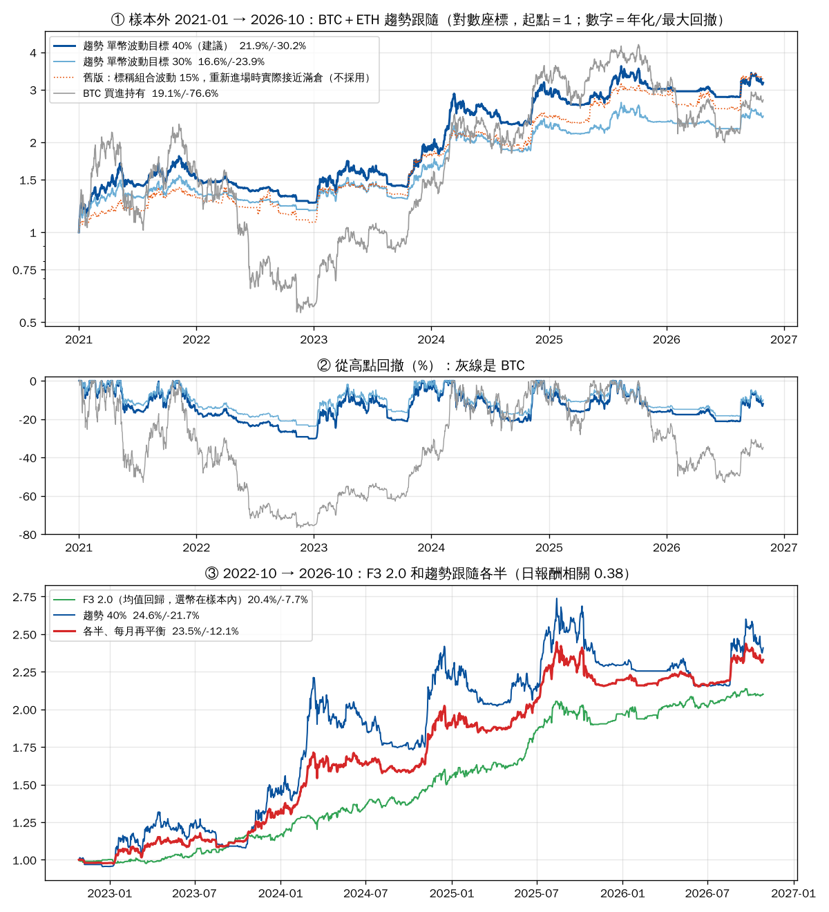

# 加密貨幣趨勢跟隨研究：年化 20% 以上、回撤盡量低（2026-10-28）

> **一句話結論：** 單靠趨勢跟隨，**年化 20% 和回撤 −30% 左右是綁在一起的**，沒有「20% 以上又只回撤 −10%」的設定。
> 最好的做法是 **BTC＋ETH 集成趨勢（單幣波動目標 40%）**：樣本外（2021-01～2026-10）年化 **21.9%**、最大回撤 **−30.2%**；同期 BTC 買進持有 19.1%／−76.6%。
> 想把回撤壓到 −10～−15%，要靠**和 F3 2.0 各半合併**：2022-10～2026-10 回測 **23.5%／−12.1%**。但 F3 2.0 的選幣是在同一段資料裡挑的（規則手冊 §13），這個數字一定偏樂觀，要先在模擬盤驗證。

---

## 1. 規則（建議版）

日線，台北 08:00（UTC 00:00）收盤後計算，隔天執行。只做現貨多單，不加槓桿、不做空。

1. **趨勢分數（0～1）**：每個幣算 7 個訊號，取平均。
   - 收盤價 > 100、150、200 日均線（3 個）
   - 60、90、180 日漲跌 > 0（3 個）
   - 唐奇安通道：突破前 20 日高點設為多、跌破前 10 日低點設為空（1 個）
2. **部位大小** ＝ 50% × 趨勢分數 × min(1, 40% ÷ 該幣 60 日年化波動)。
   - 例：BTC 波動 60%、7 個訊號全多 → 50% × 1 × 0.67 ＝ **33%**；ETH 波動 80%、分數 0.71 → 50% × 0.71 × 0.5 ＝ **18%**。其餘放 USDT。
   - 兩幣加起來最多 100%，不會借錢。
3. **少交易**：任何一個幣的目標部位和現在差超過 5 個百分點才調整，2023 年以後一年約 55～125 次小額調整（BTC＋ETH 兩個幣合計）。
4. **成本**：回測每單位換手扣 0.1%（OKX 現貨吃單費率）。

腳本：`python3 projects/crypto-f3/trend_backtest.py`（`--targets 0.40,0.45,0.50` 一次比較多個波動目標，`--source okx` 改用 OKX 日線，`--chart x.png` 出圖）。2026-10-28 的分數是 BTC 0.86、ETH 0.71，目標部位 BTC 43%、ETH 36%（BTC 近期波動偏低，所以部位比上面的例子大）。

## 2. 回測數字

資料：Yahoo 日線 2014-09～2026-10。**樣本內** 2015-06～2020（規則是在這段看過資料後才定的），**樣本外** 2021 起。

| 設定 | 樣本內 年化／回撤 | **樣本外 2021 起** | 2022 起（避開 2021 大多頭） |
|---|---|---|---|
| BTC 買進持有 | 139%／−83% | 19.1%／−76.6% | 11.7%／−66.9% |
| 趨勢，單幣波動目標 30% | — | 16.6%／−23.9% | 12.8%／−18.5% |
| **趨勢，單幣波動目標 40%（建議）** | 47.0%／−24.2% | **21.9%／−30.2%** | 16.4%／−21.7% |
| 趨勢，單幣波動目標 50% | 56.2%／−31.7% | 24.9%／−36.6% | 17.2%／−27.6% |
| 趨勢，訊號 × 100%（不控波動） | 73.2%／−48.6% | 32.4%／−44.9% | 16.3%／−29.8% |

建議版各年報酬：2021 +52%、2022 **−17%**、2023 +51%、2024 +53%、2025 +4%、2026（到 10 月）+5%。

**穩健性**：波動目標 35～50%、波動估計視窗 30／60／90 天的 12 種組合，樣本外年化都在 19～25%，回撤 −26%～−39%，沒有「只有某個參數特別好」的情況。只用均線、只用動能、改慢速參數，結果也在同一個範圍。

**看清楚的地方：**
- 趨勢跟隨主要是**把 BTC −77% 的大回撤砍到 −30%**，報酬和持有差不多，不是更高。
- **最近兩年很弱**（2025 +4%、2026 +5%）：盤整市會被來回打臉。趨勢策略的報酬集中在少數幾段大行情（2021 上半年、2023-10、2024 年初），中間可以一兩年沒賺。
- 2022 起（不含 2021 大多頭）只剩 16.4%，**低於 20% 目標**。

## 3. 研究過程踩到的坑：「組合波動 15%」的數字不能信

第一版用「組合過去 60 天的**實際**波動」把部位縮放到 15%，回測樣本外 22.6%／−24.0%，看起來剛好達標。檢查單日大漲（例如 2023-10-23 那天 BTC 部位 100%）才發現：

- 空手一段時間後，「過去 60 天的組合波動」接近 0，算出來的放大倍數暴增，**一重新進場就直接滿倉**。
- 也就是說，它實際承擔的風險遠高於標稱的 15%。改成用兩個幣的波動與相關係數**事先**估算組合波動後，同樣 15% 目標的樣本外只剩 **10.6%／−22.3%**。
- 結論：報酬來自「趨勢中放多少部位」，沒有花招可以免費拿到。改成上面「單幣波動目標」這種一看就懂部位大小的版本。

## 4. 為什麼做不到「20% 以上又低回撤」

| 單幣波動目標 | 樣本外（2021 起）年化 | 最大回撤 |
|---|---|---|
| 30% | 16.6% | −23.9% |
| 35% | 19.9% | −26.6% |
| 40% | 21.9% | −30.2% |
| 50% | 24.9% | −36.6% |

試過的降回撤方法：

| 方法 | 樣本外 | 結果 |
|---|---|---|
| 策略自己回撤超過 −10% 就部位減半 | 16.0%／−21.9% | 回撤少一點，報酬少更多 |
| 加做空（訊號弱時用永續空 BTC） | 12.9%／−40.3% | 更差：空頭期常被急反彈打到 |
| 換成 15 個幣，每週挑漲最多的前 3 名 | 2023-26 年化 39%，但**回撤 −66%** | 回撤和持有差不多，失去意義 |
| 15 個幣各自站上 200 日線就持有 | 2023-26 年化 12%／−50% | 山寨幣拖累，不如只做 BTC＋ETH |
| 加入 OKX 的 QQQ、黃金永續（4 個資產各 1/4） | 16.8%／−21.2% | 回撤降，報酬也降差不多比例，到不了 20%；把目標拉高到 60% 換回報酬，回撤也回來（18.9%／−28.8%）。還要付資金費率 |

**真正能降回撤的是加一個「賺錢方式不同」的策略**，也就是 F3 2.0 的均值回歸。

## 5. 和 F3 2.0 合併（2022-10～2026-10）

| 組合（每月再平衡） | 年化 | 最大回撤 | 年化 ÷ 回撤 |
|---|---|---|---|
| 只有 F3 2.0 | 20.4% | −7.7% | 2.6 |
| 只有趨勢（40%） | 24.6% | −21.7% | 1.1 |
| F3 70%＋趨勢 30% | 22.5% | −10.1% | 2.2 |
| **F3 50%＋趨勢 50%** | **23.5%** | **−12.1%** | 1.9 |
| F3 30%＋趨勢 70% | 24.2% | −15.9% | 1.5 |

兩者日報酬相關係數 0.38：一個在跌深時買、一個在趨勢中抱，虧錢的時間不太重疊。

**為什麼不能直接相信 23.5%／−12%：**
1. F3 2.0 的三個幣和參數是用 2022-10～2026-10 這段資料挑出來的（規則手冊 §13：同樣的挑選方法在滾動樣本外沒有證明有效）。它的 20.4%／−7.7% 是樣本內數字，實盤大概會更差。
2. 這段期間只有 4 年，只包含一次熊市尾巴（2022 年底）。
3. 比較合理的預期：合併後年化 **15～20%**、回撤 **−15～−20%**。要知道是不是真的達到 20%，只能靠模擬盤累積紀錄。

## 6. 波動目標 40%／45%／50% 比較（2026-10-28 v1.1）

回測改成「持倉隨價格漂移、差超過 5 個百分點才調回目標」，和紙上交易機器人用同一段程式（`trend_backtest.step()`），數字和 §2 差不到 0.5 個百分點。Yahoo 日線：

| | 40% | 45% | 50% |
|---|---|---|---|
| 樣本外 2021 起 年化／最大回撤 | 22.2%／−29.9% | 23.5%／−34.6% | 25.4%／−37.0% |
| 年化 ÷ 回撤 | 0.74 | 0.68 | 0.69 |
| 2022 起 年化／最大回撤 | 16.8%／−22.3% | 17.2%／−24.9% | 17.6%／−26.5% |
| 樣本內 2015-06～2020 | 51.6%／−26.6% | 56.3%／−27.9% | 59.1%／−32.2% |
| 最差單月 | −10.9% | −12.3% | −14.1% |
| 最長未創新高 | 753 天 | 756 天 | 756 天 |
| 平均部位（2021 起） | 38% | 41% | 44% |
| 一年調整次數 | 53 | 62 | 71 |
| 和 F3 2.0 各半（2022-10 起） | 23.7%／−12.7% | 24.8%／−13.0% | 25.3%／−13.9% |
| 各年 2021／22／23／24／25／26 | +52／−17／+50／+54／+6／+4 | +59／−20／+53／+59／+6／+5 | +71／−21／+55／+62／+5／+5 |

- 多出來的報酬幾乎都來自 2021 這種大多頭（波動高、趨勢強）；2022 年以後三者年化只差 0.8 個百分點，回撤卻差 4 個百分點。
- 三個版本只在「某個幣的 60 日波動高於 40%」時才不一樣。2026-10-28 BTC 34%、ETH 40%，三個版本持倉完全相同。
- 用 OKX 1Dutc 日線（2018-09 起）重跑，方向一樣：40%／45%／50% 樣本外 22.8%／−29.9%、24.5%／−34.2%、25.5%／−37.5%。

## 7. 紙上交易（2026-10-28 起）

- `projects/crypto-f3/trend_paper.py`，掛在 F3 機器人的每小時循環裡（`f3_cycle.sh`），三個版本各用 83,000 USDT 紙上資金，不下單。
- 每天 UTC 00:00 日線收盤後第一輪調整，用當下 OKX 現貨價成交，記下和收盤價的差距；每小時記一次淨值。
- 狀態和明細在 `f3-bot-state` 分支的 `trend-paper/`；監控台「趨勢跟隨」一節每天同步，和 F3 2.0 並排。
- 有調整時 Telegram 推「【趨勢紙上】」。
- 驗證：用 OKX 歷史收盤價從 2025-06-01 重播，三個版本的淨值和回測到小數點後 6 位相同。

**選目標的判斷方式（建議跑 3 個月以上，或等到出現一次波動 > 40% 的行情）：**
1. 三個版本有沒有分開：如果期間波動一直低於 40%，紙上交易分不出高下，就照回測選 40%（年化 ÷ 回撤最好）。
2. 分開之後，看高目標多賺的是否抵得過多出來的回撤。
3. 實際成交價和收盤價的差距平均 < 0.2%。

## 8. 放真錢前

- 兩個策略都至少跑完 6 個月模擬（趨勢是紙上），其中要包含一段明顯的下跌或盤整。
- 合併組合的最大回撤沒有超過 −20%；F3 2.0 沒有觸發 §15.1 的停用條件。

## 更新紀錄
- 2026-10-28 v1.0：初版。
- 2026-10-28 v1.1：§6 波動目標 40／45／50% 比較（回測改成持倉漂移、與紙上交易同一段程式）；§7 紙上交易上線；§8 放真錢前條件。
